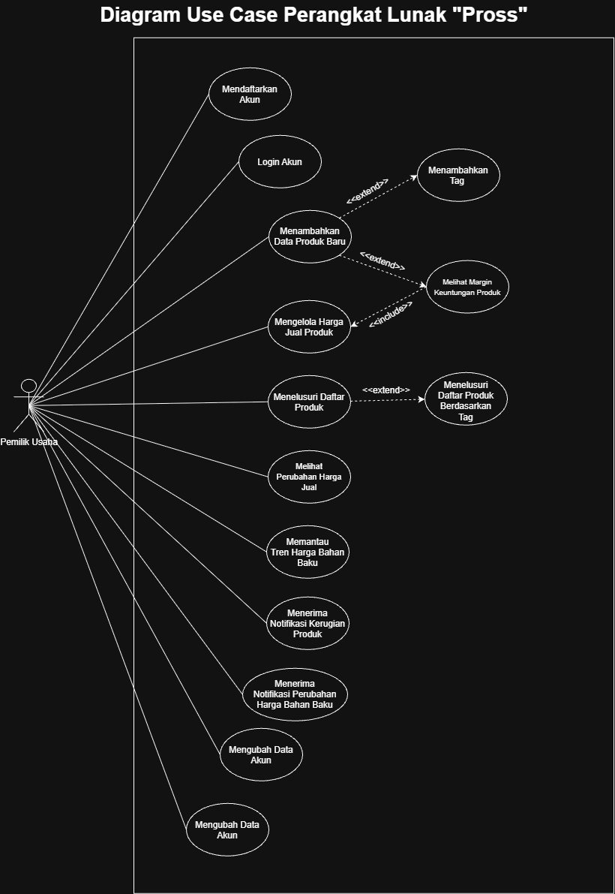

<h1>
IF2150 REKAYASA PERANGKAT LUNAK
 
TUGAS 10
 
HASIL IMPLEMENTASI DAN UJI PERANGKAT LUNAK (HIUPL)
</h1>
 

## *Pross*

### Untuk: *Stefani Angeline Oroh*

Dipersiapkan oleh:
| Informasi | Keterangan |
| --- | --- |
| Kelas | *K02* |
| Kelompok | *G07* |

| NIM | Nama |
| --- | --- |
| *13525002* | *Ahmad Boutros Fathir* |
| *13525020* | *Klio Lysander* |
| *13525047* | *Muhammad Fakhriyan Rizki M.* |
| *13525053* | *Kevin Sie* |
| *13525056* | *Mochammad Nuha Al Ghifari* |
| *13525062* | *Rafel Dzinun Muhammad* |

---

## Daftar Isi

- [BAB 1: Pendahuluan](#bab-1-pendahuluan)
  - [1.1 Tujuan Penulisan Dokumen](#11-tujuan-penulisan-dokumen)
  - [1.2 Lingkup Masalah](#12-lingkup-masalah)
  - [1.3 Definisi, Istilah, dan Singkatan](#13-definisi-istilah-dan-singkatan)
  - [1.4 Aturan Penomoran](#14-aturan-penomoran)
  - [1.5 Referensi](#15-referensi)
  - [1.6 Deskripsi Umum Dokumen (Ikhtisar)](#16-deskripsi-umum-dokumen-ikhtisar)
- [BAB 2: Deskripsi Umum Perangkat Lunak](#bab-2-deskripsi-umum-perangkat-lunak)
- [BAB 3: Implementasi](#bab-3-implementasi)
  - [3.1 Lingkungan Implementasi](#31-lingkungan-implementasi)
  - [3.2 Implementasi Modul](#32-implementasi-modul)
  - [3.3 Implementasi Antarmuka](#33-implementasi-antarmuka)
  - [3.4 File Lain](#34-file-lain)
- [BAB 4: Hasil Pengujian](#bab-4-hasil-pengujian)
  - [4.1 Strategi dan Kedalaman Pengujian Kelas](#41-strategi-dan-kedalaman-pengujian-kelas)
  - [4.2 Pengujian Unit Kelas](#42-pengujian-unit-kelas)
  - [4.3 Pengujian Integrasi](#43-pengujian-integrasi)
  - [4.4 Pengujian Use Case](#44-pengujian-use-case)
  - [4.5 Pengujian Kebutuhan Non-Fungsional (KNF)](#45-pengujian-kebutuhan-non-fungsional-knf)
  - [4.6 Tangkapan Layar dan Bukti Hasil Pengujian](#46-tangkapan-layar-dan-bukti-hasil-pengujian)
- [BAB 5: Traceability](#bab-5-traceability)

---

## Daftar Perubahan

| Revisi | Deskripsi |
| :--- | :--- |
| *A* | *Deskripsikan perubahan yang dilakukan dari dokumen sebelumnya pada dokumen ini. Jika tidak terdapat perubahan, harap kosongkan tabel.* |
| *B* |  |
| *C* |  |
| ... |  |

---

# BAB 1: Pendahuluan

## 1.1 Tujuan Penulisan Dokumen
Dokumen Hasil Implementasi dan Uji Perangkat Lunak (HIUPL) ini disusun untuk melaporkan hasil implementasi dan pengujian perangkat lunak *Pross*. Dokumen memuat lingkungan implementasi, daftar modul dan antarmuka yang telah diimplementasikan, hasil pengujian unit, integrasi, use case, dan kebutuhan non-fungsional, serta matriks yang menghubungkan kebutuhan fungsional dengan implementasi dan pengujiannya. Dokumen ini ditujukan kepada asisten dan dosen sebagai verifikasi kesesuaian perangkat lunak terhadap SKPL dan DPPL yang telah dibuat.

## 1.2 Lingkup Masalah
Lingkup masalah dalam dokumen ini adalah membangun perangkat lunak *Pross*, yaitu aplikasi mobile berbasis Android untuk manajemen Harga Pokok Penjualan (HPP) yang ditujukan bagi pedagang kuliner UMKM. Aplikasi ini membantu Pemilik Usaha memantau keuntungan atau kerugian setiap produk secara otomatis berdasarkan perubahan harga bahan baku tanpa pencatatan manual. Aplikasi dibangun menggunakan Expo (React Native) dan TypeScript, serta memanfaatkan Supabase sebagai layanan autentikasi dan basis data.

## 1.3 Definisi, Istilah, dan Singkatan
Semua definisi dan singkatan yang digunakan dalam dokumen ini beserta penjelasannya.

Tabel 1.3. Definisi Istilah dan Singkatan

| Singkatan, Akronim, atau Istilah | Penjelasan |
| :--- | :--- |
| *P/L* | *Singkatan dari Perangkat Lunak, yaitu aplikasi yang memberikan perintah kepada komputer untuk menjalankan tugas tertentu.* |
| *SKPL* | *Singkatan dari Spesifikasi Kebutuhan Perangkat Lunak, yaitu dokumen yang merangkum kriteria-kriteria yang diperlukan untuk membangun aplikasi menjalankan tugasnya.* |
| *DPPL* | *Singkatan dari Deskripsi Perancangan Perangkat Lunak, yaitu dokumen yang menjelaskan rancangan arsitektur, kelas, dan antarmuka P/L.* |
| *HIUPL* | *Singkatan dari Hasil Implementasi dan Uji Perangkat Lunak, yaitu dokumen yang melaporkan hasil implementasi dan pengujian P/L.* |
| *KF* | *Singkatan dari Kebutuhan Fungsional.* |
| *KNF* | *Singkatan dari Kebutuhan Non-Fungsional.* |
| *UC* | *Singkatan dari Use Case.* |
| *TC* | *Singkatan dari Test Case, yaitu satu kasus uji untuk skenario tertentu.* |
| *UT* | *Singkatan dari Unit Test, yaitu test case tingkat kelas/operasi.* |
| *INT* | *Singkatan dari Integration Test, yaitu test case yang menguji interaksi antarkomponen.* |
| *Boundary* | *Kasus uji pada nilai batas masukan, misalnya nilai minimum, maksimum, atau tepat di ambang aturan.* |
| *Coverage* | *Persentase baris/cabang kode yang dieksekusi oleh pengujian.* |
| *...* | *...* |

## 1.4 Aturan Penomoran
Tuliskan aturan penomoran (ID) yang digunakan dalam dokumen ini. Gunakan pola ID yang **sama** dengan yang sudah dipakai pada dokumen-dokumen sebelumnya (SKPL, APL, DPPL), kecuali untuk ID pengujian yang baru diperkenalkan pada dokumen ini.

Tabel 1.4. Aturan Penomoran

| Hal/Bagian | Penomoran | Keterangan |
| :--- | :--- | :--- |
| *Kebutuhan Fungsional* | *KFXX* | *Sesuai SKPL* |
| *Kebutuhan Non-Fungsional* | *KNFXX* | *Sesuai SKPL* |
| *Use Case* | *UCXX* | *Sesuai SKPL* |
| *Kelas* | *CXX* | *Sesuai DPPL* |
| *Antarmuka* | *I-XX* | *Sesuai DPPL* |
| *Test Case Unit* | *CXX-UTYY* | *XX adalah nomor kelas, YY adalah nomor urut test case unit pada kelas tersebut* |
| *Test Case Integrasi* | *INT-TCYY* | *YY adalah nomor urut test case integrasi* |
| *Test Case Use Case* | *UCXX-TCYY* | *XX adalah nomor use case, YY adalah nomor urut test case pada use case tersebut* |
| *Test Case KNF* | *KNFXX-TCYY* | *XX adalah nomor KNF, YY adalah nomor urut test case pada KNF tersebut* |
| *...* | *...* | *...* |

## 1.5 Referensi
1. [Spesifikasi Kebutuhan Perangkat Lunak (SKPL) *Pross*](../M5/K02_G07_SKPL.md)
2. [Arsitektur Perangkat Lunak (APL) *Pross*](../M6/K02_G07_APL.md)
3. [Deskripsi Perancangan Perangkat Lunak (DPPL) *Pross*](../M8/K02_G07_DPPL2.md)
4. [Implementasi (Tugas 9) *Pross*](../M9/K02_G07_Implementasi.md)
5. Dokumentasi Expo: [https://docs.expo.dev/](https://docs.expo.dev/)
6. Dokumentasi React Native: [https://reactnative.dev/docs/getting-started](https://reactnative.dev/docs/getting-started)
7. Dokumentasi Supabase: [https://supabase.com/docs](https://supabase.com/docs)

## 1.6 Deskripsi Umum Dokumen (Ikhtisar)
Dokumen ini terdiri dari lima bab. Bab 1 membahas pendahuluan yang meliputi tujuan penulisan, lingkup masalah, definisi istilah, aturan penomoran, referensi, dan ikhtisar dokumen. Bab 2 membahas deskripsi umum perangkat lunak *Pross* beserta use case diagram. Bab 3 membahas implementasi yang meliputi lingkungan implementasi, modul, antarmuka, dan file lain yang dihasilkan. Bab 4 membahas hasil pengujian, yaitu strategi pengujian kelas, pengujian unit, integrasi, use case, kebutuhan non-fungsional, beserta bukti pengujian. Bab 5 membahas traceability yang memetakan setiap kebutuhan fungsional ke kebutuhan non-fungsional, use case, kelas, file implementasi, dan test case.

 

---

# BAB 2: Deskripsi Umum Perangkat Lunak

*Pross* adalah aplikasi mobile Android yang membantu Pemilik Usaha kuliner UMKM mengetahui keuntungan atau kerugian setiap produk berdasarkan harga bahan baku. Pengguna memasukkan resep bahan baku beserta takarannya dan harga jual, kemudian aplikasi menghitung HPP per porsi dan margin secara otomatis. Ketika harga bahan baku berubah, aplikasi menghitung ulang margin dan memberi notifikasi apabila suatu produk mengalami kerugian.

<i>Gambar 2.1. Use Case Diagram Pross</i>

 

---

# BAB 3: Implementasi

Bagian ini diisi dengan informasi tentang elemen P/L yang dikembangkan (*executable files*, *configuration files*, *data files*, dan sebagainya) serta perubahannya terhadap rancangan pada DPPL (jika ada).

## 3.1 Lingkungan Implementasi

Tuliskan *hardware* dan *software* yang digunakan untuk implementasi, mencakup *operating system*, bahasa pemrograman beserta versinya, *framework*/*library*, DBMS, *development tools*, dan *version control*. Lingkungan ini harus konsisten dengan **Subbab 2.1 DPPL**; jelaskan jika ada perubahan. Cantumkan juga *framework* dan alat pengujian yang dipakai.

Tabel 3.1. Lingkungan Implementasi

| Aspek | Keterangan |
| :--- | :--- |
| *Hardware* | *[Spesifikasi perangkat keras]* |
| *Operating System* | *Android 16 melalui Expo Go* |
| *Bahasa Pemrograman* | *TypeScript ~6.0.3** |
| *Framework/Library* | *Expo ~58.0.23, React Native 0.88.1, React 19.3.0, React Navigation ^7, @supabase/supabase-js ^2.118.0, expo-notifications ~58.1.8, expo-linking ~58.0.16, @expo/vector-icons ^15.0.2, react-native-chart-kit ^7.0.4, react-native-svg 15.16.0, AsyncStorage 2.2.0* |
| *DBMS* | *[Nama dan versi DBMS]* |
| *Development Tools* | *Visual Studio Code, Git, GitHub, Supabase Dashboard, Expo Go* |
| *Testing Tools* | *[Framework unit test, alat ukur performa, alat coverage]* |

## 3.2 Implementasi Modul

Daftar modul/kelas yang **TELAH** diimplementasikan. Gunakan nama dan ID kelas yang sama dengan DPPL, dan konsisten dengan Tabel B.5 pada dokumen Implementasi (Tugas 9).

Tabel 3.2. Implementasi Modul

| No | ID Kelas | Nama Modul/Kelas | Nama File Fisik | Nama File Executable |
| :--- | :--- | :--- | :--- | :--- |
| 1 | *C01* | *PemilikUsaha* | *`src/models/PemilikUsaha.ts`* | *-* |
| 2 | *C02* | *Produk* | *`src/models/Produk.ts`* | *-* |
| 3 | *C03* | *BahanBaku* | *`src/models/BahanBaku.ts`* | *-* |
| 4 | *C04* | *ResepBahan* | *`src/models/ResepBahan.ts`* | *-* |
| 5 | *C05* | *RegistrationPage* | *`src/views/RegistrationPage.tsx`* | *-* |
| 6 | *C06* | *AuthController* | *`src/controllers/AuthController.ts`, `src/controllers/validators.ts`, `src/supabase/functions/login-with-username/index.ts`* | *-* |
| 7 | *C07* | *LoginPage* | *`src/views/LoginPage.tsx`* | *-* |
| 8 | *C08* | *ResetPasswordPage* | *`src/views/ResetPasswordPage.tsx`* | *-* |
| 9 | *C09* | *ResetPasswordController* | *`src/controllers/ResetPasswordController.ts`* | *-* |
| 10 | *C10* | *AddProductPage* | *`src/views/AddProductPage.tsx`, `src/views/PilihanModal.tsx`* | *-* |
| 11 | *C11* | *MarginController* | *`src/controllers/MarginController.ts`, `src/controllers/margin.ts`* | *-* |
| 12 | *C12* | *EditProductPage* | *`src/views/EditProductPage.tsx`* | *-* |
| 13 | *C13* | *PriceController* | *`src/controllers/PriceController.ts`* | *-* |
| 14 | *C14* | *RiwayatHargaBahanBaku* | *Tabel `tbl_riwayat_harga_bahan` pada `src/supabase/migrations/20261105000000_notifikasi_riwayat_harga.sql`* | *-* |
| 15 | *C15* | *TrenBahanBakuPage* | *`src/views/TrenBahanBakuPage.tsx`* | *-* |
| 16 | *C16* | *TrenBahanBakuController* | *`src/controllers/TrenBahanBakuController.ts`* | *-* |
| 17 | *C17* | *Notifikasi* | *`src/models/Notifikasi.ts`* | *-* |
| 18 | *C18* | *PushNotificationUI* | *`src/services/PushNotificationUI.ts`* | *-* |
| 19 | *C19* | *NotificationController* | *`src/controllers/NotificationController.ts`, `src/controllers/notification.ts`* | *-* |
| 20 | *C20* | *RiwayatHargaJual* | *`src/models/RiwayatHargaJual.ts`* | *-* |
| 21 | *C21* | *SearchProductPage* | *`src/views/SearchProductPage.tsx`* | *-* |
| 22 | *C22* | *ProductSearchController* | *`src/controllers/ProductSearchController.ts`* | *-* |
| 23 | *C23* | *PriceHistoryPage* | *`src/views/PriceHistoryPage.tsx`* | *-* |
| 24 | *C25* | *ProfilePage* | *`src/views/ProfilePage.tsx`* | *-* |
| 25 | *C26* | *ProfileController* | *`src/controllers/ProfileController.ts`* | *-* |

#C24 belum ada

## 3.3 Implementasi Antarmuka

Daftar antarmuka yang telah diimplementasikan. Gunakan ID dan nama layar yang sama dengan ID dan nama layar pada tugas DPPL.

Tabel 3.3. Implementasi Antarmuka

| No | ID Antarmuka | Nama Antarmuka | Nama File Fisik | Nama File Executable |
| :--- | :--- | :--- | :--- | :--- |
| 1 | *I-01* | *Login* | *`src/views/LoginPage.tsx`* | *-* |
| 2 | *I-02* | *Registrasi* | *`src/views/RegistrationPage.tsx`* | *-* |
| 3 | *I-03* | *Reset Password* | *`src/views/ResetPasswordPage.tsx`* | *-* |
| 4 | *I-04* | *Beranda* | *`src/views/HomePage.tsx`* | *-* |
| 5 | *I-05* | *Pencarian Produk* | *`src/views/SearchProductPage.tsx`* | *-* |
| 6 | *I-06* | *Tambah Produk* | *`src/views/AddProductPage.tsx`, `src/views/PilihanModal.tsx`* | *-* |
| 7 | *I-09* | *Daftar Bahan Baku dan Detail Tren Bahan Baku* | *`src/views/TrenBahanBakuPage.tsx`* | *-* |
| 8 | *I-10* | *Profil Pengguna* | *`src/views/ProfilePage.tsx`* | *-* |
| 9 | *I-11* | *Push Notification* | *`src/services/PushNotificationUI.ts`* | *-* |
| 10 | *I-12* | *Pusat Notifikasi* | *`src/views/NotificationPage.tsx`* | *-* |
| 11 | *-* | *Izin Notifikasi (tambahan, tidak ada pada DPPL)* | *`src/views/IzinNotifikasiPage.tsx`* | *-* |
| 12 | *-* | *Detail Produk (tambahan, tidak ada pada DPPL)* | *`src/views/ProductDetailPage.tsx`* | *-* |

## 3.4 File Lain

Daftar file lain yang dibuat selain file kelas dan antarmuka, misalnya file *utility*, *configuration*, *database schema/seed*, *file test*, atau *data*.

Tabel 3.4. File Lain

| No | Nama File | Keterangan |
| :--- | :--- | :--- |
| 1 | *`src/supabase/schema.sql`* | *Skema `tbl_pemilik_usaha`, trigger `on_auth_user_created`, fungsi `handle_new_user()` dan `account_exists()`.* |
| 2 | *`src/supabase/migrations/20261103000000_produk_bahan_resep.sql`* | *Migrasi tabel produk, bahan baku, dan resep beserta kebijakan RLS.* |
| 3 | *`src/supabase/migrations/20261105000000_notifikasi_riwayat_harga.sql`* | *Migrasi `tbl_notifikasi`, `tbl_riwayat_harga_bahan`, dan kolom `status_peringatan`.* |
| 4 | *`src/supabase/migrations/20261105000000_porsi_satuan.sql`* | *Migrasi kolom `hasil_resep` pada produk dan `satuan` pada bahan baku.* |
| 5 | *`src/supabase/migrations/20261109000000_sync_email_pemilik.sql`* | *Migrasi sinkronisasi email pemilik usaha.* |
| 6 | *`src/supabase/seed.sql`* | *Data contoh produk, bahan baku, dan resep, hanya berjalan bila akun `demo@pross.test` tersedia.* |
| 7 | *`src/supabase/config.toml`* | *Konfigurasi proyek Supabase.* |
| 8 | *`src/supabase/functions/login-with-username/index.ts`* | *Edge Function untuk login menggunakan username.* |
| 9 | *`src/services/supabase.ts`* | *Inisialisasi klien Supabase.* |
| 10 | *`src/controllers/margin.ts`* | *Fungsi murni perhitungan total biaya, HPP, margin, persentase margin, serta format angka.* |
| 11 | *`src/controllers/notification.ts`* | *Fungsi perhitungan ulang margin dan pembentukan pesan notifikasi.* |
| 12 | *`src/controllers/validators.ts`* | *Fungsi validasi input autentikasi.* |
| 13 | *`src/models/pesan.ts`* | *Konstanta pesan kesalahan dan fungsi pemeriksaan angka.* |
| 14 | *`src/utils/format.ts`, `src/constants/theme.ts`* | *Fungsi format dan konstanta tema tampilan.* |
| 15 | *`src/navigation/types.ts`, `src/App.tsx`* | *Definisi rute serta pengelolaan sesi dan navigasi.* |
| 16 | *`src/tests/*.test.ts`* | *Tujuh berkas pengujian otomatis Vitest (100 test).* |
| 17 | *`src/package.json`, `src/.env.example`, `src/README.md`* | *Dependensi, contoh konfigurasi environment, dan panduan menjalankan aplikasi.* |

 

---

# BAB 4: Hasil Pengujian

Bab ini melaporkan hasil pengujian P/L pada level unit, integrasi, dan sistem. Pengujian dilakukan pada tag release terakhir Tugas 9. Hasil aktual diisi berdasarkan pengamatan saat pengujian. Kesimpulan diisi `Pass` atau `Fail`, dan untuk `Fail` dilengkapi penyebab serta usulan perbaikan.

## 4.1 Strategi dan Kedalaman Pengujian Kelas

Setiap kelas perancangan pada Tabel 4.1 DPPL diklasifikasikan ke dalam tiga tingkat kedalaman pengujian. Tingkat **Mendalam** diberikan pada kelas yang memuat logika bisnis, perhitungan, validasi, aturan status, algoritma, integrasi eksternal, atau keamanan. Tingkat **Sedang** diberikan pada kelas yang hanya mengoordinasikan atau mendelegasikan proses. Tingkat **Tidak perlu** diberikan pada kelas tanpa logika, seperti *entity/DTO* dan kelas konfigurasi, yang teruji secara tidak langsung melalui test case use case. Seluruh kelas wajib dicantumkan beserta alasan penentuan tingkatnya.

Tabel 4.1.1. Identifikasi Tingkat Pengujian Kelas

| ID Kelas | Nama Kelas | Tingkat | Alasan | Test Case Terkait |
| :--- | :--- | :--- | :--- | :--- |
| *C01* | *PemilikUsaha* | *Sedang* | *Mendelegasikan pembuatan akun dan pembaruan profil ke Supabase Auth dan basis data.* | *[isi]* |
| *C02* | *Produk* | *Mendalam* | *Setter memuat validasi dan normalisasi (tag, harga jual, hasil resep, margin).* | *[isi]* |
| *C03* | *BahanBaku* | *Mendalam* | *Memuat validasi harga beli dan satuan.* | *[isi]* |
| *C04* | *ResepBahan* | *Mendalam* | *Memuat validasi takaran.* | *[isi]* |
| *C05* | *RegistrationPage* | *Tidak perlu* | *Kelas antarmuka tanpa logika bisnis. Validasi dan registrasi didelegasikan ke C06 dan teruji lewat test case use case.* | *-* |
| *C06* | *AuthController* | *Mendalam* | *Memuat validasi registrasi dan login serta keamanan autentikasi.* | *[isi]* |
| *C07* | *LoginPage* | *Tidak perlu* | *Kelas antarmuka tanpa logika bisnis, teruji lewat test case use case.* | *-* |
| *C08* | *ResetPasswordPage* | *Tidak perlu* | *Kelas antarmuka tanpa logika bisnis, teruji lewat test case use case.* | *-* |
| *C09* | *ResetPasswordController* | *Mendalam* | *Memuat validasi dan proses pengaturan ulang password.* | *[isi]* |
| *C10* | *AddProductPage* | *Tidak perlu* | *Kelas antarmuka tanpa logika bisnis. Perhitungan dan penyimpanan didelegasikan ke C11.* | *-* |
| *C11* | *MarginController* | *Mendalam* | *Memuat validasi input, perhitungan HPP dan margin, serta penyimpanan produk dan resep.* | *[isi]* |
| *C12* | *EditProductPage* | *Tidak perlu* | *Kelas antarmuka tanpa logika bisnis, teruji lewat test case use case.* | *-* |
| *C13* | *PriceController* | *Mendalam* | *Memuat validasi harga dan pencatatan riwayat harga jual.* | *[isi]* |
| *C14* | *RiwayatHargaBahanBaku* | *Tidak perlu* | *Diwujudkan sebagai tabel `tbl_riwayat_harga_bahan` dan tipe data `RiwayatHarga`, tanpa logika.* | *-* |
| *C15* | *TrenBahanBakuPage* | *Tidak perlu* | *Kelas antarmuka tanpa logika bisnis, teruji lewat test case use case.* | *-* |
| *C16* | *TrenBahanBakuController* | *Mendalam* | *Memuat penyaringan berdasarkan rentang waktu (`filterByRentang`) dan pembentukan data grafik (`formatUntukChart`).* | *[isi]* |
| *C17* | *Notifikasi* | *Sedang* | *Entitas dengan perubahan status baca (`markAsRead()`).* | *[isi]* |
| *C18* | *PushNotificationUI* | *Sedang* | *Mendelegasikan penampilan notifikasi ke pustaka notifikasi perangkat.* | *[isi]* |
| *C19* | *NotificationController* | *Mendalam* | *Memuat aturan penentuan margin negatif, pembuatan, dan pengiriman notifikasi.* | *[isi]* |
| *C20* | *RiwayatHargaJual* | *Mendalam* | *Setter memuat validasi harga dan waktu perubahan.* | *[isi]* |
| *C21* | *SearchProductPage* | *Tidak perlu* | *Kelas antarmuka tanpa logika bisnis, teruji lewat test case use case.* | *-* |
| *C22* | *ProductSearchController* | *Mendalam* | *Memuat algoritma pencarian dan penyaringan produk melalui `search()`.* | *[isi]* |
| *C23* | *PriceHistoryPage* | *Tidak perlu* | *Kelas antarmuka tanpa logika bisnis, teruji lewat test case use case.* | *-* |
| *C24* | *PriceHistoryController* | *Mendalam* | *Belum diimplementasikan pada tag v9.0 (berkas kosong), sehingga tidak dapat diuji.* | *-* |
| *C25* | *ProfilePage* | *Tidak perlu* | *Kelas antarmuka tanpa logika bisnis, teruji lewat test case use case.* | *-* |
| *C26* | *ProfileController* | *Mendalam* | *Memuat validasi data profil serta proses pembaruan dan pengakhiran sesi.* | *[isi]* |
| *...* | *...* | *...* | *...* | *...* |

## 4.2 Pengujian Unit Kelas

Pengujian unit dilakukan pada kelas bertingkat Mendalam dan Sedang. Kelas Mendalam diuji pada seluruh operasi public dengan kasus normal, batas, dan negatif, serta mencapai *coverage* minimal 70%. Kelas Sedang diuji minimal dengan satu kasus normal dan satu kasus gagal pada operasi public utama.

Cara menjalankan unit test: `npm test` pada direktori `src/`.

Lokasi file test: `src/tests/`.

### 4.2.1 Kelas [Nama Kelas 1]

**ID Kelas:** *[C02]*  
**Nama Kelas:** *[Pesanan]*  
**Tingkat:** *[Mendalam]*

Tabel 4.2.1. Hasil Pengujian Unit Kelas [C02]

| ID Pengujian | Operasi yang Diuji | Jenis Kasus | Prosedur/Masukan | Hasil yang Diharapkan | Hasil Pengujian | Kesimpulan |
| :--- | :--- | :--- | :--- | :--- | :--- | :--- |
| *C02-UT01* | *`hitungTotal(): Decimal`* | *Normal* | *Pesanan berisi 2 item: 10.000 x 2 dan 5.000 x 1* | *Total = 25.000* | *[Hasil aktual]* | *Pass/Fail* |
| *C02-UT02* | *`hitungTotal(): Decimal`* | *Batas* | *Pesanan berisi tepat 1 item dengan jumlah 1* | *Total = harga item tersebut* | *[...]* | *Pass/Fail* |
| *C02-UT03* | *`hitungTotal(): Decimal`* | *Negatif* | *Pesanan tanpa item* | *Total = 0 atau melempar kesalahan sesuai rancangan* | *[...]* | *Pass/Fail* |
| *...* | *...* | *...* | *...* | *...* | *...* | *...* |

Khusus kelas **Mendalam**:

Tabel 4.2.1b. Ringkasan Cakupan Kelas [C02]

| Informasi | Keterangan |
| :--- | :--- |
| Daftar operasi public pada DPPL | *[op1(), op2(), ...]* |
| Operasi yang diuji | *[op1(), op2(), ...]* |
| ID Algoritma yang tercakup | *[Algo-001, ...]* |
| Coverage (wajib ≥ 70%) | *[% baris / % cabang, alat dan bukti pada 4.6]* |

### 4.2.2 Kelas [Nama Kelas 2]

*[Ulangi pola 4.2.1 untuk setiap kelas bertingkat Mendalam atau Sedang.]*

 

## 4.3 Pengujian Integrasi

Pengujian integrasi memeriksa interaksi antarkomponen yang melewati batas, yaitu *Controller* ke *Model*, aplikasi ke basis data, dan aplikasi ke sistem eksternal. Daftar antarmuka mengacu pada dokumen DPPL, dengan minimal satu test case untuk setiap antarmuka. Pengujian memakai komponen nyata, bukan *mock*. Apabila ada antarmuka tambahan yang belum didaftarkan pada dokumen DPPL, cantumkan juga.

Tabel 4.3.1. Daftar Antarmuka Antarkomponen

| ID Antarmuka | Komponen Asal | Komponen Tujuan | Jenis Batas | Test Case |
| :--- | :--- | :--- | :--- | :--- |
| *I-01* | *KeranjangController* | *Keranjang (Model)* | *Controller - Model* | *INT-TC01, INT-TC02* |
| *I-02* | *Pesanan (Model)* | *Database* | *Aplikasi - Basis data* | *INT-TC03* |
| *I-03* | *PaymentGatewayAdapter* | *Payment Gateway (dummy)* | *Aplikasi - Sistem eksternal* | *INT-TC04, INT-TC05* |
| *[I-XX]* | *[Komponen asal]* | *[Komponen tujuan]* | *[Jenis batas]* | *[ID test case]* |
| *...* | *...* | *...* | *...* | *...* |

Tabel 4.3.2. Hasil Pengujian Integrasi

| ID Pengujian | ID Antarmuka | Skenario | Prosedur/Masukan | Hasil yang Diharapkan | Hasil Pengujian | Kesimpulan |
| :--- | :--- | :--- | :--- | :--- | :--- | :--- |
| *INT-TC01* | *I-01* | *Normal: tambah item ke keranjang* | *Panggil `tambahItem()` melalui KeranjangController dengan produk valid* | *Item tersimpan pada Keranjang dan tampil pada daftar item* | *[Hasil aktual]* | *Pass/Fail* |
| *INT-TC03* | *I-02* | *Normal: simpan pesanan* | *Buat pesanan, lalu baca ulang langsung dari basis data* | *Baris pesanan ada dengan nilai total dan status yang sama* | *[...]* | *Pass/Fail* |
| *INT-TC05* | *I-03* | *Gagal: gateway mengembalikan status gagal* | *Kirim otorisasi dengan saldo dummy tidak cukup* | *Status pesanan tidak berubah menjadi "Lunas", pesan gagal diteruskan ke pengguna* | *[...]* | *Pass/Fail* |
| *...* | *...* | *...* | *...* | *...* | *...* | *...* |

 

## 4.4 Pengujian Use Case

Pengujian use case dilakukan pada seluruh skenario normal dan alternatif sesuai Subbab 4.4 SKPL, dengan minimal satu test case untuk setiap skenario. Kolom ID KF menunjukkan KF yang diverifikasi oleh test case tersebut.

### 4.4.1 Use Case [Nama Use Case 1]

**ID Use Case:** *[UC01 sesuai SKPL]*  
**Nama Use Case:** *[Nama use case sesuai SKPL]*

Tabel 4.4.1. Hasil Pengujian Use Case [UC01]

| ID Pengujian | ID KF | Skenario | Prosedur Pengujian | Masukan | Hasil yang Diharapkan | Hasil Pengujian | Kesimpulan |
| :--- | :--- | :--- | :--- | :--- | :--- | :--- | :--- |
| *UC01-TC01* | *KF01* | *Normal* | *1. Buka halaman login. 2. Masukkan kredensial. 3. Klik tombol "Login".* | *User: rpl@gmail.com Pass: 123456* | *Pengguna diarahkan ke Halaman Dashboard.* | *Pengguna diarahkan ke Halaman Dashboard sesuai hasil yang diharapkan.* | *Pass* |
| *UC01-TC02* | *KF01* | *Alternatif 1: [Nama skenario]* | *[Langkah-langkah pengujian]* | *[Data masukan]* | *[Hasil yang diharapkan]* | *[Hasil aktual]* | *[Pass/Fail. Jika Fail: penjelasan dan solusi]* |
| *...* | *...* | *...* | *...* | *...* | *...* | *...* | *...* |

### 4.4.2 Use Case [Nama Use Case 2]

*[Lanjutkan untuk seluruh use case dengan pola yang sama, hingga 4.4.N.]*

 

## 4.5 Pengujian Kebutuhan Non-Fungsional (KNF)

Setiap KNF pada Tabel 3.2 SKPL diuji secara terukur berdasarkan parameter yang telah didefinisikan. Setiap pengujian memuat target terukur, metode dan alat yang sesuai dengan parameter (misalnya Chrome DevTools untuk *response time* dan inspeksi basis data untuk *security*), serta hasil aktual berupa angka atau data. KNF yang belum dipenuhi atau tidak diimplementasikan dicantumkan beserta alasan dan rencana perbaikan.

Tabel 4.5. Hasil Pengujian KNF

| ID Pengujian | ID KNF | Parameter | Target Terukur | Metode dan Alat | Hasil Aktual | Kesimpulan |
| :--- | :--- | :--- | :--- | :--- | :--- | :--- |
| *KNF01-TC01* | *KNF01* | *Reliability* | *Tidak ada data hilang/ganda saat jaringan putus di tengah transaksi* | *Simulasi putus koneksi saat bayar, lalu cek status di DB* | *[Hasil aktual]* | *Pass/Fail* |
| *KNF02-TC01* | *KNF02* | *Security* | *Password tersimpan sebagai hash, bukan plain-text* | *Inspeksi tabel pengguna di DB* | *[...]* | *Pass/Fail* |
| *KNFXX-TC01* | *KNFXX* | *Response time* | *Halaman tampil ≤ 4 detik* | *Chrome DevTools, 5 kali ukur, ambil rata-rata* | *[Rata-rata ... detik, maks ... detik]* | *Pass/Fail* |
| *...* | *...* | *...* | *...* | *...* | *...* | *...* |

 

## 4.6 Tangkapan Layar dan Bukti Hasil Pengujian

Bukti pengujian dilampirkan sesuai ID Pengujian pada Subbab 4.2 sampai 4.5, berupa tangkapan layar aplikasi, keluaran *test runner*, laporan *coverage* untuk setiap kelas Mendalam, atau hasil alat ukur.

Tabel 4.6. Bukti Hasil Pengujian

| ID Pengujian | Bukti Hasil Pengujian |
| :--- | :--- |
| *C02-UT01 – C02-UT08* | *[Sisipkan hasil keluaran unit test]* |
| *C02 (coverage)* | *[Sisipkan laporan coverage kelas C02]* |
| *INT-TC01* | *[Sisipkan bukti pengujian integrasi]* |
| *UC01-TC01* | *[Sisipkan tangkapan layar UC01-TC01 sesuai prosedur pengujian]* |
| *UC01-TC02* | *[Sisipkan tangkapan layar UC01-TC02 sesuai prosedur pengujian]* |
| *KNF01-TC01* | *[Sisipkan bukti pengukuran parameter KNF01-TC01]* |
| *...* | *...* |

 

---

# BAB 5: Traceability

Petakan setiap KF ke KNF, use case, kelas perancangan, file implementasi, dan test case. Tabel traceability berikut akan menjadi sarana verifikasi KF. Setiap KF memiliki minimal satu test case dan dinyatakan terpenuhi apabila **seluruh** test case terkaitnya berkesimpulan `Pass`. KF yang tidak diimplementasikan tetap dicantumkan beserta alasannya.

Tabel 5.1. Matriks Kerunutan KF terhadap Implementasi dan Pengujian

| KF ID | KNF Terkait | Use Case ID | Kelas Terkait | Implementasi File Terkait | Test Case (UC) | Test Case (Unit/Integrasi/KNF) |
| :--- | :--- | :--- | :--- | :--- | :--- | :--- |
| *KF05* | *KNF01* | *UC03* | *C02 - Pesanan* | *`src/...`* | *UC03-TC01* | *C02-UT05, INT-TC04, KNF01-TC01* |
| *KF01* | *-* | *UC01 UC02* | *[C01 - Nama kelas] [C02 - Nama kelas]* | *[path/ke/file1] [path/ke/file2]* | *UC01-TC01, UC01-TC02 UC02-TC01* | *-* |
| *KF02* | *[KNFXX atau -]* | *[UCXX]* | *[CXX - Nama kelas]* | *[path/ke/file]* | *[UCXX-TCYY]* | *[CXX-UTYY, INT-TCYY, KNFXX-TCYY atau -]* |
| *KFXX* | *-* | *[UCXX atau -]* | *[CXX - Nama kelas atau -]* | *Tidak diimplementasikan: [alasan]* | *-* | *-* |
| *...* | *...* | *...* | *...* | *...* | *...* | *...* |

Tabel 5.2. Matriks Kerunutan KNF terhadap Pengujian

| ID KNF | Parameter | KF/UC Terkait | Test Case |
| :--- | :--- | :--- | :--- |
| *KNF01* | *Reliability* | *KF05 / UC03* | *KNF01-TC01* |
| *KNFXX* | *[Parameter]* | *[KFXX / UCXX atau -]* | *[KNFXX-TCYY]* |
| *...* | *...* | *...* | *...* |