<h1>
IF2150 REKAYASA PERANGKAT LUNAK
 
TUGAS 5
 
DESKRIPSI PERANCANGAN PERANGKAT LUNAK (DPPL)
</h1>
 

## *Pross*

### Untuk: *Stefani Angeline Oroh*

Dipersiapkan oleh:
| Informasi | Keterangan |
| --- | --- |
| Kelas | *K02* |
| Kelompok | *G07* |

| NIM | Nama |
| --- | --- |
| *13525002* | *Ahmad Boutros Fathir* |
| *13525020* | *Klio Lysander* |
| *13525047* | *Muhammad Fakhriyan Rizki M.* |
| *13525053* | *Kevin Sie* |
| *13525056* | *Mochammad Nuha Al Ghifari* |
| *13525062* | *Rafel Dzinun Muhammad* |
---

## Daftar Perubahan

| Revisi | Deskripsi |
| :--- | :--- |
| *A* | *Deskripsikan perubahan yang dilakukan dari dokumen sebelumnya pada dokumen ini. Jika tidak terdapat perubahan, harap kosongkan tabel.* |
| *B* |  |
| *C* |  |
| ... |  |

---

# BAB 1: Pendahuluan

## 1.1 Tujuan Penulisan Dokumen
Dokumen Deskripsi Perancangan Perangkat Lunak (DPPL) ini disusun untuk mendokumentasikan perancangan teknis perangkat lunak *Pross* secara mendetail, termasuk rancangan Sequence Diagram dan Class Diagram berdasarkan spesifikasi pada SKPL dan APL. Selain itu, dokumen ini bertujuan menjadi pedoman utama bagi kelompok dalam tahap implementasi kode, sekaligus memfasilitasi asisten dalam memverifikasi kelayakan rancangan sebelum sistem mulai dikembangkan.

## 1.2 Lingkup Masalah
Pross merupakan aplikasi berbasis mobile yang berguna untuk manajemen harga pokok penjualan yang ditujukan bagi para pedagang kuliner UMKM. Aplikasi ini membantu pemilik usaha dalam memantau profitabilitas setiap produk secara otomatis berdasarkan perubahan harga bahan baku sehingga dapat mengetahui produk yang menguntungkan ataupun merugi tanpa perlu pencatatan secara manual.

## 1.3 Definisi, Istilah, dan Singkatan
Tabel 1.3. Definisi Istilah dan Singkatan

| Singkatan, Akronim, atau Istilah | Penjelasan |
| :--- | :--- |
| *P/L* | *Singkatan dari Perangkat Lunak, yaitu aplikasi yang memberikan perintah kepada komputer untuk menjalankan tugas tertentu.* |
| *SKPL* | *Singkatan dari Spesifikasi Kebutuhan Perangkat Lunak, yaitu dokumen yang merangkum kriteria-kriteria yang diperlukan untuk membangun aplikasi menjalankan tugasnya.* |
| *KF* | *Singkatan dari Kebutuhan Fungsional.* |
| *KNF* | *Singkatan dari Kebutuhan Non-Fungsional.* |
| *UC* | *Singkatan dari Use Case.* |
| *EARS* | *Easy Approach to Requirements Syntax, yaitu pola penulisan kebutuhan agar konsisten dan mudah diuji.* |
| *A* | *Singkatan dari Aktor.* |
| *C* | *Singkatan dari Class* |
| *Tag* | *Label yang diberikan pengguna pada suatu produk untuk mempermudah dalam pencarian.* |

## 1.4 Aturan Penomoran
Tabel 1.4. Aturan Penomoran
| Hal/Bagian | Penomoran | Keterangan |
| :--- | :--- | :--- |
| *Kebutuhan Fungsional* | *KFXX* | - |
| *Kebutuhan Non-Fungsional* | *KNFXX* | - |
| *Aktor* | *AXX* | - |
| *Use Case* | *UCXX* | - |
| *Kelas* | *CXX* | - |

## 1.5 Referensi 
- [Spesifikasi Kebutuhan Perangkat Lunak (SKPL) *Pross*](../M5/K02_G07_SKPL.md)
- [Arsitektur Perangkat Lunak (APL) *Pross*](../M6/K02_G07_APL.md)

## 1.6 Deskripsi Umum Dokumen (Ikhtisar)
Dokumen Deskripsi Perancangan Perangkat Lunak (DPPL) ini terdiri dari lima bab utama. Bab 1 berisi pendahuluan yang mencakup tujuan, lingkup masalah, definisi istilah, dan ikhtisar dokumen. Bab 2 menjabarkan perancangan arsitektur sistem yang meliputi lingkungan implementasi, pola arsitektur acuan (MVC), identifikasi komponen, serta model arsitektur perangkat lunak. Bab 3 menjelaskan realisasi untuk setiap use case secara rinci melalui identifikasi kelas perancangan, sequence diagram, dan class diagram. Bab 4 menyajikan gambaran diagram kelas perancangan (class diagram) secara keseluruhan. Terakhir, Bab 5 menampilkan matriks kerunutan (traceability matrix) yang memetakan keterkaitan antara setiap kelas perancangan dengan use case yang relevan.

 

---

# BAB 2: Perancangan Arsitektur

## 2.1 Rancangan Lingkungan Implementasi
| Komponen | Spesifikasi |
| :--- | :--- |
| *OS* | *Android* |
| *DBMS* | *Supabase* |
| *Development Tools* | *VSCode, ...* |
| *Filling System* | *GitHub* |
| *Bahasa Pemrograman* | *...* |

## 2.2 Style/Pattern Arsitektur Acuan

Pattern arsitektur yang dipilih untuk perangkat lunak Pross adalah MVC. Pada pattern ini, model bertanggung jawab dalam merepresentasikan dan mengelola data utama sistem. View bertanggung jawab menampilkan antarmuka kepada pengguna atau meneruskan aksi pengguna ke Controller. Controller berguna untuk memproses logika bisnis, memvalidasi input dan memperbarui model berdasarkan permintaan dari view. 

Pemilihan MVC didasarkan karena karakteristik yang akan dibuat pada perangkat lunak Pross yaitu:
1. Satu objek pada Model yang sama akan dipakai bersama oleh beberapa View berbeda. Contoh: Pada data Produk diakses oleh AddProductPage saat sebuah produk dibuat, EditProductPage saat harga jual diubah, atau SearchProductpage saat produk suatu produk dicari
2. Alur proses bisnis perangkat lunak Pross hampir selalu dimulai dari input, proses, dan menampilkan yang berulang dari beberapa fitur, sehingga pemisahan tanggung jawab memudahkan untuk mengembangkan tiap fitur.
3. Perangkat lunak Pross hanya memiliki satu jenis pengguna sehingga kebutuhan antarmuka dapat relatif seragam.

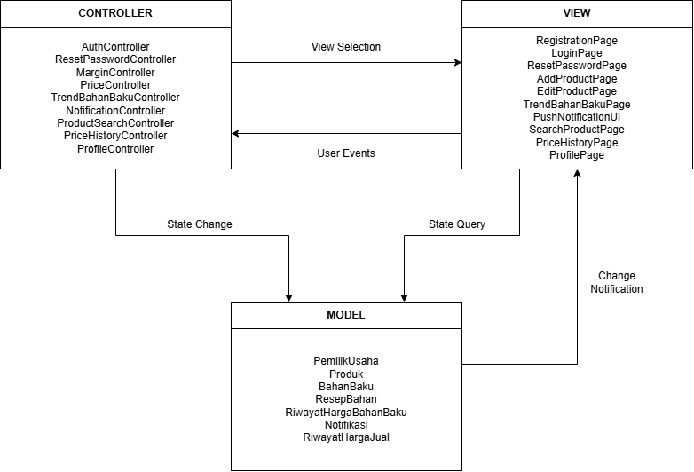

<i>Gambar 1. Contoh Arsitektur MVC</i>

## 2.3 Identifikasi Komponen / Modul / Subsistem

| Nama Komponen/Modul/Subsistem | Jenis | Penjelasan |
| :--- | :--- | :--- |
| *RegistrationPage* | *View* | *Menampilkan form untuk registrasi akun yang berisi username, email, serta password, setelah input akan diteruskan menuju AuthController.* |
| *LoginPage* | *View* | *Menampilkan form untuk memasuki aplikasi menggunakan akun yang telah dibuat lalu memverifikasinya menuju AuthController, menyediakan opsi untuk mengubah password jika melupakannya.* |
| *ResetPasswordPage* | *View* | *Menampilkan form untuk reset password lalu diteruskan menuju ResetPasswordController.* | 
| *HomePage* | *View* | *Menampilkan halaman utama dari aplikasi dengan menunjukan beberapa menu seperti menambahkan product dan searching.* | 
| *AddProductPage* | *View* | *Menampilkan halaman yang berisi form untuk menambahkan product yang nanti akan diteruskan menuju MarginController untuk dihitung Margin penjualannya.* |
| *EditProductPage* | *View* | *Menampilkan halaman yang berisi detail produk yang dapat pengguna ubah sesuai dengan keinginan lalu akan diteruskan menuju PriceController jika pengguna mengubah nilai harga jual dan disimpan pada RiwayatHargaJual.* |
| *SearchProductPage* | *View* | *Menampilkan halaman setelah pengguna mencari sebuah barang atau mencari berdasarkan tag dan bahan baku.* |
| *PriceHistoryPage* | *View* | *Menampilkan riwayat harga jual dari sebuah produk.* |
| *TrenBahanBakuPage* | *View* | *Menampilkan daftar bahan baku, filter rentang waktu, dan memvisualisasikan grafik tren riwayat harga bahan baku.* |
| *PushNotificationUI* | *View* | *Menampilkan antarmuka notifikasi bawaan sistem operasi (OS) yang muncul di perangkat pengguna sebagai peringatan kerugian.* |
| *ProfilePage* | *View* | *Menampilkan halaman yang berisi data akun dari pengguna serta tombol "logout" untuk keluar dari akun.* |
| *AuthController* | *Controller* | *Memproses logika verifikasi kredensial login, memvalidasi input form registrasi, dan mengelola sesi autentikasi pengguna.* |
| *ResetPasswordController* | *Controller* | *Memvalidasi input password baru yang memenuhi standar dan memperbaruinya di dalam database.* |
| *MarginController* | *Controller* | *Memvalidasi input produk baru, memproses kalkulasi margin awal, serta menyimpan data entitas produk dan resep ke database.* |
| *PriceController* | *Controller* | *Memvalidasi input perubahan harga jual, memperbarui harga pada produk, dan memicu pencatatan ke dalam riwayat harga.* |
| *ProductSearchController* | *Controller* | *Memproses kata kunci yang diinput dan melakukan pencocokan (filtering) terhadap data produk untuk menghasilkan daftar yang relevan.* |
| *PriceHistoryController* | *Controller* | *Mengambil data riwayat harga jual dari database, menerapkan filter waktu, dan menyusunnya menjadi format grafik yang bisa ditampilkan.* |
| *NotificationController* | *Controller* | *Mendeteksi hasil kalkulasi margin negatif setelah pembaruan harga beli, membuat objek notifikasi, dan memicu pengiriman pesan.* |
| *TrenBahanBakuController* | *Controller* | *Mengambil data riwayat harga bahan baku dari database, menerapkan filter waktu, dan mengonversinya menjadi format grafik tren.* |
| *ProfileController* | *Controller* | *Memvalidasi dan menyimpan perubahan data akun pengguna ke database, serta menangani proses pengakhiran sesi saat logout.* |
| *PemilikUsaha* | *Model* | *Menyimpan dan merepresentasikan data atribut profil pengguna (nama usaha, email, no telepon, dan password).* |
| *Produk* | *Model* | *Menyimpan data entitas operasional produk yang dikelola, meliputi nama, tag, harga jual, margin, dan status peringatan aktif.* |
| *BahanBaku* | *Model* | *Menyimpan data referensi entitas bahan baku pasar beserta nominal harga belinya.* |
| *ResepBahan* | *Model* | *Menyimpan relasi takaran spesifik dari bahan baku yang digunakan dalam komposisi resep suatu produk.* |
| *RiwayatHargaBahanBaku* | *Model* | *Menyimpan entitas catatan historis fluktuasi harga beli bahan baku beserta stempel waktu (timestamp) perubahannya.* |
| *RiwayatHargaJual* | *Model* | *Menyimpan entitas catatan historis perubahan harga jual suatu produk sebelum dan sesudah diperbarui beserta waktu perubahannya.* |
| *Notifikasi* | *Model* | *Menyimpan detail entitas pesan peringatan sistem, waktu pengiriman, dan status keterbacaan (read/unread).* |
| *Database* | *Penyimpanan Data* | *Menyimpan seluruh data model secara persisten, baik secara lokal maupun terpusat dengan menggunakan Supabase.* |

## 2.4 Model Arsitektur Perangkat Lunak

### 2.4.1 Logical View

Logical View dipilih untuk menggambarkan struktur logis perangkat lunak Pross, yaitu bagaimana komponen pada Tabel 2.1 dikelompokkan menurut pattern MVC dan saling berhubungan. Sudut pandang ini cocok untuk Pross karena aplikasi ini dirancang dengan pemisahan handling yang jelas. Ada *View* yang menampilkan antarmuka dan meneruskan aksi pengguna, ada *Controller* memproses validasi input, kalkulasi margin, pencatatan riwayat harga, dan pemicu notifikasi, lalu *Model* merepresentasikan data utama. Dengan pemisahan ini, satu *Model* seperti *Produk* dapat diakses oleh beberapa *Controller* tanpa menduplikasi logika, dan perubahan pada satu fitur tidak perlu mengubah fitur lain.

<i>Gambar 2. Contoh Logical View pada P/L E-Commerce</i>

### 2.4.2 Physical View
Physical View dipilih untuk memetakan bagaimana perangkat lunak Pross didistribusikan secara fisik ke dalam infrastruktur perangkat keras dan lingkungan eksekusi. View ini berfokus untuk menunjukkan di mana setiap bagian dari sistem dijalankan, sehingga mempermudah pemahaman mengenai topologi jaringan, lingkungan operasi, dan interaksi fisik antar-node penyusun sistem tanpa mengulang alur logika pemanggilan antar-komponen.

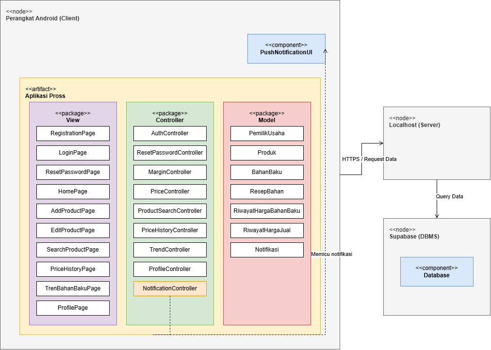

<i>Gambar 3. Contoh Pyhsical View pada P/L E-Commerce</i>

 

---

# BAB 3: Realisasi Use Case

## 3.1 Use Case Mendaftarkan Akun

**ID Use Case:** *UC01*  
**Nama Use Case:** *Mendaftarkan Akun*

### 3.1.1 Identifikasi Kelas

Tabel 3.1. Identifikasi Kelas Use Case UC01

| No | Nama Kelas Perancangan | Nama Kelas Analisis Terkait |
|:--- | :--- | :--- |
| 1 | *PemilikUsaha* | *PemilikUsaha* |
| 2 | *RegistrationPage* | *RegistrationPage* |
| 3 | *AuthController* | *AuthController* |

### 3.1.2 Sequence Diagram

- **Skenario Normal dan Alternatif**

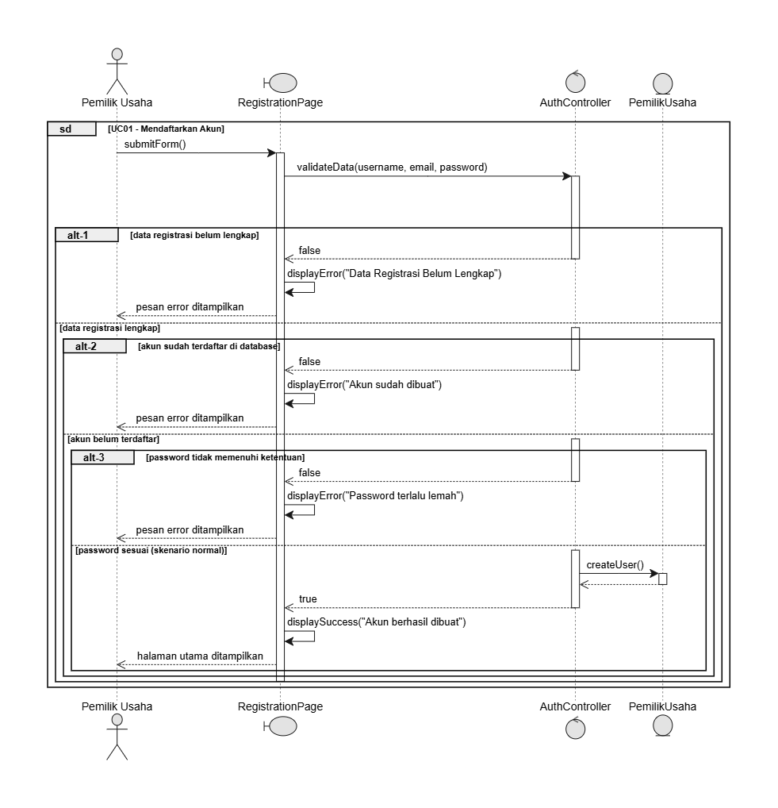

<i>Gambar 4. Sequence Diagram UC01</i>

### 3.1.3 Diagram Kelas

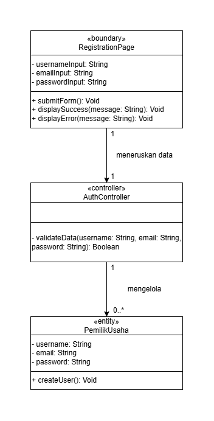

<i>Gambar 5. Diagram Kelas Mendaftarkan Akun</i>

## 3.2 Use Case Login dengan Akun yang Sudah Terdaftar

**ID Use Case:** *UC02*  
**Nama Use Case:** *Login dengan Akun yang Sudah Terdaftar*

### 3.2.1 Identifikasi Kelas

Tabel 3.1. Identifikasi Kelas Use Case UC02

| No | Nama Kelas Perancangan | Nama Kelas Analisis Terkait |
|:--- | :--- | :--- |
| 1 | *PemilikUsaha* | *PemilikUsaha* |
| 2 | *LoginPage* | *LoginPage* |
| 3 | *AuthController* | *AuthController* |
| 4 | *ResetPasswordPage* | *ResetPasswordPage* |
| 5 | *ResetPasswordController* | *ResetPasswordController* |

### 3.2.2 Sequence Diagram

- **Skenario Normal dan Alternatif**

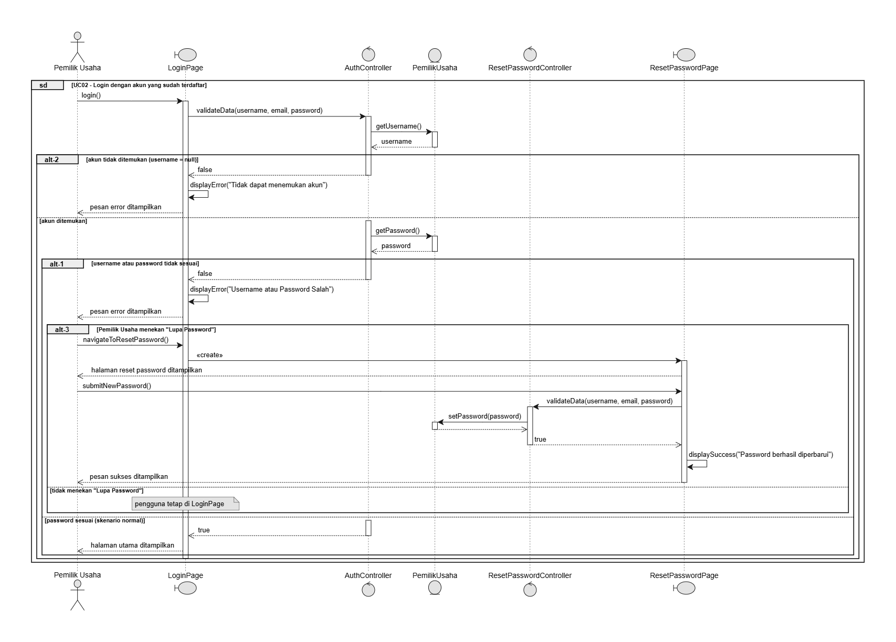

<i>Gambar 6. Sequence Diagram UC02</i>

### 3.2.3 Diagram Kelas

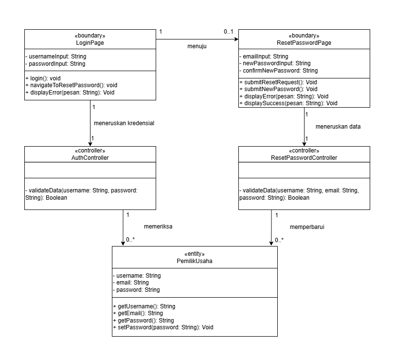

<i>Gambar 7. Diagram Kelas Login dengan Akun yang Sudah Terdaftar</i>

## 3.3 Use Case Menambahkan Data Produk Baru

**ID Use Case:** *UC03*  
**Nama Use Case:** *Menambahkan Data Produk Baru*

Tabel 3.3. Identifikasi Kelas Use Case UC03

| No | Nama Kelas Perancangan | Nama Kelas Analisis Terkait |
|:--- | :--- | :--- |
| 1 | *PemilikUsaha* | *PemilikUsaha* |
| 2 | *Produk* | *Produk* |
| 3 | *BahanBaku* | *BahanBaku* |
| 4 | *ResepBahan* | *ResepBahan* |
| 5 | *AddProductPage* | *AddProductPage* |
| 6 | *MarginController* | *MarginController* |

### 3.3.2 Sequence Diagram

- **Skenario Normal dan Alternatif**

<i>Gambar 8. Sequence Diagram UC03</i>

### 3.3.3 Diagram Kelas

<i>Gambar 9. Diagram Kelas Menambahkan Data Produk Baru</i>

## 3.4 Use Case Melihat Margin Keuntungan Produk

**ID Use Case:** *UC04*  
**Nama Use Case:** *Melihat Margin Keuntungan Produk*

### 3.4.1 Identifikasi Kelas

Tabel 3.4. Identifikasi Kelas Use Case UC04

| No | Nama Kelas Perancangan | Nama Kelas Analisis Terkait |
|:--- | :--- | :--- |
| 1 | *PemilikUsaha* | *PemilikUsaha* |
| 2 | *BahanBaku* | *BahanBaku* |
| 3 | *Produk* | *Produk* |
| 4 | *ResepBahan* | *ResepBahan* |
| 5 | *AddProductPage* | *AddProductPage* |
| 6 | *MarginController* | *MarginController* |

### 3.4.2 Sequence Diagram

- **Skenario Normal dan Alternatif**

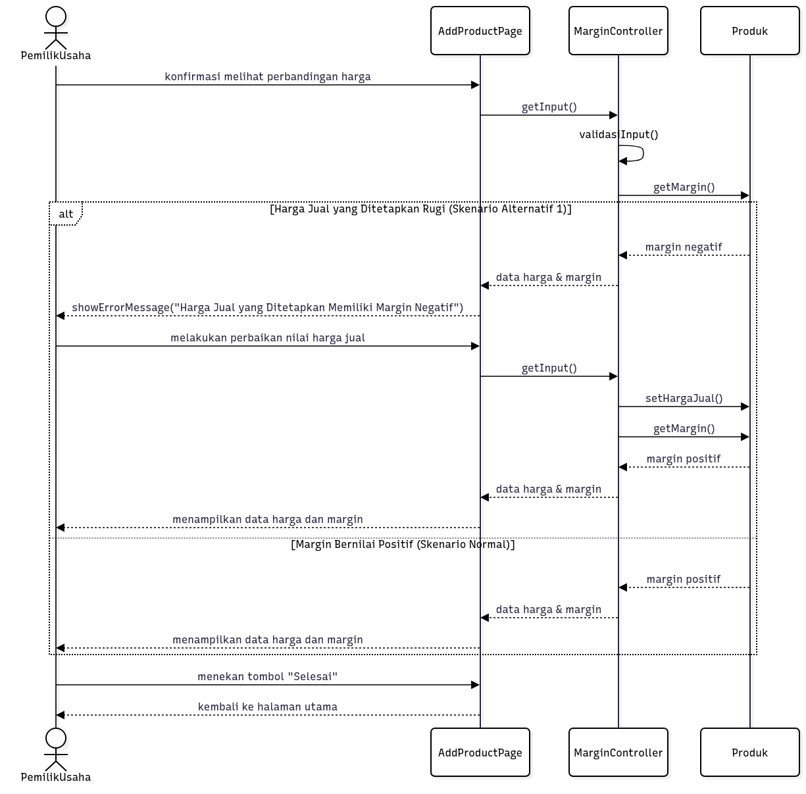

<i>Gambar 10. Sequence Diagram UC04</i>

### 3.4.3 Diagram Kelas

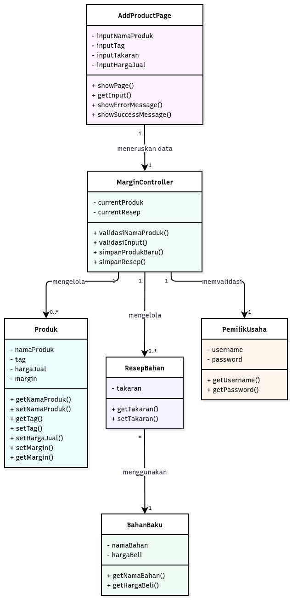

<i>Gambar 11. Diagram Kelas Melihat Margin Keuntungan Produk</i>

## 3.5 Use Case Mengelola Harga Jual Produk

**ID Use Case:** *UC05*  
**Nama Use Case:** *Mengelola Harga Jual Produk*

### 3.5.1 Identifikasi Kelas

Identifikasi kelas yang terkait dengan use case tersebut. Kelas di tahap perancangan dapat berbeda dengan dengan kelas di tahap analisis. Dapat menggunakan tabel di bawah:

Tabel 3.5. Identifikasi Kelas Use Case UC05

| No | Nama Kelas Perancangan | Nama Kelas Analisis Terkait |
|:--- | :--- | :--- |
| 1 | *[Nama kelas perancangan]* | *[Nama kelas analisis pada SKPL]* |
| 2 | *[Nama kelas perancangan]* | *[Nama kelas analisis pada SKPL]* |
| ... | *...* | *...* |

### 3.5.2 Sequence Diagram

Buat *sequence diagram* untuk **setiap skenario use case**, mencakup skenario normal dan alternatif pada subbab 4.4 SKPL. Diagram melibatkan kelas-kelas yang telah diidentifikasi pada SKPL. 

- **Skenario Normal**

<i>Gambar X. Sequence Diagram [UC01]</i>

- **Skenario Alternatif [Nomor]: [Nama Skenario]**

<i>Gambar X. Sequence Diagram [UC01] - [Nama skenario alternatif]</i>

### 3.5.3 Diagram Kelas

Buatlah diagram kelas untuk use case ini yang terdiri atas kelas-kelas dari 3.1.1. **Setiap kelas pada diagram wajib menampilkan atribut dan metode/operasi langsung di dalam kotak kelasnya**, sehingga tidak perlu membuat tabel daftar atribut dan metode per kelas pada subbab ini. Daftar lengkap atribut dan metode seluruh kelas disajikan pada Tabel 4.1 (Bab 4).

<i>Gambar X. Diagram Kelas [Nama Uce Case]</i>

Pada diagram, pastikan:
- Atribut dituliskan beserta visibilitas dan tipe datanya, misalnya `- email: String`.
- Operasi dituliskan beserta visibilitas, parameter, dan tipe kembaliannya, misalnya `+ login(email: String, password: String): Boolean`.
- Relasi antarkelas (asosiasi, agregasi, komposisi, generalisasi, dan dependensi) digambarkan lengkap dengan multiplisitas.
- Semua operasi yang dipanggil pada sequence diagram 3.1.2 (skenario normal dan alternatif) ada pada kelas yang bersangkutan.
- Kelas yang sama dengan kelas di use case lain memakai nama, atribut, dan metode yang konsisten.

## 3.6 Use Case Menelusuri Daftar Produk

**ID Use Case:** *UC06*  
**Nama Use Case:** *Menelusuri Daftar Produk*

### 3.6.1 Identifikasi Kelas

Identifikasi kelas yang terkait dengan use case tersebut. Kelas di tahap perancangan dapat berbeda dengan dengan kelas di tahap analisis. Dapat menggunakan tabel di bawah:

Tabel 3.6. Identifikasi Kelas Use Case UC06

| No | Nama Kelas Perancangan | Nama Kelas Analisis Terkait |
|:--- | :--- | :--- |
| 1 | *[Nama kelas perancangan]* | *[Nama kelas analisis pada SKPL]* |
| 2 | *[Nama kelas perancangan]* | *[Nama kelas analisis pada SKPL]* |
| ... | *...* | *...* |

### 3.6.2 Sequence Diagram

Buat *sequence diagram* untuk **setiap skenario use case**, mencakup skenario normal dan alternatif pada subbab 4.4 SKPL. Diagram melibatkan kelas-kelas yang telah diidentifikasi pada SKPL. 

- **Skenario Normal**

<i>Gambar X. Sequence Diagram [UC01]</i>

- **Skenario Alternatif [Nomor]: [Nama Skenario]**

<i>Gambar X. Sequence Diagram [UC01] - [Nama skenario alternatif]</i>

### 3.6.3 Diagram Kelas

Buatlah diagram kelas untuk use case ini yang terdiri atas kelas-kelas dari 3.1.1. **Setiap kelas pada diagram wajib menampilkan atribut dan metode/operasi langsung di dalam kotak kelasnya**, sehingga tidak perlu membuat tabel daftar atribut dan metode per kelas pada subbab ini. Daftar lengkap atribut dan metode seluruh kelas disajikan pada Tabel 4.1 (Bab 4).

<i>Gambar X. Diagram Kelas [Nama Uce Case]</i>

Pada diagram, pastikan:
- Atribut dituliskan beserta visibilitas dan tipe datanya, misalnya `- email: String`.
- Operasi dituliskan beserta visibilitas, parameter, dan tipe kembaliannya, misalnya `+ login(email: String, password: String): Boolean`.
- Relasi antarkelas (asosiasi, agregasi, komposisi, generalisasi, dan dependensi) digambarkan lengkap dengan multiplisitas.
- Semua operasi yang dipanggil pada sequence diagram 3.1.2 (skenario normal dan alternatif) ada pada kelas yang bersangkutan.
- Kelas yang sama dengan kelas di use case lain memakai nama, atribut, dan metode yang konsisten.

## 3.7 Use Case Melihat Perubahan Harga Jual

**ID Use Case:** *UC07*  
**Nama Use Case:** *Melihat Perubahan Harga Jual*

### 3.7.1 Identifikasi Kelas

Tabel 3.7. Identifikasi Kelas Use Case UC07

| No | Nama Kelas Perancangan | Nama Kelas Analisis Terkait |
|:--- | :--- | :--- |
| 1 | *PemilikUsaha* | *PemilikUsaha* |
| 2 | *Produk* | *Produk* |
| 3 | *RiwayatHargaJual* | *RiwayatHargaJual* |
| 4 | *PriceHistoryPage* | *PriceHistoryPage* |
| 5 | *PriceHistoryController* | *PriceHistoryController* |

### 3.7.2 Sequence Diagram

- **Skenario Normal dan Alternatif**

<i>Gambar 16. Sequence Diagram UC07</i>

### 3.7.3 Diagram Kelas

<i>Gambar 17. Diagram Kelas Melihat Perubahan Harga Jual</i>

## 3.8 Use Case Memantau Tren Harga Bahan Baku

**ID Use Case:** *UC08*  
**Nama Use Case:** *Memantau Tren Harga Bahan Baku*

### 3.8.1 Identifikasi Kelas

Tabel 3.8. Identifikasi Kelas Use Case UC08

| No | Nama Kelas Perancangan | Nama Kelas Analisis Terkait |
|:--- | :--- | :--- |
| 1 | *PemilikUsaha* | *PemilikUsaha* |
| 2 | *BahanBaku* | *BahanBaku* |
| 3 | *RiwayatHargaBahanBaku* | *RiwayatHargaBahanBaku* |
| 4 | *TrenBahanBakuPage* | *TrenBahanBakuPage* |
| 5 | *TrenBahanBakuController* | *TrenBahanBakuController* |

### 3.8.2 Sequence Diagram

- **Skenario Normal dan Alternatif**

<i>Gambar 18. Sequence Diagram UC08</i>

### 3.8.3 Diagram Kelas

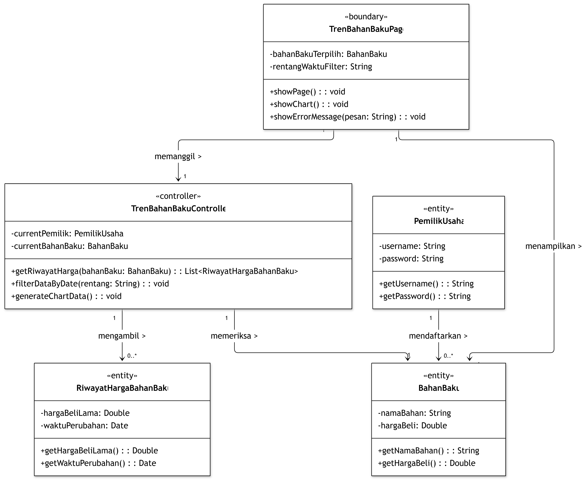

<i>Gambar 19. Diagram Kelas Memantau Tren Harga Bahan Baku</i>

## 3.9 Use Case Menerima Notifikasi Kerugian Produk

**ID Use Case:** *UC09*  
**Nama Use Case:** *Menerima Notifikasi Kerugian Produk*

### 3.9.1 Identifikasi Kelas

Tabel 3.9. Identifikasi Kelas Use Case UC09

| No | Nama Kelas Perancangan | Nama Kelas Analisis Terkait |
|:--- | :--- | :--- |
| 1 | *PemilikUsaha* | *PemilikUsaha* |
| 2 | *Produk* | *Produk* |
| 3 | *BahanBaku* | *BahanBaku* |
| 4 | *Notifikasi* | *Notifikasi* |
| 5 | *PushNotificationUI* | *PushNotificationUI* |
| 6 | *NotifikasiController* | *NotifikasiController* |
| 7 | *EditProductPage* | *EditProductPage* |
| 8 | *-* | *HomePage* |

### 3.9.2 Sequence Diagram

- **Skenario Normal dan Alternatif**

<i>Gambar 20. Sequence Diagram [UC09]</i>

### 3.9.3 Diagram Kelas

<i>Gambar 21. Diagram Kelas Menerima Notifikasi Kerugian Produk</i>

## 3.10 Use Case Menerima Notifikasi Perubahan Harga Bahan Baku

**ID Use Case:** *UC10*  
**Nama Use Case:** *Menerima Notifikasi Perubahan Harga Bahan Baku*

### 3.10.1 Identifikasi Kelas

Tabel 3.10. Identifikasi Kelas Use Case UC10

| No | Nama Kelas Perancangan | Nama Kelas Analisis Terkait |
|:--- | :--- | :--- |
|:--- | :--- | :--- |
| 1 | *PemilikUsaha* | *PemilikUsaha* |
| 2 | *Produk* | *Produk* |
| 3 | *BahanBaku* | *BahanBaku* |
| 4 | *Notifikasi* | *Notifikasi* |
| 5 | *PushNotificationUI* | *PushNotificationUI* |
| 6 | *NotifikasiController* | *NotifikasiController* |
| 7 | *EditProductPage* | *EditProductPage* |
| 8 | *-* | *HomePage* |

### 3.10.2 Sequence Diagram

- **Skenario Normal dan Alternatif**

<i>Gambar 22. Sequence Diagram [UC10]</i>

### 3.10.3 Diagram Kelas

<i>Gambar 23. Diagram Kelas Menerima Notifikasi Perubahan Harga Bahan Baku</i>

## 3.11 Use Case Mengubah Data Akun

**ID Use Case:** *UC11*  
**Nama Use Case:** *Mengubah Data Akun*

### 3.11.1 Identifikasi Kelas

Tabel 3.11. Identifikasi Kelas Use Case UC11

| No | Nama Kelas Perancangan | Nama Kelas Analisis Terkait |
|:--- | :--- | :--- |
| 1 | *PemilikUsaha* | *PemilikUsaha* |
| 2 | *ProfilePage* | *ProfilePage* |
| 3 | *ProfileController* | *ProfileController* |

### 3.11.2 Sequence Diagram

- **Skenario Normal**

<i>Gambar 24. Sequence Diagram UC11</i>

### 3.11.3 Diagram Kelas

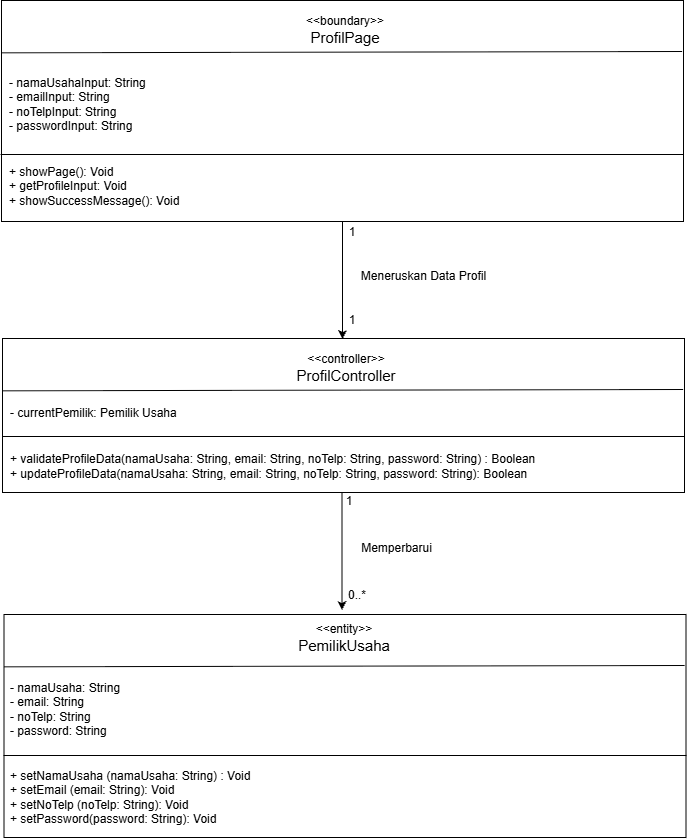

<i>Gambar 25. Diagram Kelas Mengubah Data Akun</i>

## 3.12 Use Case Keluar dari Akun

**ID Use Case:** *UC12*  
**Nama Use Case:** *Keluar dari Akun*

### 3.12.1 Identifikasi Kelas

Tabel 3.12. Identifikasi Kelas Use Case UC12

| No | Nama Kelas Perancangan | Nama Kelas Analisis Terkait |
|:--- | :--- | :--- |
| 1 | *ProfilePage* | *ProfilePage* |
| 2 | *ProfileController* | *ProfileController* |

### 3.12.2 Sequence Diagram

- **Skenario Normal**

<i>Gambar 26. Sequence Diagram UC12</i>

### 3.12.3 Diagram Kelas

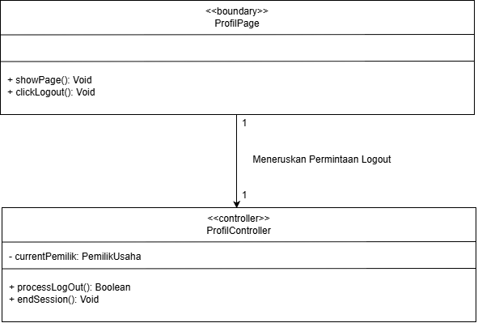

<i>Gambar 27. Diagram Kelas Keluar dari Akun</i>

 

---

# BAB 4: Diagram Kelas Keseluruhan

## 4.1 Diagram Kelas

<i>Gambar 4.1. Diagram Kelas Perancangan Keseluruhan Pross</i>

Tabel 4.1. Daftar Kelas Perancangan Keseluruhan

| ID Kelas | Nama Kelas | Atribut | Metode/Operasi |
| :--- | :--- | :--- | :--- |
| *C01* | *PemilikUsaha* | *namaUsaha, email, noTelp, password, username* | *createUser(), getNamaUsaha(), setNamaUsaha(), getEmail() setEmail(), getNoTelp(), setNoTelp(), getPassword(), setPassword(), getUsername()* |
| *C02* | *Produk* | *namaProduk, tag, hargaJual, margin* | *getNamaProduk(), setNamaProduk(), getTag(), setTag(), getHargaJual(), setHargaJual(), setMargin(), getMargin()* |
| *C03* | *BahanBaku* | *namaBahan, hargaBeli* | *getNamaBahan(), getHargaBeli(), setHargaBeli()* |
| *C04* | *ResepBahan* | *takaran* | *getTakaran(), setTakaran()* |
| *C05* | *RegistrationPage* | *usernameInput, emailInput, passwordInput* | *submitForm(), displaySuccess(), displayError()* |
| *C06* | *AuthController* | *-* | *validateData()* |
| *C07* | *LoginPage* | *usernameInput, passwordInput* | *login(), navigateToResetPassword(), displayError()* |
| *C08* | *ResetPasswordPage* | *emailInput, newPasswordInput, confirmNewPassword* | *submitResetRequest(), submitNewPassword(), displayError(), displaySuccess()* |
| *C09* | *ResetPasswordController* | *-* | *validateData(), resetPassword()* |
| *C10* | *AddProductPage* | *inputNamaProduk, inputTag, inputTakaran, inputHargaJual* | *showPage(), getInput(), showErrorMessage(), showSuccessMessage()* |
| *C11* | *MarginController* | *currentProduk, currentResep* | *validasiNamaProduk(), validasiInput(), simpanProdukBaru(), simpanResep()* |
| *C12* | *EditProductPage* | *hargaBaruInput* | *showPage(), getInput(), showSuccessMessage(), showErrorMessage()* |
| *C13* | *PriceController* | *currentPemilik, currentProduk* | *validasiInput(), updateHargaProduk(), catatRiwayat()* |
| *C14* | *RiwayatHargaBahanBaku* | *hargaBeliLama, waktuPerubahan* | *getHargaBeliLama(), getWaktuPerubahan()* |
| *C15* | *TrenBahanBakuPage* | *bahanBakuTerpilih, rentangWaktuFilter* | *showPage(), showChart(), showErrorMessage()* |
| *C16* | *TrenBahanBakuController* | *currentPemilik, currentBahanBaku* | *getRiwayatHarga(), filterDataByDate(), generateChartData()* |
| *C17* | *Notifikasi* | *idNotifikasi, pesanAlert, waktuKirim, isRead* | *getPesanAlert(), markAsRead()* |
| *C18* | *PushNotificationUI* | *notifikasiAktif* | *tampilkanNotifikasi(), onClickNotification()* |
| *C19* | *NotificationController* | *currentPemilik, targetProduk* | *cekMarginNegatif(), buatNotifikasiKerugian(), kirimNotifikasi()* |
| *C20* | *RiwayatHargaJual* | *hargaJualLama, hargaBaru, waktuPerubahan* |setHargaJualLama(), setWaktuPerubahan(), getHargaJualLama(), getHargaBaru(), getWaktuPerubahan()|
| *C21* | *SearchProductPage* | *kataKunciPencarian, hasilPencarian* | showPage(), showResults(), showErrorMessage()|
| *C22* | *ProductSearchController* | *currentPemilik, kataKunci* | searchProduk(), filterByTag()|
| *C23* | *PriceHistoryPage* | *produkTerpilih, rentangWaktuFilter* | showPage(), showChart(), showErrorMessage()|
| *C24* | *PriceHistoryController* | *currentPemilik, currentProduk* | getRiwayatHarga(), filterDataByDate(), generateChartData()|
| *C25* | *ProfilePage* | *namaUsahaInput, emailInput, noTelpInput, passwordInput* | *showPage(), getProfileInput(), clickLogout(), showSuccessMessage(), showErrorMessage()* |
| *C26* | *ProfileController* | *currentPemilik* | *validateProfileData(), updateProfileData(), processLogout(), endSession()* |

 

---

# BAB 5: Matriks Kerunutan

Tabel 5.1. Matriks Kerunutan Kelas terhadap Use Case

| Kelas | Use Case Terkait |
| :--- | :--- |
| *C01 - PemilikUsaha* | *UC01 - Mendaftarkan Akun*   *UC02 - Login dengan akun yang sudah terdaftar*   *UC03 - Menambahkan Data Produk Baru*   *UC04 - Melihat Margin Keuntungan Produk*   *UC05 - Mengelola Harga Jual Produk*   *UC06 - Menelusuri Daftar Produk*   *UC07 - Melihat Perubahan Harga Jual*   *UC08 - Memantau Tren Harga Bahan Baku*   *UC09 - Menerima Notifikasi Kerugian Produk*   *UC10 - Menerima Notifikasi Perubahan Harga Bahan Baku*   *UC11 - Mengubah Data Akun*   *UC12 - Keluar dari Akun* |
| *C02 - Produk* | *UC03 - Menambahkan Data Produk Baru*   *UC04 - Melihat Margin Keuntungan Produk*   *UC05 - Mengelola Harga Jual Produk*   *UC06 - Menelusuri Daftar Produk*   *UC07 - Melihat Perubahan Harga Jual*   *UC09 - Menerima Notifikasi Kerugian Produk*   *UC10 - Menerima Notifikasi Perubahan Harga Bahan Baku* |
| *C03 - BahanBaku* | *UC03 - Menambahkan Data Produk Baru*   *UC04 - Melihat Margin Keuntungan Produk*   *UC08 - Memantau Tren Harga Bahan Baku*   *UC09 - Menerima Notifikasi Kerugian Produk*   *UC10 - Menerima Notifikasi Perubahan Harga Bahan Baku* |
| *C04 - ResepBahan* | *UC03 - Menambahkan Data Produk Baru*   *UC04 - Melihat Margin Keuntungan Produk* |
| *C05 - RegistrationPage* | *UC01 - Mendaftarkan Akun* |
| *C06 - AuthController* | *UC01 - Mendaftarkan Akun*   *UC02 - Login dengan akun yang sudah terdaftar* |
| *C07 - LoginPage* | *UC02 - Login dengan akun yang sudah terdaftar* |
| *C08 - ResetPasswordPage* | *UC02 - Login dengan akun yang sudah terdaftar* |
| *C09 - ResetPasswordController* | *UC02 - Login dengan akun yang sudah terdaftar* |
| *C10 - AddProductPage* | *UC03 - Menambahkan Data Produk Baru*   *UC04 - Melihat Margin Keuntungan Produk* |
| *C11 - MarginController* | *UC03 - Menambahkan Data Produk Baru*   *UC04 - Melihat Margin Keuntungan Produk* |
| *C12 - EditProductPage* | *UC05 - Mengelola Harga Jual Produk* |
| *C13 - PriceController* | *UC05 - Mengelola Harga Jual Produk* |
| *C14 - RiwayatHargaBahanBaku* | *UC08 - Memantau Tren Harga Bahan Baku* |
| *C15 - TrenBahanBakuPage* | *UC08 - Memantau Tren Harga Bahan Baku* |
| *C16 - TrenBahanBakuController* | *UC08 - Memantau Tren Harga Bahan Baku* |
| *C17 - Notifikasi* | *UC09 - Menerima Notifikasi Kerugian Produk*   *UC10 - Menerima Notifikasi Perubahan Harga Bahan Baku* |
| *C18 - PushNotificationUI* | *UC09 - Menerima Notifikasi Kerugian Produk*   *UC10 - Menerima Notifikasi Perubahan Harga Bahan Baku* |
| *C19 - NotificationController* | *UC09 - Menerima Notifikasi Kerugian Produk*   *UC10 - Menerima Notifikasi Perubahan Harga Bahan Baku* |
| *C20 - RiwayatHargaJual* | *UC05 - Mengelola Harga Jual Produk*   *UC07 - Melihat Perubahan Harga Jual* |
| *C21 - SearchProductPage* | *UC06 - Menelusuri Daftar Produk* |
| *C22 - ProductSearchController* | *UC06 - Menelusuri Daftar Produk* |
| *C23 - PriceHistoryPage* | *UC07 - Melihat Perubahan Harga Jual* |
| *C24 - PriceHistoryController* | *UC07 - Melihat Perubahan Harga Jual* |
| *C25 - ProfilePage* | *UC11 - Mengubah Data Akun*   *UC12 - Keluar dari Akun* |
| *C26 - ProfileController* | *UC11 - Mengubah Data Akun*   *UC12 - Keluar dari Akun* |
