<h1>
IF2150 REKAYASA PERANGKAT LUNAK
<br>
TUGAS 5
<br>
DESKRIPSI PERANCANGAN PERANGKAT LUNAK (DPPL)
</h1>
<br>

## *Pross*


### Untuk: *Stefani Angeline Oroh*

Dipersiapkan oleh:
| Informasi | Keterangan |
| --- | --- |
| Kelas | *K02* |
| Kelompok | *G07* |

| NIM | Nama |
| --- | --- |
| *13525002* | *Ahmad Boutros Fathir* |
| *13525020* | *Klio Lysander* |
| *13525047* | *Muhammad Fakhriyan Rizki M.* |
| *13525053* | *Kevin Sie* |
| *13525056* | *Mochammad Nuha Al Ghifari* |
| *13525062* | *Rafel Dzinun Muhammad* |
---

## Daftar Perubahan

| Revisi | Deskripsi |
| :--- | :--- |
| *A* | *Deskripsikan perubahan yang dilakukan dari dokumen sebelumnya pada dokumen ini. Jika tidak terdapat perubahan, harap kosongkan tabel.* |
| *B* |  |
| *C* |  |
| ... |  |

---

<br>

> **Petunjuk pengerjaan:** *[Silahkan hapus bagian ini setelah selesai mengerjakan]*
>
> Dokumen ini melanjutkan **Deskripsi Perancangan Perangkat Lunak**. Gunakan nama, ID, kebutuhan, dan use case yang konsisten dengan kedua dokumen tersebut. Contoh pola ID baru di bawah dapat disesuaikan dengan kesepakatan kelompok, ID yang sudah ada tetap dipertahankan.

<br>

---


# BAB 1: Pendahuluan

## 1.1 Tujuan Penulisan Dokumen
Dokumen Deskripsi Perancangan Perangkat Lunak (DPPL) ini disusun untuk mendokumentasikan perancangan teknis perangkat lunak *Pross* secara mendetail, termasuk rancangan Sequence Diagram dan Class Diagram berdasarkan spesifikasi pada SKPL dan APL. Selain itu, dokumen ini bertujuan menjadi pedoman utama bagi kelompok dalam tahap implementasi kode, sekaligus memfasilitasi asisten dalam memverifikasi kelayakan rancangan sebelum sistem mulai dikembangkan.

## 1.2 Lingkup Masalah
Pross merupakan aplikasi berbasis mobile yang berguna untuk manajemen harga pokok penjualan yang ditujukan bagi para pedagang kuliner UMKM. Aplikasi ini membantu pemilik usaha dalam memantau profitabilitas setiap produk secara otomatis berdasarkan perubahan harga bahan baku sehingga dapat mengetahui produk yang menguntungkan ataupun merugi tanpa perlu pencatatan secara manual.

## 1.3 Definisi, Istilah, dan Singkatan
Tabel 1.3. Definisi Istilah dan Singkatan

| Singkatan, Akronim, atau Istilah | Penjelasan |
| :--- | :--- |
| *P/L* | *Singkatan dari Perangkat Lunak, yaitu aplikasi yang memberikan perintah kepada komputer untuk menjalankan tugas tertentu.* |
| *SKPL* | *Singkatan dari Spesifikasi Kebutuhan Perangkat Lunak, yaitu dokumen yang merangkum kriteria-kriteria yang diperlukan untuk membangun aplikasi menjalankan tugasnya.* |
| *KF* | *Singkatan dari Kebutuhan Fungsional.* |
| *KNF* | *Singkatan dari Kebutuhan Non-Fungsional.* |
| *UC* | *Singkatan dari Use Case.* |
| *EARS* | *Easy Approach to Requirements Syntax, yaitu pola penulisan kebutuhan agar konsisten dan mudah diuji.* |
| *A* | *Singkatan dari Aktor.* |
| *C* | *Singkatan dari Class* |
| *Tag* | *Label yang diberikan pengguna pada suatu produk untuk mempermudah dalam pencarian.* |

## 1.4 Aturan Penomoran
Tabel 1.4. Aturan Penomoran

| Hal/Bagian | Penomoran | Keterangan |
| :--- | :--- | :--- |
| *Kebutuhan Fungsional* | *KFXX* | - |
| *Kebutuhan Non-Fungsional* | *KNFXX* | - |
| *Aktor* | *AXX* | - |
| *Use Case* | *UCXX* | - |
| *Kelas* | *CXX* | - |

## 1.5 Referensi
- [Spesifikasi Kebutuhan Perangkat Lunak (SKPL) *Pross*](../M5/K02_G07_SKPL.md)
- [Arsitektur Perangkat Lunak (APL) *Pross*](../M6/K02_G07_APL.md)

## 1.6 Deskripsi Umum Dokumen (Ikhtisar)
Dokumen Deskripsi Perancangan Perangkat Lunak (DPPL) ini terdiri dari lima bab utama. Bab 1 berisi pendahuluan yang mencakup tujuan, lingkup masalah, definisi istilah, dan ikhtisar dokumen. Bab 2 menjabarkan perancangan arsitektur sistem yang meliputi lingkungan implementasi, pola arsitektur acuan (MVC), identifikasi komponen, serta model arsitektur perangkat lunak. Bab 3 menjelaskan realisasi untuk setiap use case secara rinci melalui identifikasi kelas perancangan, sequence diagram, dan class diagram. Bab 4 menyajikan gambaran diagram kelas perancangan (class diagram) secara keseluruhan. Terakhir, Bab 5 menampilkan matriks kerunutan (traceability matrix) yang memetakan keterkaitan antara setiap kelas perancangan dengan use case yang relevan.

<br>

---

# BAB 2: Perancangan Arsitektur

## 2.1 Rancangan Lingkungan Implementasi
| Komponen | Spesifikasi |
| :--- | :--- |
| *OS* | *Android* |
| *DBMS* | *Supabase* |
| *Development Tools* | *VSCode, Git, Supabase Dashboard* |
| *Filling System* | *GitHub* |
| *Bahasa Pemrograman* | *Typescript* |

## 2.2 Style/Pattern Arsitektur Acuan

Pattern arsitektur yang dipilih untuk perangkat lunak Pross adalah MVC. Pada pattern ini, model bertanggung jawab dalam merepresentasikan dan mengelola data utama sistem. View bertanggung jawab menampilkan antarmuka kepada pengguna atau meneruskan aksi pengguna ke Controller. Controller berguna untuk memproses logika bisnis, memvalidasi input dan memperbarui model berdasarkan permintaan dari view. 

Pemilihan MVC didasarkan karena karakteristik yang akan dibuat pada perangkat lunak Pross yaitu:
1. Satu objek pada Model yang sama akan dipakai bersama oleh beberapa View berbeda. Contoh: Pada data Produk diakses oleh AddProductPage saat sebuah produk dibuat, EditProductPage saat harga jual diubah, atau SearchProductpage saat produk suatu produk dicari
2. Alur proses bisnis perangkat lunak Pross hampir selalu dimulai dari input, proses, dan menampilkan yang berulang dari beberapa fitur, sehingga pemisahan tanggung jawab memudahkan untuk mengembangkan tiap fitur.
3. Perangkat lunak Pross hanya memiliki satu jenis pengguna sehingga kebutuhan antarmuka dapat relatif seragam.

<p align="center">

</p>
<p align="center">
<i>Gambar 1. Contoh Arsitektur MVC</i>
</p>

## 2.3 Identifikasi Komponen / Modul / Subsistem
Tabel 2.3. Identifikasi Komponen/Modul/Subsistem

| Nama Komponen/Modul/Subsistem | Jenis | Penjelasan |
| :--- | :--- | :--- |
| *RegistrationPage* | *View* | *Menampilkan form untuk registrasi akun yang berisi username, email, serta password, setelah input akan diteruskan menuju AuthController.* |
| *LoginPage* | *View* | *Menampilkan form untuk memasuki aplikasi menggunakan akun yang telah dibuat lalu memverifikasinya menuju AuthController, menyediakan opsi untuk mengubah password jika melupakannya.* |
| *ResetPasswordPage* | *View* | *Menampilkan form untuk reset password lalu diteruskan menuju ResetPasswordController.* | 
| *HomePage* | *View* | *Menampilkan halaman utama dari aplikasi dengan menunjukan beberapa menu seperti menambahkan product dan searching.* | 
| *AddProductPage* | *View* | *Menampilkan halaman yang berisi form untuk menambahkan product yang nanti akan diteruskan menuju MarginController untuk dihitung Margin penjualannya.* |
| *EditProductPage* | *View* | *Menampilkan halaman yang berisi detail produk yang dapat pengguna ubah sesuai dengan keinginan lalu akan diteruskan menuju PriceController jika pengguna mengubah nilai harga jual dan disimpan pada RiwayatHargaJual.* |
| *SearchProductPage* | *View* | *Menampilkan halaman setelah pengguna mencari sebuah barang atau mencari berdasarkan tag dan bahan baku.* |
| *PriceHistoryPage* | *View* | *Menampilkan riwayat harga jual dari sebuah produk.* |
| *TrenBahanBakuPage* | *View* | *Menampilkan daftar bahan baku, filter rentang waktu, dan memvisualisasikan grafik tren riwayat harga bahan baku.* |
| *PushNotificationUI* | *View* | *Menampilkan antarmuka notifikasi bawaan sistem operasi (OS) yang muncul di perangkat pengguna sebagai peringatan kerugian.* |
| *ProfilePage* | *View* | *Menampilkan halaman yang berisi data akun dari pengguna serta tombol "logout" untuk keluar dari akun.* |
| *AuthController* | *Controller* | *Memproses logika verifikasi kredensial login, memvalidasi input form registrasi, dan mengelola sesi autentikasi pengguna.* |
| *ResetPasswordController* | *Controller* | *Memvalidasi input password baru yang memenuhi standar dan memperbaruinya di dalam database.* |
| *MarginController* | *Controller* | *Memvalidasi input produk baru, memproses kalkulasi margin awal, serta menyimpan data entitas produk dan resep ke database.* |
| *PriceController* | *Controller* | *Memvalidasi input perubahan harga jual, memperbarui harga pada produk, dan memicu pencatatan ke dalam riwayat harga.* |
| *ProductSearchController* | *Controller* | *Memproses kata kunci yang diinput dan melakukan pencocokan (filtering) terhadap data produk untuk menghasilkan daftar yang relevan.* |
| *PriceHistoryController* | *Controller* | *Mengambil data riwayat harga jual dari database, menerapkan filter waktu, dan menyusunnya menjadi format grafik yang bisa ditampilkan.* |
| *NotificationController* | *Controller* | *Mendeteksi hasil kalkulasi margin negatif setelah pembaruan harga beli, membuat objek notifikasi, dan memicu pengiriman pesan.* |
| *TrenBahanBakuController* | *Controller* | *Mengambil data riwayat harga bahan baku dari database, menerapkan filter waktu, dan mengonversinya menjadi format grafik tren.* |
| *ProfileController* | *Controller* | *Memvalidasi dan menyimpan perubahan data akun pengguna ke database, serta menangani proses pengakhiran sesi saat logout.* |
| *PemilikUsaha* | *Model* | *Menyimpan dan merepresentasikan data atribut profil pengguna (nama usaha, email, no telepon, dan password).* |
| *Produk* | *Model* | *Menyimpan data entitas operasional produk yang dikelola, meliputi nama, tag, harga jual, margin, dan status peringatan aktif.* |
| *BahanBaku* | *Model* | *Menyimpan data referensi entitas bahan baku pasar beserta nominal harga belinya.* |
| *ResepBahan* | *Model* | *Menyimpan relasi takaran spesifik dari bahan baku yang digunakan dalam komposisi resep suatu produk.* |
| *RiwayatHargaBahanBaku* | *Model* | *Menyimpan entitas catatan historis fluktuasi harga beli bahan baku beserta stempel waktu (timestamp) perubahannya.* |
| *RiwayatHargaJual* | *Model* | *Menyimpan entitas catatan historis perubahan harga jual suatu produk sebelum dan sesudah diperbarui beserta waktu perubahannya.* |
| *Notifikasi* | *Model* | *Menyimpan detail entitas pesan peringatan sistem, waktu pengiriman, dan status keterbacaan (read/unread).* |
| *Database* | *Penyimpanan Data* | *Menyimpan seluruh data model secara persisten, baik secara lokal maupun terpusat dengan menggunakan Supabase.* |

## 2.4 Model Arsitektur Perangkat Lunak

### 2.4.1 Logical View

Logical View dipilih untuk menggambarkan struktur logis perangkat lunak Pross, yaitu bagaimana komponen pada Tabel 2.1 dikelompokkan menurut pattern MVC dan saling berhubungan. Sudut pandang ini cocok untuk Pross karena aplikasi ini dirancang dengan pemisahan handling yang jelas. Ada *View* yang menampilkan antarmuka dan meneruskan aksi pengguna, ada *Controller* memproses validasi input, kalkulasi margin, pencatatan riwayat harga, dan pemicu notifikasi, lalu *Model* merepresentasikan data utama. Dengan pemisahan ini, satu *Model* seperti *Produk* dapat diakses oleh beberapa *Controller* tanpa menduplikasi logika, dan perubahan pada satu fitur tidak perlu mengubah fitur lain.

<p align="center">
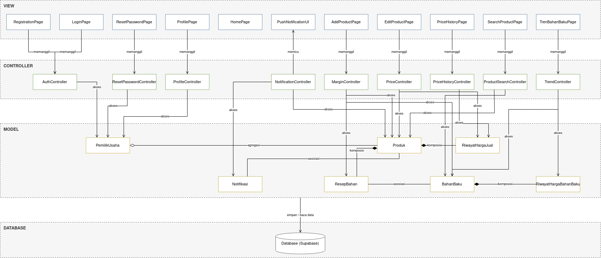
</p>
<p align="center">
<i>Gambar 2. Contoh Logical View pada P/L E-Commerce</i>
</p>

### 2.4.2 Physical View
Physical View dipilih untuk memetakan bagaimana perangkat lunak Pross didistribusikan secara fisik ke dalam infrastruktur perangkat keras dan lingkungan eksekusi. View ini berfokus untuk menunjukkan di mana setiap bagian dari sistem dijalankan, sehingga mempermudah pemahaman mengenai topologi jaringan, lingkungan operasi, dan interaksi fisik antar-node penyusun sistem tanpa mengulang alur logika pemanggilan antar-komponen.

<p align="center">

</p>
<p align="center">
<i>Gambar 3. Contoh Pyhsical View pada P/L E-Commerce</i>
</p>

<br>

---


# BAB 3: Realisasi Use Case

## 3.1 Use Case Mendaftarkan Akun

**ID Use Case:** *UC01*  
**Nama Use Case:** *Mendaftarkan Akun*

### 3.1.1 Identifikasi Kelas

Tabel 3.1. Identifikasi Kelas Use Case UC01

| No | Nama Kelas Perancangan | Nama Kelas Analisis Terkait |
|:--- | :--- | :--- |
| 1 | *PemilikUsaha* | *PemilikUsaha* |
| 2 | *RegistrationPage* | *RegistrationPage* |
| 3 | *AuthController* | *AuthController* |

### 3.1.2 Sequence Diagram

- **Skenario Normal dan Alternatif**

<p align="center">

</p>
<p align="center">
<i>Gambar 4. Sequence Diagram UC01</i>
</p>

### 3.1.3 Diagram Kelas

<p align="center">

</p>
<p align="center">
<i>Gambar 5. Diagram Kelas Mendaftarkan Akun</i>
</p>


## 3.2 Use Case Login dengan Akun yang Sudah Terdaftar

**ID Use Case:** *UC02*  
**Nama Use Case:** *Login dengan Akun yang Sudah Terdaftar*

### 3.2.1 Identifikasi Kelas

Tabel 3.1. Identifikasi Kelas Use Case UC02

| No | Nama Kelas Perancangan | Nama Kelas Analisis Terkait |
|:--- | :--- | :--- |
| 1 | *PemilikUsaha* | *PemilikUsaha* |
| 2 | *LoginPage* | *LoginPage* |
| 3 | *AuthController* | *AuthController* |
| 4 | *ResetPasswordPage* | *ResetPasswordPage* |
| 5 | *ResetPasswordController* | *ResetPasswordController* |

### 3.2.2 Sequence Diagram

- **Skenario Normal dan Alternatif**

<p align="center">
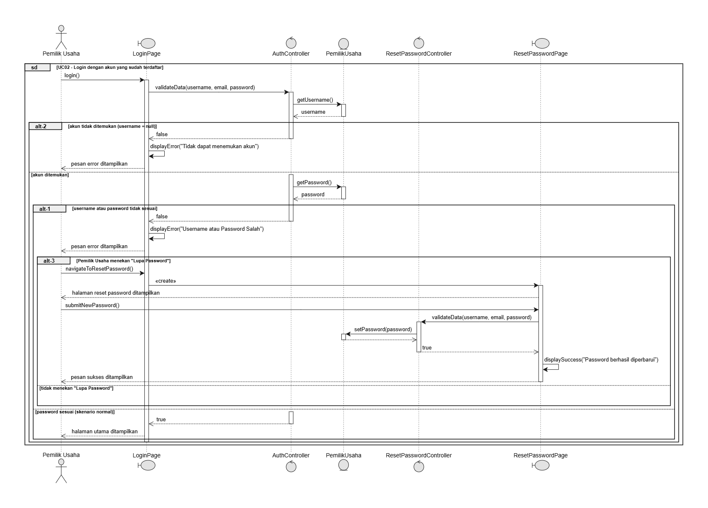
</p>
<p align="center">
<i>Gambar 6. Sequence Diagram UC02</i>
</p>


### 3.2.3 Diagram Kelas

<p align="center">

</p>
<p align="center">
<i>Gambar 7. Diagram Kelas Login dengan Akun yang Sudah Terdaftar</i>
</p>


## 3.3 Use Case Menambahkan Data Produk Baru

**ID Use Case:** *UC03*  
**Nama Use Case:** *Menambahkan Data Produk Baru*

Tabel 3.3. Identifikasi Kelas Use Case UC03

| No | Nama Kelas Perancangan | Nama Kelas Analisis Terkait |
|:--- | :--- | :--- |
| 1 | *PemilikUsaha* | *PemilikUsaha* |
| 2 | *Produk* | *Produk* |
| 3 | *BahanBaku* | *BahanBaku* |
| 4 | *ResepBahan* | *ResepBahan* |
| 5 | *AddProductPage* | *AddProductPage* |
| 6 | *MarginController* | *MarginController* |

### 3.3.2 Sequence Diagram

- **Skenario Normal dan Alternatif**

<p align="center">
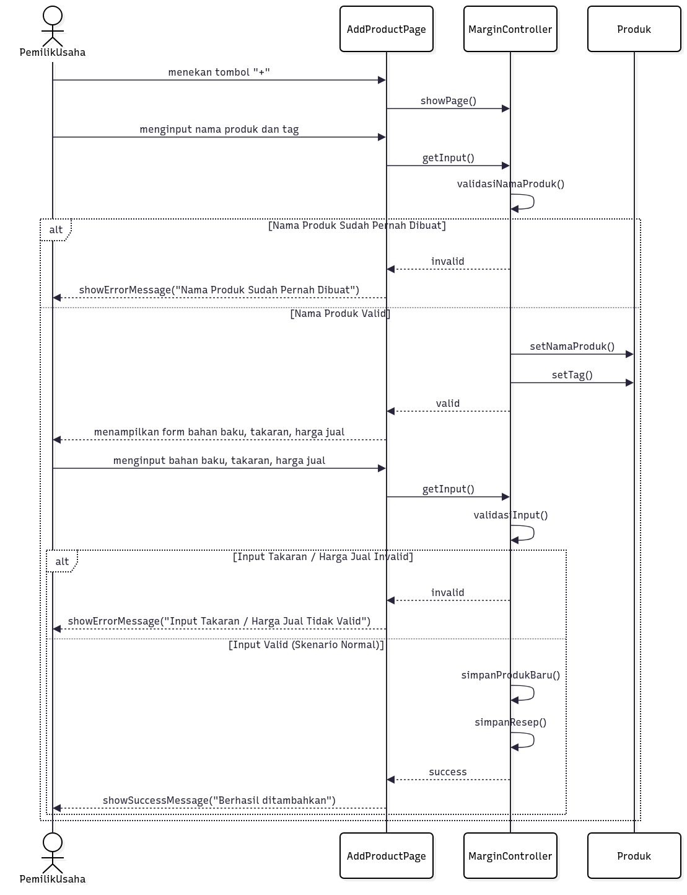
</p>
<p align="center">
<i>Gambar 8. Sequence Diagram UC03</i>
</p>

### 3.3.3 Diagram Kelas

<p align="center">

</p>
<p align="center">
<i>Gambar 9. Diagram Kelas Menambahkan Data Produk Baru</i>
</p>


## 3.4 Use Case Melihat Margin Keuntungan Produk

**ID Use Case:** *UC04*  
**Nama Use Case:** *Melihat Margin Keuntungan Produk*

### 3.4.1 Identifikasi Kelas

Tabel 3.4. Identifikasi Kelas Use Case UC04

| No | Nama Kelas Perancangan | Nama Kelas Analisis Terkait |
|:--- | :--- | :--- |
| 1 | *PemilikUsaha* | *PemilikUsaha* |
| 2 | *BahanBaku* | *BahanBaku* |
| 3 | *Produk* | *Produk* |
| 4 | *ResepBahan* | *ResepBahan* |
| 5 | *AddProductPage* | *AddProductPage* |
| 6 | *MarginController* | *MarginController* |

### 3.4.2 Sequence Diagram


- **Skenario Normal dan Alternatif**

<p align="center">

</p>
<p align="center">
<i>Gambar 10. Sequence Diagram UC04</i>
</p>


### 3.4.3 Diagram Kelas

<p align="center">

</p>
<p align="center">
<i>Gambar 11. Diagram Kelas Melihat Margin Keuntungan Produk</i>
</p>


## 3.5 Use Case Mengelola Harga Jual Produk

**ID Use Case:** *UC05*  
**Nama Use Case:** *Mengelola Harga Jual Produk*

### 3.5.1 Identifikasi Kelas

Tabel 3.5. Identifikasi Kelas Use Case UC05

| No | Nama Kelas Perancangan | Nama Kelas Analisis Terkait |
|:--- | :--- | :--- |
| 1 | *PemilikUsaha* | *PemilikUsaha* |
| 2 | *Produk* | *Produk* |
| 3 | *RiwayatHargaJual* | *RiwayatHargaJual* |
| 4 | *EditProductPage* | *EditProductPage* |
| 5 | *PriceController* | *PriceController* |

### 3.5.2 Sequence Diagram

- **Skenario Normal dan Alternatif**

<p align="center">
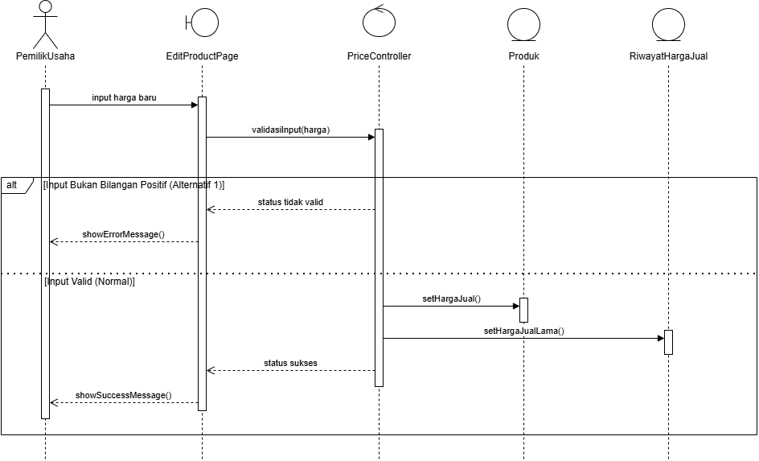
</p>
<p align="center">
<i>Gambar 12. Sequence Diagram UC05</i>
</p>

### 3.5.3 Diagram Kelas

<p align="center">
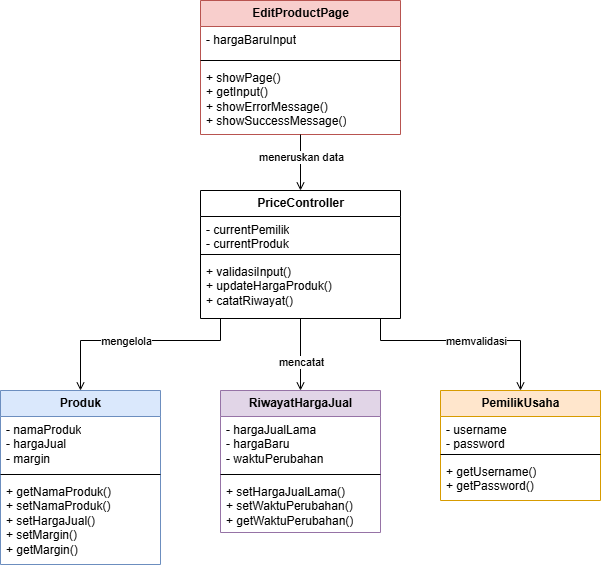
</p>
<p align="center">
<i>Gambar 13. Diagram Kelas Mengelola Harga Jual Produk</i>
</p>


## 3.6 Use Case Menelusuri Daftar Produk

**ID Use Case:** *UC06*  
**Nama Use Case:** *Menelusuri Daftar Produk*

### 3.6.1 Identifikasi Kelas

Tabel 3.6. Identifikasi Kelas Use Case UC06

| No | Nama Kelas Perancangan | Nama Kelas Analisis Terkait |
|:--- | :--- | :--- |
| 1 | *PemilikUsaha* | *PemilikUsaha* |
| 2 | *Produk* | *Produk* |
| 3 | *SearchProductPage* | *SearchProductPage* |
| 4 | *ProductSearchController* | *ProductSearchController* |

### 3.6.2 Sequence Diagram

- **Skenario Normal dan Alternatif**

<p align="center">
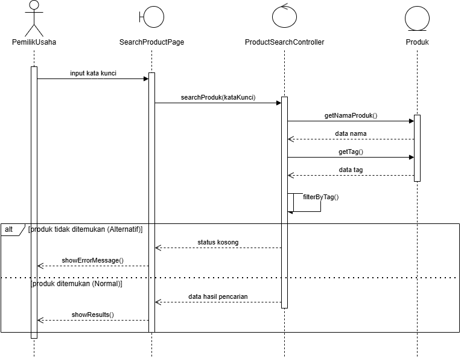
</p>
<p align="center">
<i>Gambar 14. Sequence Diagram UC06</i>
</p>

### 3.6.3 Diagram Kelas

<p align="center">
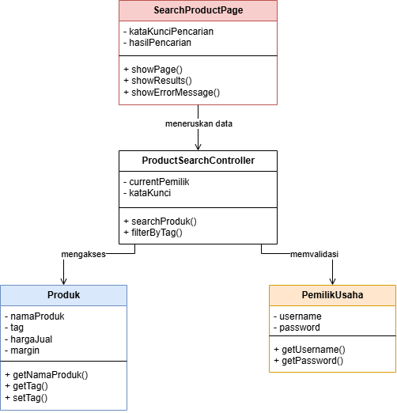
</p>
<p align="center">
<i>Gambar 15. Diagram Kelas Menelusuri Daftar Produk</i>
</p>


## 3.7 Use Case Melihat Perubahan Harga Jual

**ID Use Case:** *UC07*  
**Nama Use Case:** *Melihat Perubahan Harga Jual*

### 3.7.1 Identifikasi Kelas

Tabel 3.7. Identifikasi Kelas Use Case UC07

| No | Nama Kelas Perancangan | Nama Kelas Analisis Terkait |
|:--- | :--- | :--- |
| 1 | *PemilikUsaha* | *PemilikUsaha* |
| 2 | *Produk* | *Produk* |
| 3 | *RiwayatHargaJual* | *RiwayatHargaJual* |
| 4 | *PriceHistoryPage* | *PriceHistoryPage* |
| 5 | *PriceHistoryController* | *PriceHistoryController* |

### 3.7.2 Sequence Diagram

- **Skenario Normal dan Alternatif**

<p align="center">
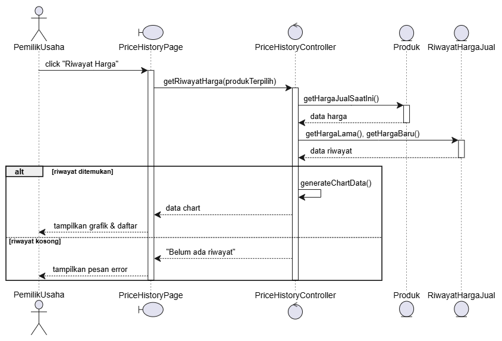
</p>
<p align="center">
<i>Gambar 16. Sequence Diagram UC07</i>
</p>

### 3.7.3 Diagram Kelas

<p align="center">
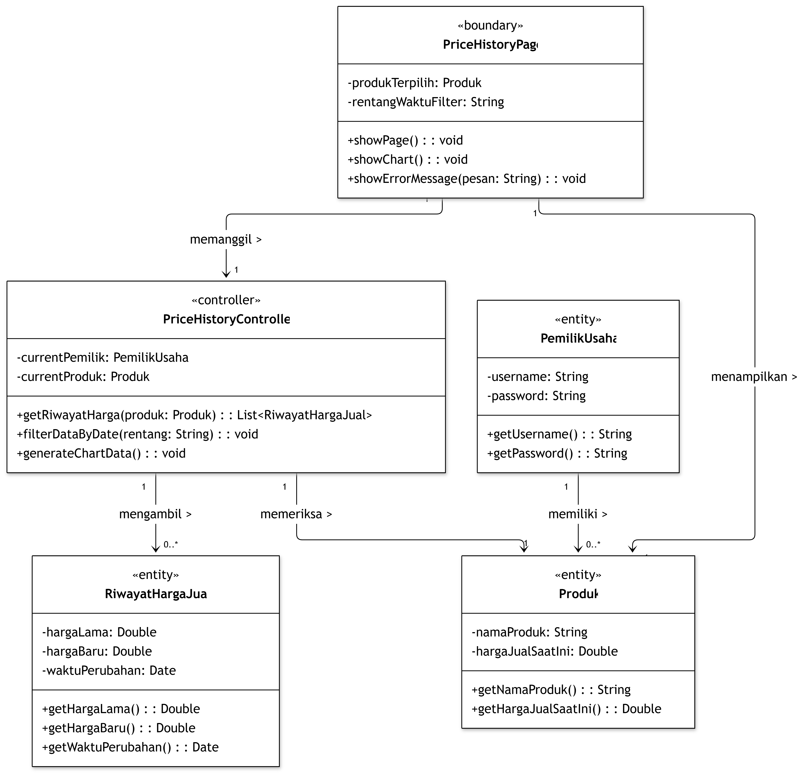
</p>
<p align="center">
<i>Gambar 17. Diagram Kelas Melihat Perubahan Harga Jual</i>
</p>


## 3.8 Use Case Memantau Tren Harga Bahan Baku

**ID Use Case:** *UC08*  
**Nama Use Case:** *Memantau Tren Harga Bahan Baku*

### 3.8.1 Identifikasi Kelas

Tabel 3.8. Identifikasi Kelas Use Case UC08

| No | Nama Kelas Perancangan | Nama Kelas Analisis Terkait |
|:--- | :--- | :--- |
| 1 | *PemilikUsaha* | *PemilikUsaha* |
| 2 | *BahanBaku* | *BahanBaku* |
| 3 | *RiwayatHargaBahanBaku* | *RiwayatHargaBahanBaku* |
| 4 | *TrenBahanBakuPage* | *TrenBahanBakuPage* |
| 5 | *TrenBahanBakuController* | *TrenBahanBakuController* |

### 3.8.2 Sequence Diagram

- **Skenario Normal dan Alternatif**

<p align="center">
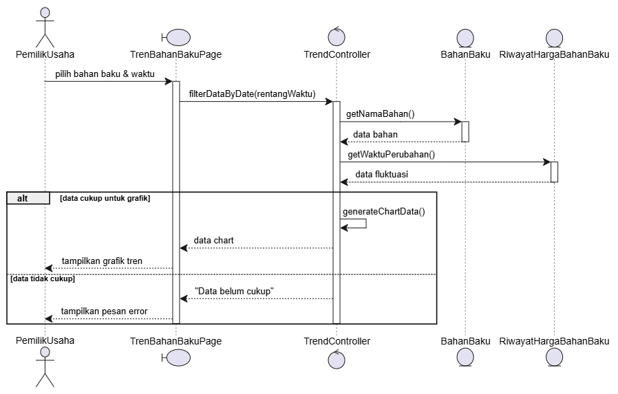
</p>
<p align="center">
<i>Gambar 18. Sequence Diagram UC08</i>
</p>


### 3.8.3 Diagram Kelas

<p align="center">

</p>
<p align="center">
<i>Gambar 19. Diagram Kelas Memantau Tren Harga Bahan Baku</i>
</p>


## 3.9 Use Case Menerima Notifikasi Kerugian Produk

**ID Use Case:** *UC09*  
**Nama Use Case:** *Menerima Notifikasi Kerugian Produk*

### 3.9.1 Identifikasi Kelas

Tabel 3.9. Identifikasi Kelas Use Case UC09

| No | Nama Kelas Perancangan | Nama Kelas Analisis Terkait |
|:--- | :--- | :--- |
| 1 | *PemilikUsaha* | *PemilikUsaha* |
| 2 | *Produk* | *Produk* |
| 3 | *BahanBaku* | *BahanBaku* |
| 4 | *Notifikasi* | *Notifikasi* |
| 5 | *PushNotificationUI* | *PushNotificationUI* |
| 6 | *NotifikasiController* | *NotifikasiController* |
| 7 | *EditProductPage* | *EditProductPage* |
| 8 | *-* | *HomePage* |


### 3.9.2 Sequence Diagram

- **Skenario Normal dan Alternatif**

<p align="center">
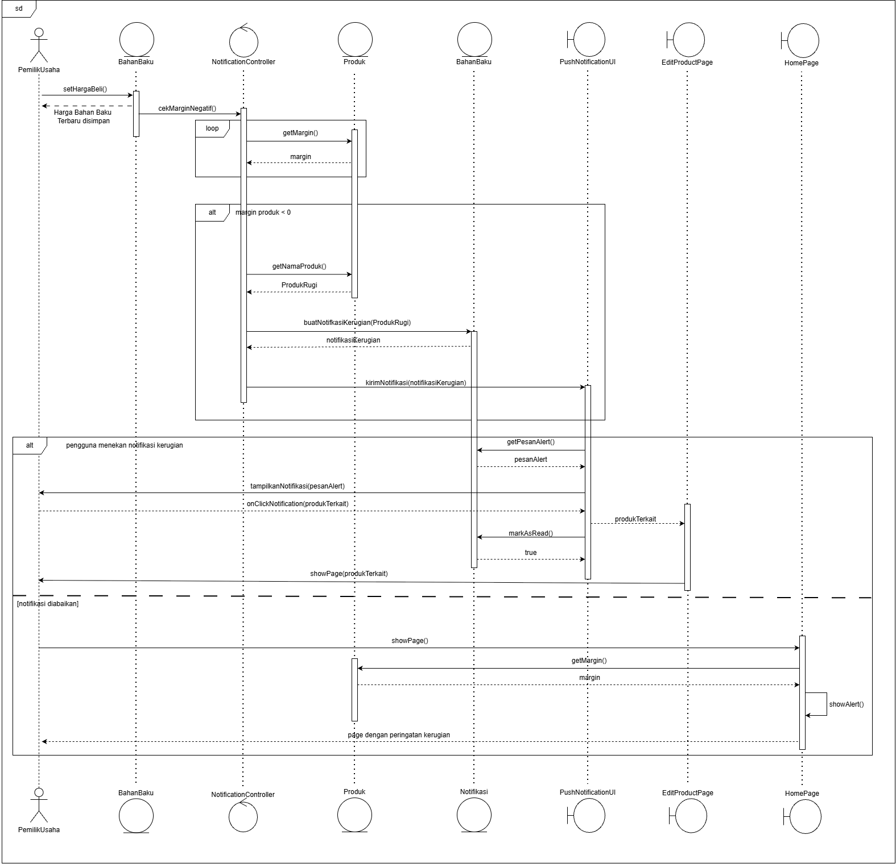
</p>
<p align="center">
<i>Gambar 20. Sequence Diagram [UC09]</i>
</p>

### 3.9.3 Diagram Kelas

<p align="center">
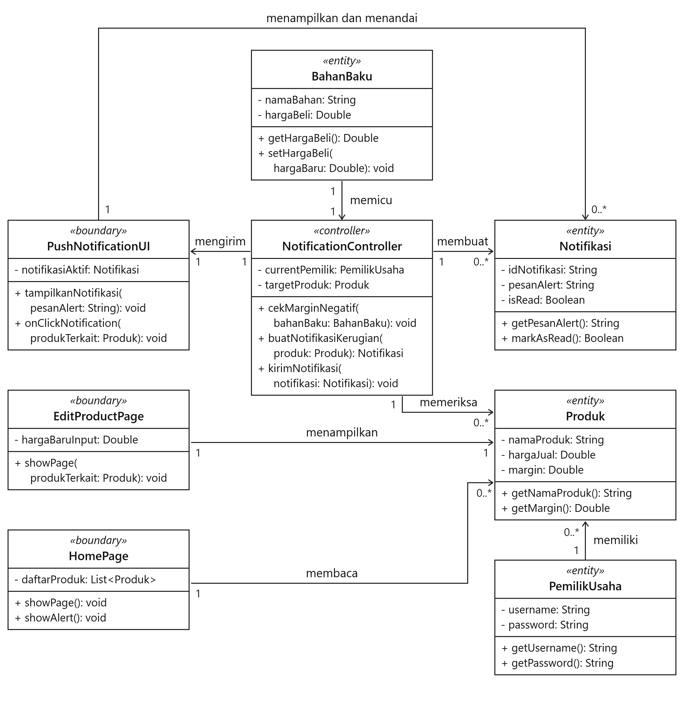
</p>
<p align="center">
<i>Gambar 21. Diagram Kelas Menerima Notifikasi Kerugian Produk</i>
</p>

## 3.10 Use Case Menerima Notifikasi Perubahan Harga Bahan Baku

**ID Use Case:** *UC10*  
**Nama Use Case:** *Menerima Notifikasi Perubahan Harga Bahan Baku*

### 3.10.1 Identifikasi Kelas

Tabel 3.10. Identifikasi Kelas Use Case UC10

| No | Nama Kelas Perancangan | Nama Kelas Analisis Terkait |
|:--- | :--- | :--- |
|:--- | :--- | :--- |
| 1 | *PemilikUsaha* | *PemilikUsaha* |
| 2 | *Produk* | *Produk* |
| 3 | *BahanBaku* | *BahanBaku* |
| 4 | *Notifikasi* | *Notifikasi* |
| 5 | *PushNotificationUI* | *PushNotificationUI* |
| 6 | *NotifikasiController* | *NotifikasiController* |
| 7 | *EditProductPage* | *EditProductPage* |
| 8 | *-* | *HomePage* |

### 3.10.2 Sequence Diagram

- **Skenario Normal dan Alternatif**

<p align="center">
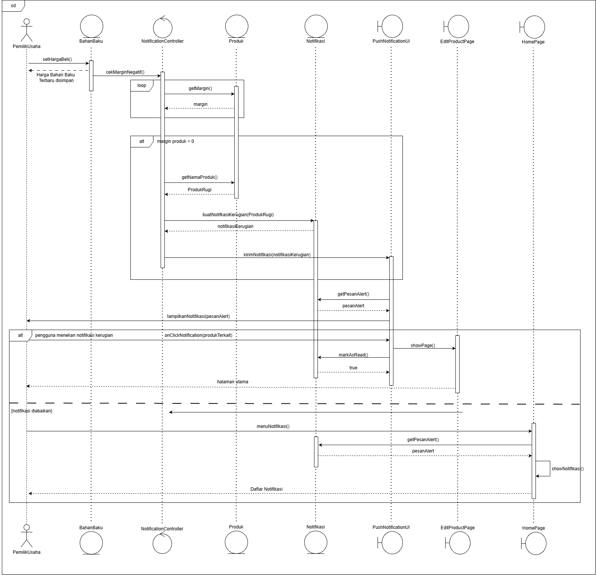
</p>
<p align="center">
<i>Gambar 22. Sequence Diagram [UC10]</i>
</p>

### 3.10.3 Diagram Kelas

<p align="center">
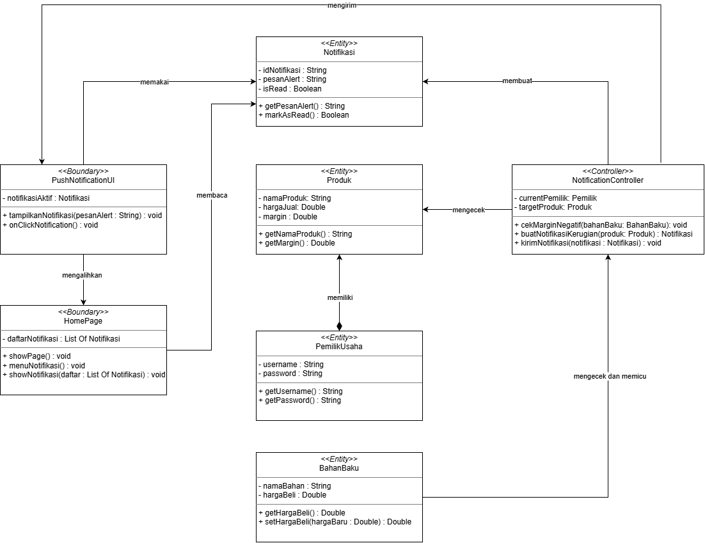
</p>
<p align="center">
<i>Gambar 23. Diagram Kelas Menerima Notifikasi Perubahan Harga Bahan Baku</i>
</p>


## 3.11 Use Case Mengubah Data Akun

**ID Use Case:** *UC11*  
**Nama Use Case:** *Mengubah Data Akun*

### 3.11.1 Identifikasi Kelas

Tabel 3.11. Identifikasi Kelas Use Case UC11

| No | Nama Kelas Perancangan | Nama Kelas Analisis Terkait |
|:--- | :--- | :--- |
| 1 | *PemilikUsaha* | *PemilikUsaha* |
| 2 | *ProfilePage* | *ProfilePage* |
| 3 | *ProfileController* | *ProfileController* |

### 3.11.2 Sequence Diagram

- **Skenario Normal**

<p align="center">
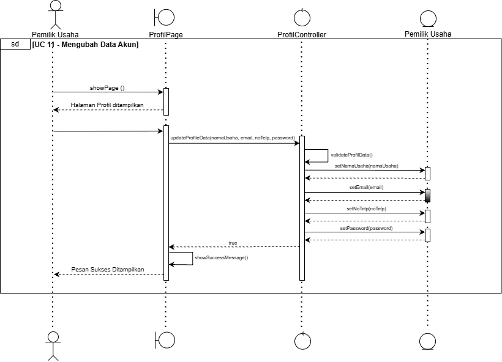
</p>
<p align="center">
<i>Gambar 24. Sequence Diagram UC11</i>
</p>

### 3.11.3 Diagram Kelas

<p align="center">

</p>
<p align="center">
<i>Gambar 25. Diagram Kelas Mengubah Data Akun</i>
</p>

## 3.12 Use Case Keluar dari Akun

**ID Use Case:** *UC12*  
**Nama Use Case:** *Keluar dari Akun*

### 3.12.1 Identifikasi Kelas

Tabel 3.12. Identifikasi Kelas Use Case UC12

| No | Nama Kelas Perancangan | Nama Kelas Analisis Terkait |
|:--- | :--- | :--- |
| 1 | *ProfilePage* | *ProfilePage* |
| 2 | *ProfileController* | *ProfileController* |

### 3.12.2 Sequence Diagram

- **Skenario Normal**

<p align="center">
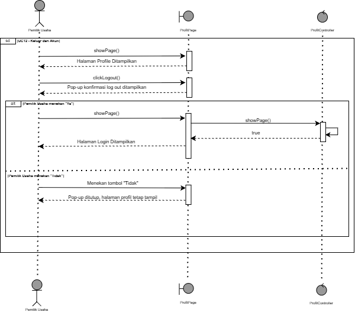
</p>
<p align="center">
<i>Gambar 26. Sequence Diagram UC12</i>
</p>

### 3.12.3 Diagram Kelas

<p align="center">

</p>
<p align="center">
<i>Gambar 27. Diagram Kelas Keluar dari Akun</i>
</p>

<br>

---

# BAB 4: Diagram Kelas Keseluruhan

## 4.1 Diagram Kelas

<p align="center">
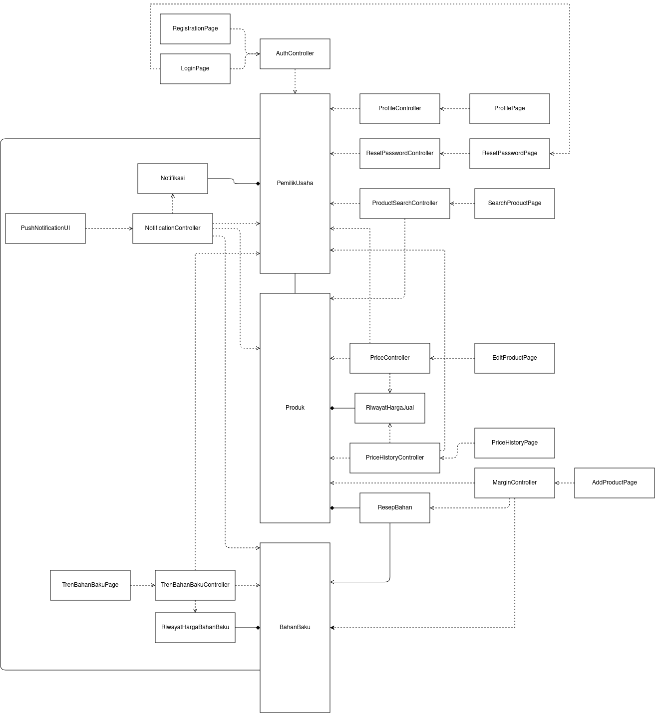
</p>
<p align="center">
<i>Gambar 4.1. Diagram Kelas Perancangan Keseluruhan Pross</i>
</p>

Tabel 4.1. Daftar Kelas Perancangan Keseluruhan

| ID Kelas | Nama Kelas | Atribut | Metode/Operasi |
| :--- | :--- | :--- | :--- |
| *C01* | *PemilikUsaha* | *namaUsaha, email, noTelp, password, username* | *createUser(), getNamaUsaha(), setNamaUsaha(), getEmail() setEmail(), getNoTelp(), setNoTelp(), getPassword(), setPassword(), getUsername()* |
| *C02* | *Produk* | *namaProduk, tag, hargaJual, margin* | *getNamaProduk(), setNamaProduk(), getTag(), setTag(), getHargaJual(), setHargaJual(), setMargin(), getMargin()* |
| *C03* | *BahanBaku* | *namaBahan, hargaBeli* | *getNamaBahan(), getHargaBeli(), setHargaBeli()* |
| *C04* | *ResepBahan* | *takaran* | *getTakaran(), setTakaran()* |
| *C05* | *RegistrationPage* | *usernameInput, emailInput, passwordInput* | *submitForm(), displaySuccess(), displayError()* |
| *C06* | *AuthController* | *-* | *validateData()* |
| *C07* | *LoginPage* | *usernameInput, passwordInput* | *login(), navigateToResetPassword(), displayError()* |
| *C08* | *ResetPasswordPage* | *emailInput, newPasswordInput, confirmNewPassword* | *submitResetRequest(), submitNewPassword(), displayError(), displaySuccess()* |
| *C09* | *ResetPasswordController* | *-* | *validateData(), resetPassword()* |
| *C10* | *AddProductPage* | *inputNamaProduk, inputTag, inputTakaran, inputHargaJual* | *showPage(), getInput(), showErrorMessage(), showSuccessMessage()* |
| *C11* | *MarginController* | *currentProduk, currentResep* | *validasiNamaProduk(), validasiInput(), simpanProdukBaru(), simpanResep()* |
| *C12* | *EditProductPage* | *hargaBaruInput* | *showPage(), getInput(), showSuccessMessage(), showErrorMessage()* |
| *C13* | *PriceController* | *currentPemilik, currentProduk* | *validasiInput(), updateHargaProduk(), catatRiwayat()* |
| *C14* | *RiwayatHargaBahanBaku* | *hargaBeliLama, waktuPerubahan* | *getHargaBeliLama(), getWaktuPerubahan()* |
| *C15* | *TrenBahanBakuPage* | *bahanBakuTerpilih, rentangWaktuFilter* | *showPage(), showChart(), showErrorMessage()* |
| *C16* | *TrenBahanBakuController* | *currentPemilik, currentBahanBaku* | *getRiwayatHarga(), filterDataByDate(), generateChartData()* |
| *C17* | *Notifikasi* | *idNotifikasi, pesanAlert, waktuKirim, isRead* | *getPesanAlert(), markAsRead()* |
| *C18* | *PushNotificationUI* | *notifikasiAktif* | *tampilkanNotifikasi(), onClickNotification()* |
| *C19* | *NotificationController* | *currentPemilik, targetProduk* | *cekMarginNegatif(), buatNotifikasiKerugian(), kirimNotifikasi()* |
| *C20* | *RiwayatHargaJual* | *hargaJualLama, hargaBaru, waktuPerubahan* |setHargaJualLama(), setWaktuPerubahan(), getHargaJualLama(), getHargaBaru(), getWaktuPerubahan()|
| *C21* | *SearchProductPage* | *kataKunciPencarian, hasilPencarian* | showPage(), showResults(), showErrorMessage()|
| *C22* | *ProductSearchController* | *currentPemilik, kataKunci* | searchProduk(), filterByTag()|
| *C23* | *PriceHistoryPage* | *produkTerpilih, rentangWaktuFilter* | showPage(), showChart(), showErrorMessage()|
| *C24* | *PriceHistoryController* | *currentPemilik, currentProduk* | getRiwayatHarga(), filterDataByDate(), generateChartData()|
| *C25* | *ProfilePage* | *namaUsahaInput, emailInput, noTelpInput, passwordInput* | *showPage(), getProfileInput(), clickLogout(), showSuccessMessage(), showErrorMessage()* |
| *C26* | *ProfileController* | *currentPemilik* | *validateProfileData(), updateProfileData(), processLogout(), endSession()* |

---

# BAB 5: Perancangan Rinci Kelas

Bagian ini diisi dengan daftar seluruh kelas dalam tabel berikut:

Tabel 5.1. Daftar Kelas Perancangan dan Kelas Analisis Terkait

| No | Nama Kelas Perancangan | Nama Kelas Analisis Terkait |
| :--- | :--- | :--- |
| 1 | *PemilikUsaha* | *PemilikUsaha* |
| 2 | *Produk* | *Produk* |
| 3 | *BahanBaku* | *BahanBaku* |
| 4 | *ResepBahan* | *ResepBahan* |
| 5 | *RegistrationPage* | *RegistrationPage* |
| 6 | *AuthController* | *AuthController* |
| 7 | *LoginPage* | *LoginPage* |

Untuk **setiap kelas**, identifikasi operasi berdasarkan tanggung jawab kelas beserta *visibility*-nya, serta atribut beserta *visibility* dan tipenya. Buat subbab tersendiri untuk setiap kelas.

## 5.1 Kelas PemilikUsaha

**Nama Kelas:** *PemilikUsaha*  
**ID Kelas:** *C01*

Tabel 5.1.1. Operasi Kelas PemilikUsaha

| Nama Operasi | Visibility (private, public) | Keterangan |
| :--- | :--- | :--- |
| *+ createUser(): Void* | *public* | *Membuat akun pemilik usaha baru dengan melakukan hash terhadap password lalu menyimpan data akun ke basis data. Dipanggil AuthController setelah data registrasi lolos validasi.* |
| *+ getNamaUsaha(): String* | *public* | *Mengambil nama usaha.* |
| *+ setNamaUsaha(namaUsaha: String): Void* | *public* | *Mengubah nama usaha dan menyimpannya ke basis data.* |
| *+ getEmail(): String* | *public* | *Mengambil alamat email.* |
| *+ setEmail(email: String): Void* | *public* | *Mengubah email dan menyimpannya ke basis data.* |
| *+ getNoTelp(): String* | *public* | *Mengambil nomor telepon.* |
| *+ setNoTelp(noTelp: String): Void* | *public* | *Mengubah nomor telepon dan menyimpannya ke basis data.* |
| *+ getPassword(): String* | *public* | *Mengambil hash password untuk diverifikasi saat login.* |
| *+ setPassword(password: String): Void* | *public* | *Mengubah password: melakukan hash lalu menyimpannya ke basis data.* |
| *+ getUsername(): String* | *public* | *Mengambil username.* |
   
Tabel 5.1.2. Atribut Kelas PemilikUsaha

| Nama Atribut | Visibility (private, public) | Tipe |
| :--- | :--- | :--- |
| *namaUsaha* | *private* | *String* |
| *email* | *private* | *String* |
| *noTelp* | *private* | *String* |
| *password* | *private* | *String* |
| *username* | *private* | *String* |

### 5.1.1 Algoritma/Query

**Nama Kelas:** *PemilikUsaha*  
**Nama Operasi:** *createUser()*  
**ID Algoritma:** *Algo-C01-01*

```text
Procedure createUser()
    if (isEmpty(this.username) or isEmpty(this.email) or isEmpty(this.password)) then
        raise Error("Data akun tidak lengkap")
    hashedPassword ← HASH_FUNCTION(this.password)
    try
        DB_SERVICE.insertPemilikUsaha(this.username, this.email, hashedPassword,
                                      this.namaUsaha, this.noTelp)
        this.password ← hashedPassword
    catch DatabaseError as e
        raise Error("Gagal membuat akun: " + e.message)
```

Tabel 5.1.3. Query Operasi createUser()

| No Query | Query | Keterangan |
| :--- | :--- | :--- |
| *Q-C01-01* | `INSERT INTO tbl_pemilik_usaha (username, email, password_hash, nama_usaha, no_telp) VALUES (@username, @email, @passwordHash, @namaUsaha, @noTelp);` | *Menyimpan akun pemilik usaha baru ke basis data.* |

### 5.1.2 Algoritma/Query

**Nama Kelas:** *PemilikUsaha*  
**Nama Operasi:** *getNamaUsaha()*  
**ID Algoritma:** *Algo-C01-02*

```text
Function getNamaUsaha()
    → this.namaUsaha
```

### 5.1.3 Algoritma/Query

**Nama Kelas:** *PemilikUsaha*  
**Nama Operasi:** *setNamaUsaha(namaUsaha)*  
**ID Algoritma:** *Algo-C01-03*

```text
Procedure setNamaUsaha(namaUsaha)
    try
        DB_SERVICE.updateNamaUsahaByUsername(this.username, namaUsaha)
        this.namaUsaha ← namaUsaha
    catch DatabaseError as e
        raise Error("Gagal memperbarui nama usaha: " + e.message)
```

Tabel 5.1.4. Query Operasi setNamaUsaha()

| No Query | Query | Keterangan |
| :--- | :--- | :--- |
| *Q-C01-02* | `UPDATE tbl_pemilik_usaha SET nama_usaha = @namaUsaha WHERE username = @username;` | *Memperbarui nama usaha milik pemilik usaha.* |

### 5.1.4 Algoritma/Query

**Nama Kelas:** *PemilikUsaha*  
**Nama Operasi:** *getEmail()*  
**ID Algoritma:** *Algo-C01-04*

```text
Function getEmail()
    → this.email
```

### 5.1.5 Algoritma/Query

**Nama Kelas:** *PemilikUsaha*  
**Nama Operasi:** *setEmail(email)*  
**ID Algoritma:** *Algo-C01-05*

```text
Procedure setEmail(email)
    try
        DB_SERVICE.updateEmailByUsername(this.username, email)
        this.email ← email
    catch DatabaseError as e
        raise Error("Gagal memperbarui email: " + e.message)
```

Tabel 5.1.5. Query Operasi setEmail()

| No Query | Query | Keterangan |
| :--- | :--- | :--- |
| *Q-C01-03* | `UPDATE tbl_pemilik_usaha SET email = @email WHERE username = @username;` | *Memperbarui email milik pemilik usaha.* |

### 5.1.6 Algoritma/Query

**Nama Kelas:** *PemilikUsaha*  
**Nama Operasi:** *getNoTelp()*  
**ID Algoritma:** *Algo-C01-06*

```text
Function getNoTelp()
    → this.noTelp
```

### 5.1.7 Algoritma/Query

**Nama Kelas:** *PemilikUsaha*  
**Nama Operasi:** *setNoTelp(noTelp)*  
**ID Algoritma:** *Algo-C01-07*

```text
Procedure setNoTelp(noTelp)
    try
        DB_SERVICE.updateNoTelpByUsername(this.username, noTelp)
        this.noTelp ← noTelp
    catch DatabaseError as e
        raise Error("Gagal memperbarui nomor telepon: " + e.message)
```

Tabel 5.1.6. Query Operasi setNoTelp()

| No Query | Query | Keterangan |
| :--- | :--- | :--- |
| *Q-C01-04* | `UPDATE tbl_pemilik_usaha SET no_telp = @noTelp WHERE username = @username;` | *Memperbarui nomor telepon milik pemilik usaha.* |

### 5.1.8 Algoritma/Query

**Nama Kelas:** *PemilikUsaha*  
**Nama Operasi:** *getPassword()*  
**ID Algoritma:** *Algo-C01-08*

```text
Function getPassword()
    → this.password
```

### 5.1.9 Algoritma/Query

**Nama Kelas:** *PemilikUsaha*  
**Nama Operasi:** *setPassword(password)*  
**ID Algoritma:** *Algo-C01-09*

```text
Procedure setPassword(password)
    if (isEmpty(password)) then
        raise Error("Password tidak boleh kosong")
    hashedPassword ← HASH_FUNCTION(password)
    try
        DB_SERVICE.updatePasswordByUsername(this.username, hashedPassword)
        this.password ← hashedPassword
    catch DatabaseError as e
        raise Error("Gagal memperbarui password: " + e.message)
```

Tabel 5.1.7. Query Operasi setPassword()

| No Query | Query | Keterangan |
| :--- | :--- | :--- |
| *Q-C01-05* | `UPDATE tbl_pemilik_usaha SET password_hash = @passwordHash WHERE username = @username;` | *Memperbarui hash password milik pemilik usaha.* |

### 5.1.10 Algoritma/Query

**Nama Kelas:** *PemilikUsaha*  
**Nama Operasi:** *getUsername()*  
**ID Algoritma:** *Algo-C01-10*

```text
Function getUsername()
    → this.username
```

## 5.2 Kelas Produk

**Nama Kelas:** *Produk*  
**ID Kelas:** *C02*

Tabel 5.2.1. Operasi Kelas Produk

| Nama Operasi | Visibility (private, public) | Keterangan |
| :--- | :--- | :--- |
| *+ getNamaProduk(): String* | *public* | *Mengambil nama produk.* |
| *+ setNamaProduk(namaProduk: String): Void* | *public* | *Mengatur nama produk; nama tidak boleh kosong.* |
| *+ getTag(): List Of String* | *public* | *Mengambil daftar tag produk.* |
| *+ setTag(tag: List Of String): Void* | *public* | *Mengatur daftar tag setelah dinormalisasi (huruf kecil, tanpa spasi berlebih, tanpa duplikat).* |
| *+ getHargaJual(): Double* | *public* | *Mengambil harga jual produk.* |
| *+ setHargaJual(hargaJual: Double): Void* | *public* | *Mengatur harga jual; harus bilangan positif.* |
| *+ getMargin(): Double* | *public* | *Mengambil margin keuntungan (bernilai negatif bila rugi).* |
| *+ setMargin(margin: Double): Void* | *public* | *Mengatur margin hasil perhitungan MarginController.* |

Tabel 5.2.2. Atribut Kelas Produk

| Nama Atribut | Visibility (private, public) | Tipe |
| :--- | :--- | :--- |
| *namaProduk* | *private* | *String* |
| *tag* | *private* | *List Of String* |
| *hargaJual* | *private* | *Double* |
| *margin* | *private* | *Double* |

### 5.2.1 Algoritma/Query

**Nama Kelas:** *Produk*  
**Nama Operasi:** *getNamaProduk()*  
**ID Algoritma:** *Algo-C02-01*

```text
Function getNamaProduk()
    → this.namaProduk
```

### 5.2.2 Algoritma/Query

**Nama Kelas:** *Produk*  
**Nama Operasi:** *setNamaProduk(namaProduk)*  
**ID Algoritma:** *Algo-C02-02*

```text
Procedure setNamaProduk(namaProduk)
    if (isEmpty(TRIM(namaProduk))) then
        raise Error("Nama produk tidak boleh kosong")
    this.namaProduk ← TRIM(namaProduk)
```

### 5.2.3 Algoritma/Query

**Nama Kelas:** *Produk*  
**Nama Operasi:** *getTag()*  
**ID Algoritma:** *Algo-C02-03*

```text
Function getTag()
    → this.tag
```

### 5.2.4 Algoritma/Query

**Nama Kelas:** *Produk*  
**Nama Operasi:** *setTag(tag)*  
**ID Algoritma:** *Algo-C02-04*

```text
Procedure setTag(tag)
    normalized ← new List<String>
    for each t in tag
        t ← LOWERCASE(TRIM(t))
        if (not isEmpty(t) and not contains(normalized, t)) then
            add(normalized, t)
    this.tag ← normalized
```

### 5.2.5 Algoritma/Query

**Nama Kelas:** *Produk*  
**Nama Operasi:** *getHargaJual()*  
**ID Algoritma:** *Algo-C02-05*

```text
Function getHargaJual()
    → this.hargaJual
```

### 5.2.6 Algoritma/Query

**Nama Kelas:** *Produk*  
**Nama Operasi:** *setHargaJual(hargaJual)*  
**ID Algoritma:** *Algo-C02-06*

```text
Procedure setHargaJual(hargaJual)
    if (hargaJual = NULL or hargaJual <= 0) then
        raise Error("Masukkan bilangan positif")
    this.hargaJual ← hargaJual
```

### 5.2.7 Algoritma/Query

**Nama Kelas:** *Produk*  
**Nama Operasi:** *getMargin()*  
**ID Algoritma:** *Algo-C02-07*

```text
Function getMargin()
    → this.margin
```

### 5.2.8 Algoritma/Query

**Nama Kelas:** *Produk*  
**Nama Operasi:** *setMargin(margin)*  
**ID Algoritma:** *Algo-C02-08*

```text
Procedure setMargin(margin)
    this.margin ← margin
```

## 5.3 Kelas BahanBaku

**Nama Kelas:** *BahanBaku*  
**ID Kelas:** *C03*

Tabel 5.3.1. Operasi Kelas BahanBaku

| Nama Operasi | Visibility (private, public) | Keterangan |
| :--- | :--- | :--- |
| *+ getNamaBahan(): String* | *public* | *Mengambil nama bahan baku.* |
| *+ getHargaBeli(): Double* | *public* | *Mengambil harga beli bahan baku saat ini.* |
| *+ setHargaBeli(hargaBeli: Double): Void* | *public* | *Mengatur harga beli baru; harus bilangan positif. Pencatatan riwayat harga dan pemicu notifikasi dilakukan oleh kelas pemanggil (controller).* |

Tabel 5.3.2. Atribut Kelas BahanBaku

| Nama Atribut | Visibility (private, public) | Tipe |
| :--- | :--- | :--- |
| *namaBahan* | private | *String* |
| *hargaBeli* | private | *Double* |

### 5.3.1 Algoritma/Query

**Nama Kelas:** *BahanBaku*  
**Nama Operasi:** *getNamaBahan()*  
**ID Algoritma:** *Algo-C03-01*

```text
Function getNamaBahan()
    → this.namaBahan
```

### 5.3.2 Algoritma/Query

**Nama Kelas:** *BahanBaku*  
**Nama Operasi:** *getHargaBeli()*  
**ID Algoritma:** *Algo-C03-02*

```text
Function getHargaBeli()
    → this.hargaBeli
```

### 5.3.3 Algoritma/Query

**Nama Kelas:** *BahanBaku*  
**Nama Operasi:** *setHargaBeli(hargaBeli)*  
**ID Algoritma:** *Algo-C03-03*

```text
Procedure setHargaBeli(hargaBeli)
    if (hargaBeli = NULL or hargaBeli <= 0) then
        raise Error("Harga beli harus bilangan positif")
    this.hargaBeli ← hargaBeli
```

## 5.4 Kelas ResepBahan

**Nama Kelas:** *ResepBahan*  
**ID Kelas:** *C04*

Tabel 5.4.1. Operasi Kelas ResepBahan

| Nama Operasi | Visibility (private, public) | Keterangan |
| :--- | :--- | :--- |
| *+ getTakaran(): Double* | *public* | *Mengambil takaran bahan baku yang dipakai dalam satu resep produk.* |
| *+ setTakaran(takaran: Double): Void* | *public* | *Mengatur takaran; harus bilangan positif.* |

Tabel 5.4.2. Atribut Kelas ResepBahan

| Nama Atribut | Visibility (private, public) | Tipe |
| :--- | :--- | :--- |
| *takaran* | private | *Double* |


### 5.4.1 Algoritma/Query

**Nama Kelas:** *ResepBahan*  
**Nama Operasi:** *getTakaran()*  
**ID Algoritma:** *Algo-C04-01*

```text
Function getTakaran()
    → this.takaran
```

### 5.4.2 Algoritma/Query

**Nama Kelas:** *ResepBahan*  
**Nama Operasi:** *setTakaran(takaran)*  
**ID Algoritma:** *Algo-C04-02*

```text
Procedure setTakaran(takaran)
    if (takaran = NULL or takaran <= 0) then
        raise Error("Input Takaran / Harga Jual Tidak Valid")
    this.takaran ← takaran
```

## 5.5 Kelas RegistrationPage

**Nama Kelas:** *RegistrationPage*  
**ID Kelas:** *C05*

Tabel 5.5.1. Operasi Kelas RegistrationPage

| Nama Operasi | Visibility (private, public) | Keterangan |
| :--- | :--- | :--- |
| *+ submitForm(): Void* | *public* | *Mengambil isi form registrasi lalu mengirimkannya ke AuthController untuk divalidasi dan disimpan. Dipanggil saat tombol "Buat Akun" ditekan.* |
| *+ displaySuccess(message: String): Void* | *public* | *Menampilkan pesan bahwa akun berhasil dibuat.* |
| *+ displayError(message: String): Void* | *public* | *Menampilkan pesan kesalahan registrasi dan mengembalikan pengguna ke form registrasi.* |

Tabel 5.5.2. Atribut Kelas RegistrationPage

| Nama Atribut | Visibility (private, public) | Tipe |
| :--- | :--- | :--- |
| *usernameInput* | private | *String* |
| *emailInput* | private | *String* |
| *passwordInput* | private | *String* |

### 5.5.1 Algoritma/Query

**Nama Kelas:** *RegistrationPage*  
**Nama Operasi:** *submitForm()*  
**ID Algoritma:** *Algo-C05-01*

```text
Procedure submitForm()
    username ← TRIM(this.usernameInput.getText())
    email    ← TRIM(this.emailInput.getText())
    password ← this.passwordInput.getText()
    try
        isValid ← AUTH_CONTROLLER.validateData(username, email, password)
        if (isValid) then
            displaySuccess("Akun berhasil dibuat")
            NAVIGATOR.goTo(HomePage)
    catch ValidationError as e
        displayError(e.message)
```

### 5.5.2 Algoritma/Query

**Nama Kelas:** *RegistrationPage*  
**Nama Operasi:** *displaySuccess(message)*  
**ID Algoritma:** *Algo-C05-02*

```text
Procedure displaySuccess(message)
    this.messageLabel.setText(message)
    this.messageLabel.setVisible(true)
```

### 5.5.3 Algoritma/Query

**Nama Kelas:** *RegistrationPage*  
**Nama Operasi:** *displayError(message)*  
**ID Algoritma:** *Algo-C05-03*

```text
Procedure displayError(message)
    this.errorLabel.setText(message)
    this.errorLabel.setVisible(true)
```

## 5.6 Kelas AuthController

**Nama Kelas:** *AuthController*  
**ID Kelas:** *C06*

Tabel 5.6.1. Operasi Kelas AuthController

| Nama Operasi | Visibility (private, public) | Keterangan |
| :--- | :--- | :--- |
| *+ validateData(username: String, email: String, password: String): Boolean* | *public* | *Memvalidasi data pada dua mode. Mode registrasi (email tidak NULL): memeriksa kelengkapan data, keunikan akun, dan kekuatan password, lalu membuat akun melalui PemilikUsaha.createUser(). Mode login (email = NULL): memeriksa keberadaan akun dan kecocokan password. Mengembalikan true bila berhasil; bila gagal melempar ValidationError berisi pesan untuk ditampilkan oleh page.* |

Tabel 5.6.2. Atribut Kelas AuthController

| Nama Atribut | Visibility (private, public) | Tipe |
| :--- | :--- | :--- |
| *-* | *-* | *-* |

### 5.6.1 Algoritma/Query

**Nama Kelas:** *AuthController*  
**Nama Operasi:** *validateData(username, email, password)*  
**ID Algoritma:** *Algo-C06-01*

```text
Function validateData(username, email, password)

    if (email != NULL) then
        if (isEmpty(username) or isEmpty(email) or isEmpty(password)) then
            raise ValidationError("Data Registrasi Belum Lengkap")

        count ← DB_SERVICE.countPemilikByUsernameOrEmail(username, email)
        if (count > 0) then
            raise ValidationError("Akun sudah dibuat")

        if (LENGTH(password) < 8 or not HAS_LETTER(password) or not HAS_DIGIT(password)) then
            raise ValidationError("Password terlalu lemah")

        pemilik ← new PemilikUsaha(username, email, password)
        pemilik.createUser()
        → true

    else
        record ← DB_SERVICE.findPemilikByUsername(username)
        if (record = NULL) then
            raise ValidationError("Tidak dapat menemukan akun")

        pemilik ← new PemilikUsaha(record)

        if (not COMPARE_HASH(password, pemilik.getPassword())) then
            raise ValidationError("Username atau Password Salah")

        → true
```

Tabel 5.6.3. Query Operasi validateData()

| No Query | Query | Keterangan |
| :--- | :--- | :--- |
| *Q-C06-01* | `SELECT COUNT(1) FROM tbl_pemilik_usaha WHERE LOWER(username) = LOWER(@username) OR LOWER(email) = LOWER(@email);` | *Memeriksa apakah username atau email sudah terdaftar saat registrasi.* |
| *Q-C06-02* | `SELECT username, email, password_hash, nama_usaha, no_telp FROM tbl_pemilik_usaha WHERE username = @username LIMIT 1;` | *Mengambil data akun berdasarkan username untuk verifikasi login.* |
| *Q-C01-01* | `INSERT INTO tbl_pemilik_usaha (username, email, password_hash, nama_usaha, no_telp) VALUES (@username, @email, @passwordHash, @namaUsaha, @noTelp);` | *Menyimpan akun baru melalui PemilikUsaha.createUser().* |

## 5.7 Kelas LoginPage

**Nama Kelas:** *LoginPage*  
**ID Kelas:** *C07*

Tabel 5.7.1. Operasi Kelas LoginPage

| Nama Operasi | Visibility (private, public) | Keterangan |
| :--- | :--- | :--- |
| *+ login(): Void* | *public* | *Mengambil username dan password dari form lalu mengirimkannya ke AuthController untuk diverifikasi. Dipanggil saat tombol "Login" ditekan.* |
| *+ navigateToResetPassword(): Void* | *public* | *Mengarahkan pengguna ke halaman reset password. Dipanggil saat tombol "Lupa Password" ditekan.* |
| *+ displayError(pesan: String): Void* | *public* | *Menampilkan pesan kesalahan login.* |

Tabel 5.7.2. Atribut Kelas LoginPage

| Nama Atribut | Visibility (private, public) | Tipe |
| :--- | :--- | :--- |
| *usernameInput* | private | *String* |
| *passwordInput* | private | *String* |


### 5.7.1 Algoritma/Query

**Nama Kelas:** *LoginPage*  
**Nama Operasi:** *login()*  
**ID Algoritma:** *Algo-C07-01*

```text
Procedure login()
    username ← TRIM(this.usernameInput.getText())
    password ← this.passwordInput.getText()
    try
        isValid ← AUTH_CONTROLLER.validateData(username, NULL, password)
        if (isValid) then
            NAVIGATOR.goTo(HomePage)
    catch ValidationError as e
        displayError(e.message)
```

### 5.7.2 Algoritma/Query

**Nama Kelas:** *LoginPage*  
**Nama Operasi:** *navigateToResetPassword()*  
**ID Algoritma:** *Algo-C07-02*

```text
Procedure navigateToResetPassword()
    NAVIGATOR.goTo(ResetPasswordPage)
```

### 5.7.3 Algoritma/Query

**Nama Kelas:** *LoginPage*  
**Nama Operasi:** *displayError(pesan)*  
**ID Algoritma:** *Algo-C07-03*

```text
Procedure displayError(pesan)
    this.passwordInput.clear()
    this.errorLabel.setText(pesan)
    this.errorLabel.setVisible(true)
```

## 5.8 Kelas ResetPasswordPage
 
**Nama Kelas:** *ResetPasswordPage*  
**ID Kelas:** *C08*
 
Tabel 5.8.1. Operasi Kelas ResetPasswordPage
 
| Nama Operasi | Visibility (private, public) | Keterangan |
| :--- | :--- | :--- |
| *+ submitResetRequest(): Void* | *public* | *Mengambil email dari form lalu mengirimkannya ke ResetPasswordController untuk memastikan akun terdaftar. Bila akun ditemukan, kolom password baru ditampilkan dan dipanggil saat tombol "Kirim" ditekan.* |
| *+ submitNewPassword(): Void* | *public* | *Mengambil password baru beserta konfirmasinya, memastikan keduanya sama, lalu mengirimkannya ke ResetPasswordController untuk divalidasi dan disimpan serta dipanggil saat tombol "Simpan Password" ditekan.* |
| *+ displayError(pesan: String): Void* | *public* | *Menampilkan pesan kesalahan reset password.* |
| *+ displaySuccess(pesan: String): Void* | *public* | *Menampilkan pesan bahwa password berhasil diperbarui.* |
 
Tabel 5.8.2. Atribut Kelas ResetPasswordPage
 
| Nama Atribut | Visibility (private, public) | Tipe |
| :--- | :--- | :--- |
| *emailInput* | private | *String* |
| *newPasswordInput* | private | *String* |
| *confirmNewPassword* | private | *String* |
 
### 5.8.1 Algoritma/Query
 
**Nama Kelas:** *ResetPasswordPage*  
**Nama Operasi:** *submitResetRequest()*  
**ID Algoritma:** *Algo-C08-01*
 
```text
Procedure submitResetRequest()
    email ← TRIM(this.emailInput.getText())
    try
        isValid ← RESET_PASSWORD_CONTROLLER.validateData(NULL, email, NULL)
        if (isValid) then
            this.newPasswordInput.setVisible(true)
            this.confirmNewPassword.setVisible(true)
    catch ValidationError as e
        displayError(e.message)
```
 
### 5.8.2 Algoritma/Query
 
**Nama Kelas:** *ResetPasswordPage*  
**Nama Operasi:** *submitNewPassword()*  
**ID Algoritma:** *Algo-C08-02*
 
```text
Procedure submitNewPassword()
    email       ← TRIM(this.emailInput.getText())
    newPassword ← this.newPasswordInput.getText()
    confirm     ← this.confirmNewPassword.getText()
    if (newPassword != confirm) then
        displayError("Konfirmasi password tidak sama")
    else
        try
            isValid ← RESET_PASSWORD_CONTROLLER.validateData(NULL, email, newPassword)
            if (isValid) then
                displaySuccess("Password berhasil diperbarui")
        catch ValidationError as e
            displayError(e.message)
```
 
### 5.8.3 Algoritma/Query
 
**Nama Kelas:** *ResetPasswordPage*  
**Nama Operasi:** *displayError(pesan)*  
**ID Algoritma:** *Algo-C08-03*
 
```text
Procedure displayError(pesan)
    this.newPasswordInput.clear()
    this.confirmNewPassword.clear()
    this.errorLabel.setText(pesan)
    this.errorLabel.setVisible(true)
```
 
### 5.8.4 Algoritma/Query
 
**Nama Kelas:** *ResetPasswordPage*  
**Nama Operasi:** *displaySuccess(pesan)*  
**ID Algoritma:** *Algo-C08-04*
 
```text
Procedure displaySuccess(pesan)
    this.messageLabel.setText(pesan)
    this.messageLabel.setVisible(true)
```
 
## 5.9 Kelas ResetPasswordController
 
**Nama Kelas:** *ResetPasswordController*  
**ID Kelas:** *C09*
 
Tabel 5.9.1. Operasi Kelas ResetPasswordController
 
| Nama Operasi | Visibility (private, public) | Keterangan |
| :--- | :--- | :--- |
| *+ validateData(username: String, email: String, password: String): Boolean* | *public* | *Memvalidasi permintaan reset password pada dua mode (username dan password boleh NULL). Bila password NULL: hanya memeriksa keberadaan akun berdasarkan email. Jika password tidak NULL maka memeriksa kekuatan password lalu memanggil resetPassword() dan mengembalikan true bila berhasil. Jila gagal akan melempar ValidationError berisi pesan untuk ditampilkan oleh page.* |
| *+ resetPassword(email: String, password: String): Void* | *public* | *Mengganti password akun yang terkait dengan email tertentu melalui PemilikUsaha.setPassword()dan Dipanggil oleh validateData() setelah semua pemeriksaan lolos.* |
 
Tabel 5.9.2. Atribut Kelas ResetPasswordController
 
| Nama Atribut | Visibility (private, public) | Tipe |
| :--- | :--- | :--- |
| *-* | *-* | *-* |
 
### 5.9.1 Algoritma/Query
 
**Nama Kelas:** *ResetPasswordController*  
**Nama Operasi:** *validateData(username, email, password)*  
**ID Algoritma:** *Algo-C09-01*
 
```text
Function validateData(username, email, password)
    if (isEmpty(email)) then
        raise ValidationError("Email tidak boleh kosong")
 
    record ← DB_SERVICE.findPemilikByEmail(email)
    if (record = NULL) then
        raise ValidationError("Tidak dapat menemukan akun")
 
    if (username != NULL and LOWER(username) != LOWER(record.username)) then
        raise ValidationError("Tidak dapat menemukan akun")
 
    if (password != NULL) then
        if (LENGTH(password) < 8 or not HAS_LETTER(password) or not HAS_DIGIT(password)) then
            raise ValidationError("Password terlalu lemah")
        resetPassword(email, password)
 
    → true
```
 
Tabel 5.9.3. Query Operasi validateData()
 
| No Query | Query | Keterangan |
| :--- | :--- | :--- |
| *Q-C09-01* | `SELECT username, email FROM tbl_pemilik_usaha WHERE LOWER(email) = LOWER(@email) LIMIT 1;` | *Mencari akun berdasarkan email untuk keperluan reset password.* |
 
### 5.9.2 Algoritma/Query
 
**Nama Kelas:** *ResetPasswordController*  
**Nama Operasi:** *resetPassword(email, password)*  
**ID Algoritma:** *Algo-C09-02*
 
```text
Procedure resetPassword(email, password)
    record ← DB_SERVICE.findPemilikByEmail(email)
    pemilik ← new PemilikUsaha(record)
    pemilik.setPassword(password)
```
 
Tabel 5.9.4. Query Operasi resetPassword()
 
| No Query | Query | Keterangan |
| :--- | :--- | :--- |
| *Q-C09-01* | `SELECT username, email FROM tbl_pemilik_usaha WHERE LOWER(email) = LOWER(@email) LIMIT 1;` | *Mengambil akun yang akan diganti passwordnya.* |
| *Q-C01-05* | `UPDATE tbl_pemilik_usaha SET password_hash = @passwordHash WHERE username = @username;` | *Menyimpan hash password baru melalui PemilikUsaha.setPassword().* |
 
## 5.10 Kelas AddProductPage
 
**Nama Kelas:** *AddProductPage*  
**ID Kelas:** *C10*
 
Tabel 5.10.1. Operasi Kelas AddProductPage
 
| Nama Operasi | Visibility (private, public) | Keterangan |
| :--- | :--- | :--- |
| *+ showPage(): Void* | *public* | *Menampilkan form tambah produk. Pada tahap awal hanya kolom nama produk dan tag yang ditampilkan dan Dipanggil saat tombol "+" ditekan.* |
| *+ getInput(): Void* | *public* | *Mengambil isian form lalu mengirimkannya ke MarginController memvalidasi nama produk dan tag serta bahan baku, takaran, dan harga jual divalidasi dan disimpan.* |
| *+ showErrorMessage(pesan: String): Void* | *public* | *Menampilkan pesan kesalahan input produk.* |
| *+ showSuccessMessage(pesan: String): Void* | *public* | *Menampilkan pesan bahwa produk berhasil ditambahkan beserta data harga dan margin produk.* |
 
Tabel 5.10.2. Atribut Kelas AddProductPage
 
| Nama Atribut | Visibility (private, public) | Tipe |
| :--- | :--- | :--- |
| *inputNamaProduk* | private | *String* |
| *inputTag* | private | *String* |
| *inputTakaran* | private | *List Of Object* |
| *inputHargaJual* | private | *Double* |
 
### 5.10.1 Algoritma/Query
 
**Nama Kelas:** *AddProductPage*  
**Nama Operasi:** *showPage()*  
**ID Algoritma:** *Algo-C10-01*
 
```text
Procedure showPage()
    this.tahap ← 1
    this.inputNamaProduk.clear()
    this.inputTag.clear()
    this.formResep.setVisible(false)
    NAVIGATOR.goTo(AddProductPage)
```
 
### 5.10.2 Algoritma/Query
 
**Nama Kelas:** *AddProductPage*  
**Nama Operasi:** *getInput()*  
**ID Algoritma:** *Algo-C10-02*
 
```text
Procedure getInput()
    if (this.tahap = 1) then
        nama ← TRIM(this.inputNamaProduk.getText())
        tag  ← SPLIT(this.inputTag.getText(), ",")
        try
            isValid ← MARGIN_CONTROLLER.validasiNamaProduk(nama, tag)
            if (isValid) then
                this.formResep.setVisible(true)
                this.tahap ← 2
        catch ValidationError as e
            showErrorMessage(e.message)
    else
        daftarBahan ← this.inputTakaran.getItems()
        hargaJual   ← PARSE_NUMBER(this.inputHargaJual.getText())
        try
            isValid ← MARGIN_CONTROLLER.validasiInput(daftarBahan, hargaJual)
            if (isValid) then
                showSuccessMessage("Berhasil ditambahkan")
        catch ValidationError as e
            showErrorMessage(e.message)
```
 
### 5.10.3 Algoritma/Query
 
**Nama Kelas:** *AddProductPage*  
**Nama Operasi:** *showErrorMessage(pesan)*  
**ID Algoritma:** *Algo-C10-03*
 
```text
Procedure showErrorMessage(pesan)
    this.errorLabel.setText(pesan)
    this.errorLabel.setVisible(true)
```
 
### 5.10.4 Algoritma/Query
 
**Nama Kelas:** *AddProductPage*  
**Nama Operasi:** *showSuccessMessage(pesan)*  
**ID Algoritma:** *Algo-C10-04*
 
```text
Procedure showSuccessMessage(pesan)
    this.messageLabel.setText(pesan)
    this.messageLabel.setVisible(true)
    this.marginLabel.setText(FORMAT_RUPIAH(MARGIN_CONTROLLER.currentProduk.getMargin()))
```
 
## 5.11 Kelas MarginController
 
**Nama Kelas:** *MarginController*  
**ID Kelas:** *C11*
 
Tabel 5.11.1. Operasi Kelas MarginController
 
| Nama Operasi | Visibility (private, public) | Keterangan |
| :--- | :--- | :--- |
| *+ validasiNamaProduk(namaProduk: String, tag: List Of String): Boolean* | *public* | *Memeriksa bahwa nama produk tidak kosong dan belum pernah dibuat oleh pemilik usaha yang sama. Jika valid, membuat objek Produk baru dan mengisi nama serta tag-nya.* |
| *+ validasiInput(daftarBahan: List Of Object, hargaJual: Double): Boolean* | *public* | *Memvalidasi bahan baku, takaran, dan harga jual, menghitung HPP dan margin produk, lalu memanggil simpanProdukBaru() dan simpanResep(). Margin dihitung sebagai harga jual dikurangi HPP, dengan HPP = jumlah (takaran x harga beli) seluruh bahan.* |
| *+ simpanProdukBaru(): Void* | *public* | *Menyimpan produk baru (nama, tag, harga jual, dan margin) ke basis data.* |
| *+ simpanResep(): Void* | *public* | *Menyimpan resep produk, untuk setiap bahan, mencari bahan baku yang sudah ada (atau membuatnya bila belum ada), lalu menyimpan takarannya pada produk yang baru dibuat.* |
 
Tabel 5.11.2. Atribut Kelas MarginController
 
| Nama Atribut | Visibility (private, public) | Tipe |
| :--- | :--- | :--- |
| *currentProduk* | private | *Produk* |
| *currentResep* | private | *List Of ResepBahan* |
 
### 5.11.1 Algoritma/Query
 
**Nama Kelas:** *MarginController*  
**Nama Operasi:** *validasiNamaProduk(namaProduk, tag)*  
**ID Algoritma:** *Algo-C11-01*
 
```text
Function validasiNamaProduk(namaProduk, tag)
    if (isEmpty(TRIM(namaProduk))) then
        raise ValidationError("Nama produk tidak boleh kosong")
 
    count ← DB_SERVICE.countProdukByNama(currentPemilik.getUsername(), namaProduk)
    if (count > 0) then
        raise ValidationError("Nama Produk Sudah Pernah Dibuat")
 
    this.currentProduk ← new Produk()
    this.currentProduk.setNamaProduk(namaProduk)
    this.currentProduk.setTag(tag)
    → true
```
 
Tabel 5.11.3. Query Operasi validasiNamaProduk()
 
| No Query | Query | Keterangan |
| :--- | :--- | :--- |
| *Q-C11-01* | `SELECT COUNT(1) FROM tbl_produk WHERE username = @username AND LOWER(nama_produk) = LOWER(@namaProduk);` | *Memeriksa apakah nama produk sudah dipakai oleh pemilik usaha yang sama.* |
 
### 5.11.2 Algoritma/Query
 
**Nama Kelas:** *MarginController*  
**Nama Operasi:** *validasiInput(daftarBahan, hargaJual)*  
**ID Algoritma:** *Algo-C11-02*
 
```text
Function validasiInput(daftarBahan, hargaJual)
    if (isEmpty(daftarBahan)) then
        raise ValidationError("Input Takaran / Harga Jual Tidak Valid")
 
    this.currentResep ← new List<ResepBahan>
    hpp ← 0
    for each item in daftarBahan
        if (isEmpty(TRIM(item.namaBahan)) or item.hargaBeli = NULL or item.hargaBeli <= 0) then
            raise ValidationError("Input Takaran / Harga Jual Tidak Valid")
        resep ← new ResepBahan()
        resep.setTakaran(item.takaran)          // raise Error bila takaran <= 0
        resep.bahanBaku ← new BahanBaku(item.namaBahan, item.hargaBeli)
        add(this.currentResep, resep)
        hpp ← hpp + (item.takaran * item.hargaBeli)
 
    this.currentProduk.setHargaJual(hargaJual)  // raise Error bila hargaJual <= 0
    this.currentProduk.setMargin(hargaJual - hpp)
 
    simpanProdukBaru()
    simpanResep()
    → true
```
 
### 5.11.3 Algoritma/Query
 
**Nama Kelas:** *MarginController*  
**Nama Operasi:** *simpanProdukBaru()*  
**ID Algoritma:** *Algo-C11-03*
 
```text
Procedure simpanProdukBaru()
    try
        this.currentProduk.id ← DB_SERVICE.insertProduk(currentPemilik.getUsername(),
                                    this.currentProduk.getNamaProduk(),
                                    this.currentProduk.getTag(),
                                    this.currentProduk.getHargaJual(),
                                    this.currentProduk.getMargin())
    catch DatabaseError as e
        raise Error("Gagal menyimpan produk: " + e.message)
```
 
Tabel 5.11.4. Query Operasi simpanProdukBaru()
 
| No Query | Query | Keterangan |
| :--- | :--- | :--- |
| *Q-C11-02* | `INSERT INTO tbl_produk (username, nama_produk, tag, harga_jual, margin) VALUES (@username, @namaProduk, @tag, @hargaJual, @margin) RETURNING id_produk;` | *Menyimpan produk baru dan mengembalikan ID produk.* |
 
### 5.11.4 Algoritma/Query
 
**Nama Kelas:** *MarginController*  
**Nama Operasi:** *simpanResep()*  
**ID Algoritma:** *Algo-C11-04*
 
```text
Procedure simpanResep()
    for each resep in this.currentResep
        bahan   ← resep.bahanBaku
        idBahan ← DB_SERVICE.findIdBahan(currentPemilik.getUsername(), bahan.getNamaBahan())
        if (idBahan = NULL) then
            idBahan ← DB_SERVICE.insertBahanBaku(currentPemilik.getUsername(),
                                                 bahan.getNamaBahan(), bahan.getHargaBeli())
        DB_SERVICE.insertResepBahan(this.currentProduk.id, idBahan, resep.getTakaran())
```
 
Tabel 5.11.5. Query Operasi simpanResep()
 
| No Query | Query | Keterangan |
| :--- | :--- | :--- |
| *Q-C11-03* | `SELECT id_bahan FROM tbl_bahan_baku WHERE username = @username AND LOWER(nama_bahan) = LOWER(@namaBahan) LIMIT 1;` | *Mencari bahan baku yang sudah pernah dibuat.* |
| *Q-C11-04* | `INSERT INTO tbl_bahan_baku (username, nama_bahan, harga_beli) VALUES (@username, @namaBahan, @hargaBeli) RETURNING id_bahan;` | *Menyimpan bahan baku baru.* |
| *Q-C11-05* | `INSERT INTO tbl_resep_bahan (id_produk, id_bahan, takaran) VALUES (@idProduk, @idBahan, @takaran);` | *Menyimpan takaran bahan baku pada resep produk.* |
 
## 5.12 Kelas EditProductPage
 
**Nama Kelas:** *EditProductPage*  
**ID Kelas:** *C12*
 
Tabel 5.12.1. Operasi Kelas EditProductPage
 
| Nama Operasi | Visibility (private, public) | Keterangan |
| :--- | :--- | :--- |
| *+ showPage(produkTerkait: Produk): Void* | *public* | *Menampilkan halaman ubah harga jual untuk produk terpilih beserta harga jual dan margin saat ini.* |
| *+ getInput(): Void* | *public* | *Mengambil harga jual baru dari form lalu mengirimkannya ke PriceController untuk divalidasi dan disimpan. Dipanggil saat tombol "Simpan" ditekan.* |
| *+ showSuccessMessage(pesan: String): Void* | *public* | *Menampilkan pesan bahwa harga jual berhasil diperbarui beserta margin terbaru.* |
| *+ showErrorMessage(pesan: String): Void* | *public* | *Menampilkan pesan kesalahan input harga jual.* |
 
Tabel 5.12.2. Atribut Kelas EditProductPage
 
| Nama Atribut | Visibility (private, public) | Tipe |
| :--- | :--- | :--- |
| *hargaBaruInput* | private | *Double* |
 
### 5.12.1 Algoritma/Query
 
**Nama Kelas:** *EditProductPage*  
**Nama Operasi:** *showPage(produkTerkait)*  
**ID Algoritma:** *Algo-C12-01*
 
```text
Procedure showPage(produkTerkait)
    this.produkTerpilih ← produkTerkait
    this.hargaBaruInput.setText(produkTerkait.getHargaJual())
    this.marginLabel.setText(FORMAT_RUPIAH(produkTerkait.getMargin()))
    NAVIGATOR.goTo(EditProductPage)
```
 
### 5.12.2 Algoritma/Query
 
**Nama Kelas:** *EditProductPage*  
**Nama Operasi:** *getInput()*  
**ID Algoritma:** *Algo-C12-02*
 
```text
Procedure getInput()
    hargaBaru ← PARSE_NUMBER(this.hargaBaruInput.getText())
    try
        isValid ← PRICE_CONTROLLER.validasiInput(hargaBaru)
        if (isValid) then
            showSuccessMessage("Harga jual berhasil diperbarui")
    catch ValidationError as e
        showErrorMessage(e.message)
```
 
### 5.12.3 Algoritma/Query
 
**Nama Kelas:** *EditProductPage*  
**Nama Operasi:** *showSuccessMessage(pesan)*  
**ID Algoritma:** *Algo-C12-03*
 
```text
Procedure showSuccessMessage(pesan)
    this.messageLabel.setText(pesan)
    this.messageLabel.setVisible(true)
    this.marginLabel.setText(FORMAT_RUPIAH(this.produkTerpilih.getMargin()))
```
 
### 5.12.4 Algoritma/Query
 
**Nama Kelas:** *EditProductPage*  
**Nama Operasi:** *showErrorMessage(pesan)*  
**ID Algoritma:** *Algo-C12-04*
 
```text
Procedure showErrorMessage(pesan)
    this.errorLabel.setText(pesan)
    this.errorLabel.setVisible(true)
```
 
## 5.13 Kelas PriceController
 
**Nama Kelas:** *PriceController*  
**ID Kelas:** *C13*
 
Tabel 5.13.1. Operasi Kelas PriceController
 
| Nama Operasi | Visibility (private, public) | Keterangan |
| :--- | :--- | :--- |
| *+ validasiInput(hargaBaru: Double): Boolean* | *public* | *Memeriksa bahwa harga jual baru berupa bilangan positif. Bila valid, memanggil updateHargaProduk().* |
| *+ updateHargaProduk(hargaBaru: Double): Void* | *public* | *Mengubah harga jual produk, menghitung ulang margin berdasarkan HPP terkini, menyimpannya ke basis data, lalu mencatat riwayat perubahan harga jual.* |
| *+ catatRiwayat(hargaLama: Double, hargaBaru: Double): Void* | *public* | *Mencatat perubahan harga jual (harga lama, harga baru, dan waktu perubahan) sebagai satu entri RiwayatHargaJual.* |
 
Tabel 5.13.2. Atribut Kelas PriceController
 
| Nama Atribut | Visibility (private, public) | Tipe |
| :--- | :--- | :--- |
| *currentPemilik* | private | *PemilikUsaha* |
| *currentProduk* | private | *Produk* |
 
### 5.13.1 Algoritma/Query
 
**Nama Kelas:** *PriceController*  
**Nama Operasi:** *validasiInput(hargaBaru)*  
**ID Algoritma:** *Algo-C13-01*
 
```text
Function validasiInput(hargaBaru)
    if (hargaBaru = NULL or hargaBaru <= 0) then
        raise ValidationError("Masukkan bilangan positif")
    updateHargaProduk(hargaBaru)
    → true
```
 
### 5.13.2 Algoritma/Query
 
**Nama Kelas:** *PriceController*  
**Nama Operasi:** *updateHargaProduk(hargaBaru)*  
**ID Algoritma:** *Algo-C13-02*
 
```text
Procedure updateHargaProduk(hargaBaru)
    hargaLama ← this.currentProduk.getHargaJual()
    hpp       ← DB_SERVICE.hitungHpp(this.currentProduk.id)
 
    this.currentProduk.setHargaJual(hargaBaru)
    this.currentProduk.setMargin(hargaBaru - hpp)
 
    try
        DB_SERVICE.updateHargaDanMargin(this.currentProduk.id, hargaBaru,
                                        this.currentProduk.getMargin())
    catch DatabaseError as e
        raise Error("Gagal memperbarui harga jual: " + e.message)
 
    catatRiwayat(hargaLama, hargaBaru)
```
 
Tabel 5.13.3. Query Operasi updateHargaProduk()
 
| No Query | Query | Keterangan |
| :--- | :--- | :--- |
| *Q-C13-01* | `SELECT COALESCE(SUM(r.takaran * b.harga_beli), 0) AS hpp FROM tbl_resep_bahan r JOIN tbl_bahan_baku b ON b.id_bahan = r.id_bahan WHERE r.id_produk = @idProduk;` | *Menghitung HPP produk dari seluruh bahan pada resep dan harga beli terkini.* |
| *Q-C13-02* | `UPDATE tbl_produk SET harga_jual = @hargaBaru, margin = @margin WHERE id_produk = @idProduk AND username = @username;` | *Memperbarui harga jual dan margin produk.* |
 
### 5.13.3 Algoritma/Query
 
**Nama Kelas:** *PriceController*  
**Nama Operasi:** *catatRiwayat(hargaLama, hargaBaru)*  
**ID Algoritma:** *Algo-C13-03*
 
```text
Procedure catatRiwayat(hargaLama, hargaBaru)
    riwayat ← new RiwayatHargaJual(hargaBaru)
    riwayat.setHargaJualLama(hargaLama)
    riwayat.setWaktuPerubahan(NOW())
    DB_SERVICE.insertRiwayatHargaJual(this.currentProduk.id,
                                      riwayat.getHargaJualLama(),
                                      riwayat.getHargaBaru(),
                                      riwayat.getWaktuPerubahan())
```
 
Tabel 5.13.4. Query Operasi catatRiwayat()
 
| No Query | Query | Keterangan |
| :--- | :--- | :--- |
| *Q-C13-03* | `INSERT INTO tbl_riwayat_harga_jual (id_produk, harga_jual_lama, harga_baru, waktu_perubahan) VALUES (@idProduk, @hargaJualLama, @hargaBaru, @waktuPerubahan);` | *Menyimpan riwayat perubahan harga jual.* |
 
## 5.14 Kelas RiwayatHargaBahanBaku
 
**Nama Kelas:** *RiwayatHargaBahanBaku*  
**ID Kelas:** *C14*
 
Tabel 5.14.1. Operasi Kelas RiwayatHargaBahanBaku
 
| Nama Operasi | Visibility (private, public) | Keterangan |
| :--- | :--- | :--- |
| *+ getHargaBeliLama(): Double* | *public* | *Mengambil harga beli bahan baku sebelum perubahan.* |
| *+ getWaktuPerubahan(): Date* | *public* | *Mengambil waktu terjadinya perubahan harga beli.* |
 
Tabel 5.14.2. Atribut Kelas RiwayatHargaBahanBaku
 
| Nama Atribut | Visibility (private, public) | Tipe |
| :--- | :--- | :--- |
| *hargaBeliLama* | private | *Double* |
| *waktuPerubahan* | private | *Date* |
 
### 5.14.1 Algoritma/Query
 
**Nama Kelas:** *RiwayatHargaBahanBaku*  
**Nama Operasi:** *getHargaBeliLama()*  
**ID Algoritma:** *Algo-C14-01*
 
```text
Function getHargaBeliLama()
    → this.hargaBeliLama
```
 
### 5.14.2 Algoritma/Query
 
**Nama Kelas:** *RiwayatHargaBahanBaku*  
**Nama Operasi:** *getWaktuPerubahan()*  
**ID Algoritma:** *Algo-C14-02*
 
```text
Function getWaktuPerubahan()
    → this.waktuPerubahan
```

## 5.15 Kelas TrenBahanBakuPage

**Nama Kelas:** *TrenBahanBakuPage*  
**ID Kelas:** *C15*

Tabel 5.15.1. Operasi Kelas TrenBahanBakuPage

| Nama Operasi | Visibility (private, public) | Keterangan |
| :--- | :--- | :--- |
| *+ showPage(): Void* | *public* | *Menampilkan daftar bahan baku milik pengguna beserta pilihan filter rentang waktu. Bila bahan baku dan rentang waktu sudah dipilih, meminta data grafik ke TrenBahanBakuController lalu menampilkannya.* |
| *+ showChart(dataGrafik: List Of Object): Void* | *public* | *Menampilkan grafik tren harga beli bahan baku terpilih berdasarkan data grafik yang dihasilkan controller.* |
| *+ showErrorMessage(pesan: String): Void* | *public* | *Menampilkan pesan kesalahan, misalnya bila bahan baku belum memiliki riwayat perubahan harga pada rentang waktu terpilih.* |

Tabel 5.15.2. Atribut Kelas TrenBahanBakuPage

| Nama Atribut | Visibility (private, public) | Tipe |
| :--- | :--- | :--- |
| *bahanBakuTerpilih* | private | *BahanBaku* |
| *rentangWaktuFilter* | private | *Integer (jumlah hari)* |

### 5.15.1 Algoritma/Query

**Nama Kelas:** *TrenBahanBakuPage*  
**Nama Operasi:** *showPage()*  
**ID Algoritma:** *Algo-C15-01*

```text
Procedure showPage()
    if (this.rentangWaktuFilter = NULL) then
        this.rentangWaktuFilter ← 30
    this.errorLabel.setVisible(false)
    this.listBahanBaku.setItems(DB_SERVICE.getDaftarBahanBaku(currentPemilik.getUsername()))
    this.filterWaktu.setValue(this.rentangWaktuFilter)

    if (this.bahanBakuTerpilih != NULL) then
        try
            TREN_CONTROLLER.currentBahanBaku ← this.bahanBakuTerpilih
            dataGrafik ← TREN_CONTROLLER.generateChartData(this.rentangWaktuFilter)
            showChart(dataGrafik)
        catch ValidationError as e
            showErrorMessage(e.message)
```

Tabel 5.15.3. Query Operasi showPage()

| No Query | Query | Keterangan |
| :--- | :--- | :--- |
| *Q-C15-01* | `SELECT id_bahan, nama_bahan, harga_beli FROM tbl_bahan_baku WHERE username = @username ORDER BY nama_bahan ASC;` | *Mengambil seluruh bahan baku milik pengguna untuk ditampilkan sebagai daftar pilihan.* |

### 5.15.2 Algoritma/Query

**Nama Kelas:** *TrenBahanBakuPage*  
**Nama Operasi:** *showChart(dataGrafik)*  
**ID Algoritma:** *Algo-C15-02*

```text
Procedure showChart(dataGrafik)
    this.errorLabel.setVisible(false)
    this.chartView.clear()
    this.chartView.setTitle("Tren Harga " + this.bahanBakuTerpilih.getNamaBahan())
    for each titik in dataGrafik
        this.chartView.addPoint(FORMAT_TANGGAL(titik.waktu), titik.harga)
    this.chartView.setVisible(true)
```

### 5.15.3 Algoritma/Query

**Nama Kelas:** *TrenBahanBakuPage*  
**Nama Operasi:** *showErrorMessage(pesan)*  
**ID Algoritma:** *Algo-C15-03*

```text
Procedure showErrorMessage(pesan)
    this.chartView.setVisible(false)
    this.errorLabel.setText(pesan)
    this.errorLabel.setVisible(true)
```

## 5.16 Kelas TrenBahanBakuController

**Nama Kelas:** *TrenBahanBakuController*  
**ID Kelas:** *C16*

Tabel 5.16.1. Operasi Kelas TrenBahanBakuController

| Nama Operasi | Visibility (private, public) | Keterangan |
| :--- | :--- | :--- |
| *+ getRiwayatHarga(): List Of RiwayatHargaBahanBaku* | *public* | *Mengambil seluruh riwayat perubahan harga beli bahan baku terpilih dari basis data, diurutkan dari yang terlama.* |
| *+ filterDataByDate(daftarRiwayat: List Of RiwayatHargaBahanBaku, tanggalMulai: Date, tanggalAkhir: Date): List Of RiwayatHargaBahanBaku* | *public* | *Menyaring riwayat sehingga hanya yang waktu perubahannya berada dalam rentang tanggal yang dipilih.* |
| *+ generateChartData(rentangHari: Integer): List Of Object* | *public* | *Memanggil getRiwayatHarga() dan filterDataByDate(), lalu menyusun hasilnya menjadi titik-titik (waktu, harga) untuk grafik. Titik terakhir adalah harga beli saat ini. Melempar ValidationError bila tidak ada data pada rentang tersebut.* |

Tabel 5.16.2. Atribut Kelas TrenBahanBakuController

| Nama Atribut | Visibility (private, public) | Tipe |
| :--- | :--- | :--- |
| *currentPemilik* | private | *PemilikUsaha* |
| *currentBahanBaku* | private | *BahanBaku* |

### 5.16.1 Algoritma/Query

**Nama Kelas:** *TrenBahanBakuController*  
**Nama Operasi:** *getRiwayatHarga()*  
**ID Algoritma:** *Algo-C16-01*

```text
Function getRiwayatHarga()
    daftar ← new List<RiwayatHargaBahanBaku>
    try
        rows ← DB_SERVICE.getRiwayatHargaBahanBaku(currentPemilik.getUsername(),
                                                   this.currentBahanBaku.id)
    catch DatabaseError as e
        raise Error("Gagal mengambil riwayat harga: " + e.message)
    for each row in rows
        riwayat ← new RiwayatHargaBahanBaku(row.harga_beli_lama, row.waktu_perubahan)
        add(daftar, riwayat)
    → daftar
```

Tabel 5.16.3. Query Operasi getRiwayatHarga()

| No Query | Query | Keterangan |
| :--- | :--- | :--- |
| *Q-C16-01* | `SELECT r.harga_beli_lama, r.waktu_perubahan FROM tbl_riwayat_harga_bahan_baku r JOIN tbl_bahan_baku b ON b.id_bahan = r.id_bahan WHERE r.id_bahan = @idBahan AND b.username = @username ORDER BY r.waktu_perubahan ASC;` | *Mengambil riwayat perubahan harga beli suatu bahan baku milik pengguna.* |

### 5.16.2 Algoritma/Query

**Nama Kelas:** *TrenBahanBakuController*  
**Nama Operasi:** *filterDataByDate(daftarRiwayat, tanggalMulai, tanggalAkhir)*  
**ID Algoritma:** *Algo-C16-02*

```text
Function filterDataByDate(daftarRiwayat, tanggalMulai, tanggalAkhir)
    hasil ← new List<RiwayatHargaBahanBaku>
    for each riwayat in daftarRiwayat
        waktu ← riwayat.getWaktuPerubahan()
        if (waktu >= tanggalMulai and waktu <= tanggalAkhir) then
            add(hasil, riwayat)
    → hasil
```

### 5.16.3 Algoritma/Query

**Nama Kelas:** *TrenBahanBakuController*  
**Nama Operasi:** *generateChartData(rentangHari)*  
**ID Algoritma:** *Algo-C16-03*

```text
Function generateChartData(rentangHari)
    tanggalAkhir ← NOW()
    tanggalMulai ← tanggalAkhir - rentangHari hari

    semuaRiwayat ← getRiwayatHarga()
    terfilter    ← filterDataByDate(semuaRiwayat, tanggalMulai, tanggalAkhir)

    if (isEmpty(terfilter)) then
        raise ValidationError("Belum ada perubahan harga pada rentang waktu ini")

    dataGrafik ← new List<Object>
    for each riwayat in terfilter
        add(dataGrafik, {waktu: riwayat.getWaktuPerubahan(),
                         harga: riwayat.getHargaBeliLama()})

    // titik terakhir: harga beli saat ini
    add(dataGrafik, {waktu: tanggalAkhir,
                     harga: this.currentBahanBaku.getHargaBeli()})
    → dataGrafik
```

## 5.17 Kelas Notifikasi

**Nama Kelas:** *Notifikasi*  
**ID Kelas:** *C17*

Tabel 5.17.1. Operasi Kelas Notifikasi

| Nama Operasi | Visibility (private, public) | Keterangan |
| :--- | :--- | :--- |
| *+ getPesanAlert(): String* | *public* | *Mengambil isi pesan peringatan notifikasi.* |
| *+ markAsRead(): Void* | *public* | *Mengubah status notifikasi menjadi sudah dibaca (isRead = true) dan menyimpannya ke basis data. Dipanggil saat pengguna membuka notifikasi.* |

Tabel 5.17.2. Atribut Kelas Notifikasi

| Nama Atribut | Visibility (private, public) | Tipe |
| :--- | :--- | :--- |
| *idNotifikasi* | private | *Integer* |
| *pesanAlert* | private | *String* |
| *waktuKirim* | private | *Date* |
| *isRead* | private | *Boolean* |

### 5.17.1 Algoritma/Query

**Nama Kelas:** *Notifikasi*  
**Nama Operasi:** *getPesanAlert()*  
**ID Algoritma:** *Algo-C17-01*

```text
Function getPesanAlert()
    → this.pesanAlert
```

### 5.17.2 Algoritma/Query

**Nama Kelas:** *Notifikasi*  
**Nama Operasi:** *markAsRead()*  
**ID Algoritma:** *Algo-C17-02*

```text
Procedure markAsRead()
    if (this.isRead) then
        return
    try
        DB_SERVICE.updateStatusBaca(this.idNotifikasi, true)
        this.isRead ← true
    catch DatabaseError as e
        raise Error("Gagal memperbarui status notifikasi: " + e.message)
```

Tabel 5.17.3. Query Operasi markAsRead()

| No Query | Query | Keterangan |
| :--- | :--- | :--- |
| *Q-C17-01* | `UPDATE tbl_notifikasi SET is_read = TRUE WHERE id_notifikasi = @idNotifikasi;` | *Menandai notifikasi sebagai sudah dibaca.* |

## 5.18 Kelas PushNotificationUI

**Nama Kelas:** *PushNotificationUI*  
**ID Kelas:** *C18*

Tabel 5.18.1. Operasi Kelas PushNotificationUI

| Nama Operasi | Visibility (private, public) | Keterangan |
| :--- | :--- | :--- |
| *+ tampilkanNotifikasi(notifikasi: Notifikasi): Void* | *public* | *Menampilkan notifikasi bawaan sistem operasi pada perangkat pengguna berisi pesan peringatan. Dipanggil oleh NotificationController.kirimNotifikasi().* |
| *+ onClickNotification(): Void* | *public* | *Menangani aksi pengguna menekan notifikasi: menandai notifikasi sudah dibaca, lalu mengarahkan pengguna ke halaman ubah produk terkait (atau ke HomePage bila produk tidak ditemukan).* |

Tabel 5.18.2. Atribut Kelas PushNotificationUI

| Nama Atribut | Visibility (private, public) | Tipe |
| :--- | :--- | :--- |
| *notifikasiAktif* | private | *Notifikasi* |

### 5.18.1 Algoritma/Query

**Nama Kelas:** *PushNotificationUI*  
**Nama Operasi:** *tampilkanNotifikasi(notifikasi)*  
**ID Algoritma:** *Algo-C18-01*

```text
Procedure tampilkanNotifikasi(notifikasi)
    this.notifikasiAktif ← notifikasi
    OS_NOTIFICATION.show(title   ← "Peringatan Kerugian Produk",
                         body    ← notifikasi.getPesanAlert(),
                         onClick ← onClickNotification)
```

### 5.18.2 Algoritma/Query

**Nama Kelas:** *PushNotificationUI*  
**Nama Operasi:** *onClickNotification()*  
**ID Algoritma:** *Algo-C18-02*

```text
Procedure onClickNotification()
    if (this.notifikasiAktif = NULL) then
        NAVIGATOR.goTo(HomePage)
        return

    this.notifikasiAktif.markAsRead()

    produk ← NOTIFICATION_CONTROLLER.targetProduk
    if (produk != NULL) then
        NAVIGATOR.goTo(EditProductPage, produk)
    else
        NAVIGATOR.goTo(HomePage)
```

## 5.19 Kelas NotificationController

**Nama Kelas:** *NotificationController*  
**ID Kelas:** *C19*

Tabel 5.19.1. Operasi Kelas NotificationController

| Nama Operasi | Visibility (private, public) | Keterangan |
| :--- | :--- | :--- |
| *+ cekMarginNegatif(): Boolean* | *public* | *Menghitung ulang HPP dan margin produk target setelah harga beli bahan baku berubah, menyimpan margin terbaru, dan mengembalikan true bila margin bernilai negatif.* |
| *+ buatNotifikasiKerugian(): Notifikasi* | *public* | *Membuat objek Notifikasi berisi pesan peringatan bahwa produk target mengalami kerugian, lalu menyimpannya ke basis data.* |
| *+ kirimNotifikasi(notifikasi: Notifikasi): Void* | *public* | *Meneruskan notifikasi ke PushNotificationUI agar ditampilkan pada perangkat pengguna.* |

Tabel 5.19.2. Atribut Kelas NotificationController

| Nama Atribut | Visibility (private, public) | Tipe |
| :--- | :--- | :--- |
| *currentPemilik* | private | *PemilikUsaha* |
| *targetProduk* | private | *Produk* |

### 5.19.1 Algoritma/Query

**Nama Kelas:** *NotificationController*  
**Nama Operasi:** *cekMarginNegatif()*  
**ID Algoritma:** *Algo-C19-01*

```text
Function cekMarginNegatif()
    hpp         ← DB_SERVICE.hitungHpp(this.targetProduk.id)
    marginBaru  ← this.targetProduk.getHargaJual() - hpp
    this.targetProduk.setMargin(marginBaru)

    try
        DB_SERVICE.updateMargin(this.targetProduk.id, marginBaru)
    catch DatabaseError as e
        raise Error("Gagal memperbarui margin: " + e.message)

    → (marginBaru < 0)
```

Tabel 5.19.3. Query Operasi cekMarginNegatif()

| No Query | Query | Keterangan |
| :--- | :--- | :--- |
| *Q-C13-01* | `SELECT COALESCE(SUM(r.takaran * b.harga_beli), 0) AS hpp FROM tbl_resep_bahan r JOIN tbl_bahan_baku b ON b.id_bahan = r.id_bahan WHERE r.id_produk = @idProduk;` | *Menghitung HPP produk dengan harga beli bahan baku terkini.* |
| *Q-C19-01* | `UPDATE tbl_produk SET margin = @margin WHERE id_produk = @idProduk AND username = @username;` | *Memperbarui margin produk setelah perubahan harga beli.* |

### 5.19.2 Algoritma/Query

**Nama Kelas:** *NotificationController*  
**Nama Operasi:** *buatNotifikasiKerugian()*  
**ID Algoritma:** *Algo-C19-02*

```text
Function buatNotifikasiKerugian()
    pesan ← "Produk " + this.targetProduk.getNamaProduk() +
            " mengalami kerugian. Margin saat ini: " +
            FORMAT_RUPIAH(this.targetProduk.getMargin())

    notifikasi ← new Notifikasi()
    notifikasi.pesanAlert  ← pesan
    notifikasi.waktuKirim  ← NOW()
    notifikasi.isRead      ← false

    try
        notifikasi.idNotifikasi ← DB_SERVICE.insertNotifikasi(
                                      currentPemilik.getUsername(),
                                      this.targetProduk.id,
                                      notifikasi.getPesanAlert(),
                                      notifikasi.waktuKirim)
    catch DatabaseError as e
        raise Error("Gagal menyimpan notifikasi: " + e.message)

    → notifikasi
```

Tabel 5.19.4. Query Operasi buatNotifikasiKerugian()

| No Query | Query | Keterangan |
| :--- | :--- | :--- |
| *Q-C19-02* | `INSERT INTO tbl_notifikasi (username, id_produk, pesan_alert, waktu_kirim, is_read) VALUES (@username, @idProduk, @pesanAlert, @waktuKirim, FALSE) RETURNING id_notifikasi;` | *Menyimpan notifikasi kerugian baru dan mengembalikan ID notifikasi.* |

### 5.19.3 Algoritma/Query

**Nama Kelas:** *NotificationController*  
**Nama Operasi:** *kirimNotifikasi(notifikasi)*  
**ID Algoritma:** *Algo-C19-03*

```text
Procedure kirimNotifikasi(notifikasi)
    try
        PUSH_NOTIFICATION_UI.tampilkanNotifikasi(notifikasi)
    catch NotificationError as e
        raise Error("Gagal mengirim notifikasi: " + e.message)
```

## 5.20 Kelas RiwayatHargaJual

**Nama Kelas:** *RiwayatHargaJual*  
**ID Kelas:** *C20*

Tabel 5.20.1. Operasi Kelas RiwayatHargaJual

| Nama Operasi | Visibility (private, public) | Keterangan |
| :--- | :--- | :--- |
| *+ setHargaJualLama(hargaJualLama: Double): Void* | *public* | *Mengatur harga jual sebelum perubahan; harus bilangan positif.* |
| *+ setWaktuPerubahan(waktuPerubahan: Date): Void* | *public* | *Mengatur waktu terjadinya perubahan harga jual.* |
| *+ getHargaJualLama(): Double* | *public* | *Mengambil harga jual sebelum perubahan.* |
| *+ getHargaBaru(): Double* | *public* | *Mengambil harga jual setelah perubahan.* |
| *+ getWaktuPerubahan(): Date* | *public* | *Mengambil waktu terjadinya perubahan harga jual.* |

Tabel 5.20.2. Atribut Kelas RiwayatHargaJual

| Nama Atribut | Visibility (private, public) | Tipe |
| :--- | :--- | :--- |
| *hargaJualLama* | private | *Double* |
| *hargaBaru* | private | *Double* |
| *waktuPerubahan* | private | *Date* |

### 5.20.1 Algoritma/Query

**Nama Kelas:** *RiwayatHargaJual*  
**Nama Operasi:** *setHargaJualLama(hargaJualLama)*  
**ID Algoritma:** *Algo-C20-01*

```text
Procedure setHargaJualLama(hargaJualLama)
    if (hargaJualLama = NULL or hargaJualLama <= 0) then
        raise Error("Harga jual lama harus bilangan positif")
    this.hargaJualLama ← hargaJualLama
```

### 5.20.2 Algoritma/Query

**Nama Kelas:** *RiwayatHargaJual*  
**Nama Operasi:** *setWaktuPerubahan(waktuPerubahan)*  
**ID Algoritma:** *Algo-C20-02*

```text
Procedure setWaktuPerubahan(waktuPerubahan)
    if (waktuPerubahan = NULL) then
        raise Error("Waktu perubahan tidak boleh kosong")
    this.waktuPerubahan ← waktuPerubahan
```

### 5.20.3 Algoritma/Query

**Nama Kelas:** *RiwayatHargaJual*  
**Nama Operasi:** *getHargaJualLama()*  
**ID Algoritma:** *Algo-C20-03*

```text
Function getHargaJualLama()
    → this.hargaJualLama
```

### 5.20.4 Algoritma/Query

**Nama Kelas:** *RiwayatHargaJual*  
**Nama Operasi:** *getHargaBaru()*  
**ID Algoritma:** *Algo-C20-04*

```text
Function getHargaBaru()
    → this.hargaBaru
```

### 5.20.5 Algoritma/Query

**Nama Kelas:** *RiwayatHargaJual*  
**Nama Operasi:** *getWaktuPerubahan()*  
**ID Algoritma:** *Algo-C20-05*

```text
Function getWaktuPerubahan()
    → this.waktuPerubahan
```

## 5.21 Kelas SearchProductPage

**Nama Kelas:** *SearchProductPage*  
**ID Kelas:** *C21*

Tabel 5.21.1. Operasi Kelas SearchProductPage

| Nama Operasi | Visibility (private, public) | Keterangan |
| :--- | :--- | :--- |
| *+ showPage(): Void* | *public* | *Menampilkan halaman pencarian produk beserta kolom kata kunci. Setiap kata kunci yang dimasukkan dikirim ke ProductSearchController (pencarian nama atau tag) dan hasilnya ditampilkan melalui showResults().* |
| *+ showResults(hasil: List Of Produk): Void* | *public* | *Menampilkan daftar produk hasil pencarian beserta harga jual dan margin masing-masing.* |
| *+ showErrorMessage(pesan: String): Void* | *public* | *Menampilkan pesan bahwa tidak ada produk yang cocok dengan kata kunci.* |

Tabel 5.21.2. Atribut Kelas SearchProductPage

| Nama Atribut | Visibility (private, public) | Tipe |
| :--- | :--- | :--- |
| *kataKunciPencarian* | private | *String* |
| *hasilPencarian* | private | *List Of Produk* |

### 5.21.1 Algoritma/Query

**Nama Kelas:** *SearchProductPage*  
**Nama Operasi:** *showPage()*  
**ID Algoritma:** *Algo-C21-01*

```text
Procedure showPage()
    this.kataKunciPencarian ← ""
    this.hasilPencarian ← new List<Produk>
    this.inputKataKunci.clear()
    this.errorLabel.setVisible(false)
    NAVIGATOR.goTo(SearchProductPage)

    // dijalankan setiap pengguna selesai mengetik kata kunci
    this.inputKataKunci.onSubmit ←
        Procedure()
            this.kataKunciPencarian ← TRIM(this.inputKataKunci.getText())
            hasil ← PRODUCT_SEARCH_CONTROLLER.searchProduk(this.kataKunciPencarian)
            if (isEmpty(hasil)) then
                showErrorMessage("Produk tidak ditemukan")
            else
                showResults(hasil)
```

### 5.21.2 Algoritma/Query

**Nama Kelas:** *SearchProductPage*  
**Nama Operasi:** *showResults(hasil)*  
**ID Algoritma:** *Algo-C21-02*

```text
Procedure showResults(hasil)
    this.hasilPencarian ← hasil
    this.errorLabel.setVisible(false)
    this.listProduk.clear()
    for each produk in hasil
        this.listProduk.addItem(produk.getNamaProduk(),
                                FORMAT_RUPIAH(produk.getHargaJual()),
                                FORMAT_RUPIAH(produk.getMargin()))
    this.listProduk.setVisible(true)
```

### 5.21.3 Algoritma/Query

**Nama Kelas:** *SearchProductPage*  
**Nama Operasi:** *showErrorMessage(pesan)*  
**ID Algoritma:** *Algo-C21-03*

```text
Procedure showErrorMessage(pesan)
    this.listProduk.clear()
    this.listProduk.setVisible(false)
    this.errorLabel.setText(pesan)
    this.errorLabel.setVisible(true)
```

<br>

---

# BAB 6: Perancangan Antarmuka

Bab ini menjelaskan rancangan antarmuka perangkat lunak Pross berdasarkan prototipe yang telah dibuat. Setiap antarmuka memiliki ID unik dan dilengkapi dengan gambar rancangan serta tabel spesifikasi objek yang menjelaskan jenis, konten, dan reaksi sistem terhadap interaksi pengguna. Rancangan mencakup kondisi normal, validasi kesalahan, pemuatan data, serta tampilan ketika data belum tersedia.

## 6.1 Rancangan Antarmuka I-01

**Antarmuka:** I-01  
**Nama Layar:** Login  
**Kelas Perancangan:** LoginPage  
**Use Case Terkait:** UC02

<p align="center">
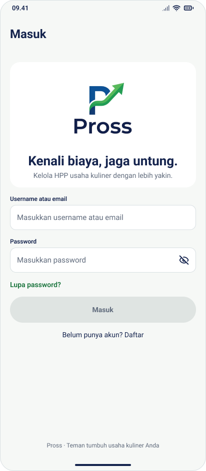
</p>
<p align="center">
<i>Gambar 6.1. Rancangan Antarmuka I-01 - Login</i>
</p>

Tabel 6.1. Spesifikasi Objek Antarmuka I-01

| Id_Objek | Jenis | Konten | Keterangan |
| :--- | :--- | :--- | :--- |
| I-01-01 | Text Label | Masuk | Menampilkan judul halaman login. |
| I-01-02 | Image | Logo Pross | Menampilkan identitas aplikasi Pross. |
| I-01-03 | Text Label | Kenali biaya, jaga untung. | Menampilkan deskripsi singkat aplikasi. |
| I-01-04 | Text Field | Username atau email | Menerima username atau email pengguna sebagai identitas autentikasi. |
| I-01-05 | Password Field | Password | Menerima password pengguna dengan karakter yang disembunyikan. |
| I-01-06 | Icon Button | Tampilkan/sembunyikan password | Mengubah visibilitas karakter password tanpa mengubah nilainya. |
| I-01-07 | Text Link | Lupa password? | Mengarahkan pengguna ke antarmuka I-03 untuk melakukan pemulihan password. |
| I-01-08 | Button | Masuk | Memvalidasi input dan meneruskan proses autentikasi kepada AuthController. Jika berhasil, sistem menampilkan konfirmasi login dan menyediakan navigasi menuju I-04. |
| I-01-09 | Text Link | Belum punya akun? Daftar | Mengarahkan pengguna ke antarmuka I-02. |
| I-01-10 | Alert | Username atau password salah | Menampilkan pesan kesalahan ketika autentikasi gagal. |
| I-01-11 | Loading Indicator | Memeriksa akun... | Menunjukkan proses autentikasi sedang berlangsung dan menonaktifkan tombol Masuk sementara. |
| I-01-12 | Success Message | Berhasil masuk | Menampilkan konfirmasi keberhasilan autentikasi. |
| I-01-13 | Button | Ke Beranda | Mengarahkan pengguna menuju antarmuka I-04 setelah autentikasi berhasil. |

## 6.2 Rancangan Antarmuka I-02

**Antarmuka:** I-02  
**Nama Layar:** Registrasi  
**Kelas Perancangan:** RegistrationPage  
**Use Case Terkait:** UC01

<p align="center">
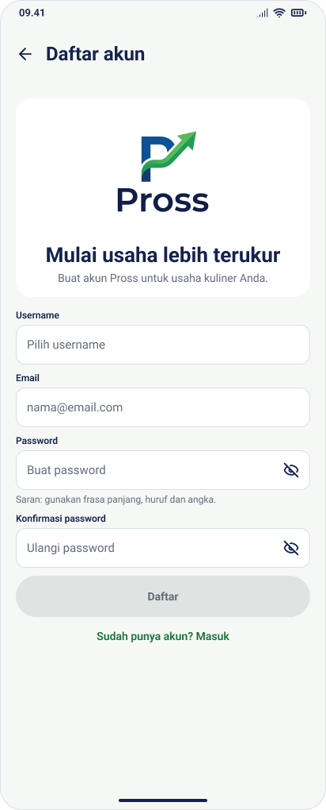
</p>
<p align="center">
<i>Gambar 6.2. Rancangan Antarmuka I-02 - Registrasi</i>
</p>

Tabel 6.2. Spesifikasi Objek Antarmuka I-02

| Id_Objek | Jenis | Konten | Keterangan |
| :--- | :--- | :--- | :--- |
| I-02-01 | Icon Button | Kembali | Mengarahkan pengguna kembali ke antarmuka I-01. |
| I-02-02 | Text Label | Daftar akun | Menampilkan judul halaman registrasi. |
| I-02-03 | Image | Logo Pross | Menampilkan identitas aplikasi. |
| I-02-04 | Text Label | Mulai usaha lebih terukur | Menampilkan pesan pengantar registrasi. |
| I-02-05 | Text Field | Username | Menerima username pengguna baru. |
| I-02-06 | Text Field | Email | Menerima alamat email pengguna dan memvalidasi format email. |
| I-02-07 | Password Field | Password | Menerima password akun baru. |
| I-02-08 | Password Field | Konfirmasi password | Menerima pengulangan password dan memeriksa kesesuaiannya dengan password pertama. |
| I-02-09 | Icon Button | Tampilkan/sembunyikan password | Mengubah visibilitas karakter pada field password terkait. |
| I-02-10 | Button | Daftar | Memvalidasi seluruh isian dan meneruskan permintaan pendaftaran kepada AuthController untuk menyimpan akun baru. |
| I-02-11 | Text Link | Sudah punya akun? Masuk | Mengarahkan pengguna ke antarmuka I-01. |
| I-02-12 | Validation Message | Format email tidak valid; Password lemah; Konfirmasi password belum cocok | Menampilkan informasi kesalahan pada input terkait. |
| I-02-13 | Loading Indicator | Membuat akun... | Menampilkan status proses registrasi dan menonaktifkan tombol Daftar sementara. |
| I-02-14 | Success Message | Akun berhasil dibuat | Menampilkan konfirmasi bahwa registrasi berhasil dilakukan. |
| I-02-15 | Button | Masuk | Mengarahkan pengguna menuju antarmuka I-01 setelah pendaftaran berhasil. |

## 6.3 Rancangan Antarmuka I-03

**Antarmuka:** I-03  
**Nama Layar:** Reset Password  
**Kelas Perancangan:** ResetPasswordPage  
**Use Case Terkait:** UC02

<p align="center">
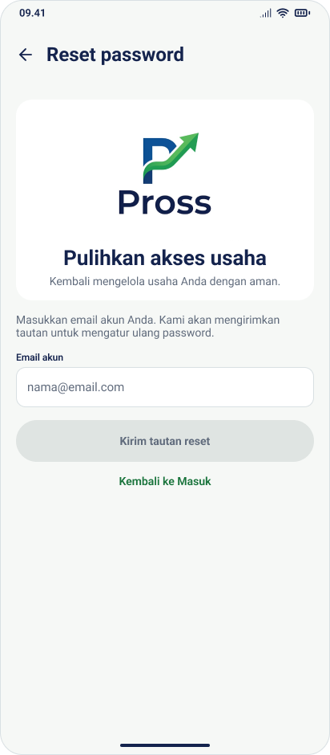
</p>
<p align="center">
<i>Gambar 6.3. Rancangan Antarmuka I-03 - Reset Password</i>
</p>

Tabel 6.3. Spesifikasi Objek Antarmuka I-03

| Id_Objek | Jenis | Konten | Keterangan |
| :--- | :--- | :--- | :--- |
| I-03-01 | Icon Button | Kembali | Mengarahkan pengguna ke halaman sebelumnya. |
| I-03-02 | Text Label | Reset password | Menampilkan judul halaman pemulihan password. |
| I-03-03 | Image | Logo Pross | Menampilkan identitas aplikasi. |
| I-03-04 | Text Label | Pulihkan akses usaha | Memberikan informasi mengenai proses pemulihan akun. |
| I-03-05 | Text Field | Email akun | Menerima alamat email akun yang akan dipulihkan. |
| I-03-06 | Button | Kirim tautan reset | Memvalidasi email dan meminta pengiriman tautan pemulihan password. |
| I-03-07 | Loading Indicator | Mengirim tautan... | Menunjukkan proses pengiriman tautan pemulihan sedang berlangsung. |
| I-03-08 | Success Message | Tautan reset terkirim | Menginformasikan bahwa permintaan pengiriman tautan berhasil diproses. |
| I-03-09 | Button | Kirim ulang tautan | Meminta pengiriman ulang tautan reset password. |
| I-03-10 | Password Field | Password baru | Menerima password pengganti setelah tautan pemulihan divalidasi. |
| I-03-11 | Password Field | Konfirmasi password baru | Memvalidasi kesesuaian password baru dengan konfirmasinya. |
| I-03-12 | Icon Button | Tampilkan/sembunyikan password | Mengubah visibilitas password pada field terkait. |
| I-03-13 | Button | Ubah password | Memvalidasi password baru dan meneruskan perubahan kepada ResetPasswordController. |
| I-03-14 | Validation Message | Password tidak cocok | Ditampilkan ketika password dan konfirmasinya berbeda. |
| I-03-15 | Success Message | Password berhasil diubah | Menampilkan konfirmasi keberhasilan perubahan password. |
| I-03-16 | Button | Kembali ke Masuk | Mengarahkan pengguna ke antarmuka I-01. |

## 6.4 Rancangan Antarmuka I-04

**Antarmuka:** I-04  
**Nama Layar:** Beranda  
**Kelas Perancangan:** HomePage  
**Use Case Terkait:** UC04, UC06

<p align="center">
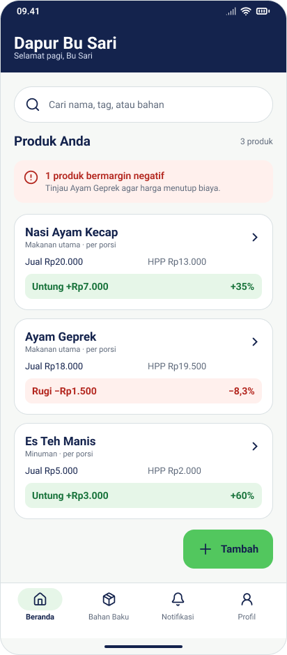
</p>
<p align="center">
<i>Gambar 6.4. Rancangan Antarmuka I-04 - Beranda</i>
</p>

Tabel 6.4. Spesifikasi Objek Antarmuka I-04

| Id_Objek | Jenis | Konten | Keterangan |
| :--- | :--- | :--- | :--- |
| I-04-01 | Text Label | Nama usaha | Menampilkan nama usaha pengguna yang sedang login. |
| I-04-02 | Text Label | Selamat pagi | Menampilkan pesan sambutan kepada pengguna. |
| I-04-03 | Search Field | Cari nama, tag, atau bahan | Mengarahkan pengguna menuju I-05 untuk melakukan pencarian produk. |
| I-04-04 | Text Label | Produk Anda | Menampilkan judul bagian daftar produk. |
| I-04-05 | Text Label | Jumlah produk | Menampilkan jumlah produk usaha yang telah tersimpan. |
| I-04-06 | Alert | Produk bermargin negatif | Menampilkan peringatan apabila terdapat produk dengan margin negatif. |
| I-04-07 | Product Card | Nama produk, harga jual, HPP, keuntungan/kerugian, margin | Menampilkan ringkasan informasi setiap produk. Ketika dipilih, sistem membuka I-07 untuk produk terkait. |
| I-04-08 | Status Label | Untung / Rugi | Menampilkan status profitabilitas produk berdasarkan perbandingan HPP dan harga jual. |
| I-04-09 | Button | + Tambah | Mengarahkan pengguna ke I-06 untuk menambahkan produk baru. |
| I-04-10 | Bottom Navigation | Beranda | Membuka atau mempertahankan antarmuka I-04. |
| I-04-11 | Bottom Navigation | Bahan Baku | Membuka antarmuka I-09. |
| I-04-12 | Bottom Navigation | Notifikasi | Membuka antarmuka I-12. |
| I-04-13 | Bottom Navigation | Profil | Membuka antarmuka I-10. |
| I-04-14 | Loading Placeholder | Memuat produk usaha... | Ditampilkan ketika sistem mengambil daftar produk. |
| I-04-15 | Error Message | Produk gagal dimuat | Menampilkan kegagalan pengambilan data produk. |
| I-04-16 | Button | Coba lagi | Mengulangi permintaan pengambilan daftar produk. |
| I-04-17 | Empty State | Belum ada produk | Ditampilkan ketika pengguna belum memiliki produk tersimpan. |

## 6.5 Rancangan Antarmuka I-05

**Antarmuka:** I-05  
**Nama Layar:** Pencarian Produk  
**Kelas Perancangan:** SearchProductPage  
**Use Case Terkait:** UC06

<p align="center">
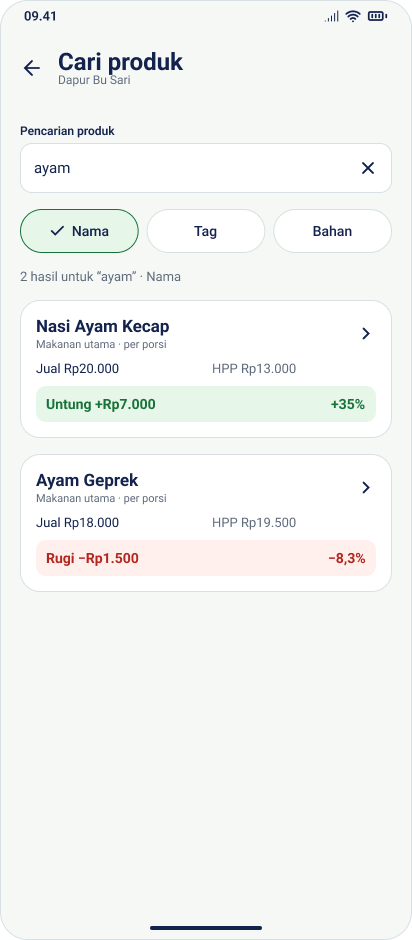
</p>
<p align="center">
<i>Gambar 6.5. Rancangan Antarmuka I-05 - Pencarian Produk</i>
</p>

Tabel 6.5. Spesifikasi Objek Antarmuka I-05

| Id_Objek | Jenis | Konten | Keterangan |
| :--- | :--- | :--- | :--- |
| I-05-01 | Icon Button | Kembali | Mengarahkan pengguna ke halaman sebelumnya. |
| I-05-02 | Text Label | Cari produk | Menampilkan judul halaman pencarian. |
| I-05-03 | Search Field | Pencarian produk | Menerima kata kunci untuk mencari produk. |
| I-05-04 | Icon Button | Hapus pencarian | Menghapus kata kunci yang sedang dimasukkan. |
| I-05-05 | Filter Button | Nama | Menjalankan pencarian berdasarkan nama produk. |
| I-05-06 | Filter Button | Tag | Menjalankan pencarian berdasarkan tag produk. |
| I-05-07 | Filter Button | Bahan | Menjalankan pencarian berdasarkan bahan baku yang digunakan. |
| I-05-08 | Text Label | Jumlah hasil pencarian | Menampilkan jumlah produk yang cocok dengan kata kunci dan filter aktif. |
| I-05-09 | Product Card | Nama produk, harga jual, HPP, margin | Menampilkan produk yang sesuai hasil pencarian. Jika dipilih, sistem membuka I-07 untuk produk terkait. |
| I-05-10 | Loading Placeholder | Mencari produk... | Menunjukkan proses pencarian sedang berlangsung. |
| I-05-11 | Error Message | Pencarian gagal | Ditampilkan ketika permintaan pencarian tidak berhasil. Kata kunci dan filter tetap dipertahankan. |
| I-05-12 | Button | Coba lagi | Mengulangi pencarian menggunakan kata kunci dan filter sebelumnya. |
| I-05-13 | Empty State | Produk tidak ditemukan | Ditampilkan apabila tidak ada produk yang memenuhi kriteria pencarian. |
| I-05-14 | Button | Hapus filter | Menghapus filter aktif untuk memperluas hasil pencarian. |

## 6.6 Rancangan Antarmuka I-06

**Antarmuka:** I-06  
**Nama Layar:** Tambah Produk  
**Kelas Perancangan:** AddProductPage  
**Use Case Terkait:** UC03, UC04

<p align="center">
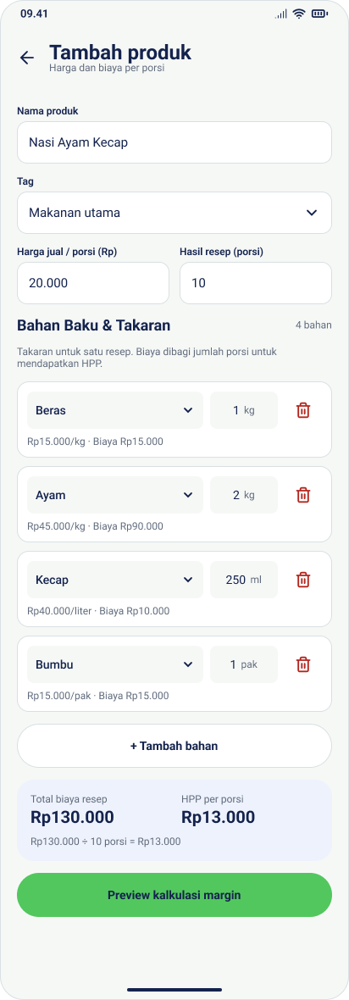
</p>
<p align="center">
<i>Gambar 6.6. Rancangan Antarmuka I-06 - Tambah Produk</i>
</p>

Tabel 6.6. Spesifikasi Objek Antarmuka I-06

| Id_Objek | Jenis | Konten | Keterangan |
| :--- | :--- | :--- | :--- |
| I-06-01 | Icon Button | Kembali | Mengarahkan pengguna menuju halaman sebelumnya. |
| I-06-02 | Text Label | Tambah produk | Menampilkan judul halaman penambahan produk. |
| I-06-03 | Text Field | Nama produk | Menerima nama produk yang akan ditambahkan. |
| I-06-04 | Dropdown | Tag | Memungkinkan pengguna memilih tag atau kategori produk. |
| I-06-05 | Numeric Field | Harga jual / porsi (Rp) | Menerima harga jual produk per porsi. |
| I-06-06 | Numeric Field | Hasil resep (porsi) | Menerima jumlah porsi yang dihasilkan oleh satu resep. |
| I-06-07 | Text Label | Bahan Baku & Takaran | Menampilkan bagian komposisi bahan baku produk. |
| I-06-08 | Dropdown | Pilih bahan | Memungkinkan pengguna memilih bahan baku yang digunakan pada resep. |
| I-06-09 | Numeric Field | Takaran bahan | Menerima jumlah bahan baku yang digunakan sesuai satuan bahan tersebut. |
| I-06-10 | Text Label | Harga beli per unit; Biaya bahan | Menampilkan harga bahan dan kontribusi biayanya terhadap resep. |
| I-06-11 | Icon Button | Hapus bahan | Menghapus baris bahan baku dari komposisi resep. |
| I-06-12 | Button | + Tambah bahan | Menambahkan baris input bahan baku baru ke formulir. |
| I-06-13 | Result Panel | Total biaya resep | Menampilkan total biaya seluruh bahan baku dalam satu resep. |
| I-06-14 | Result Panel | HPP per porsi | Menampilkan hasil perhitungan biaya resep dibagi jumlah porsi. |
| I-06-15 | Button | Preview kalkulasi margin | Memvalidasi data produk, menghitung HPP dan margin melalui MarginController, lalu membuka dialog preview. |
| I-06-16 | Dialog | Preview kalkulasi margin | Menampilkan HPP per porsi, harga jual, nominal keuntungan atau kerugian, serta persentase margin. |
| I-06-17 | Alert | Margin negatif | Menampilkan peringatan apabila HPP lebih besar daripada harga jual. |
| I-06-18 | Button | Kembali edit | Menutup dialog preview dan mengembalikan pengguna ke formulir. |
| I-06-19 | Button | Simpan produk | Menyimpan data produk, harga jual, dan komposisi bahan baku setelah dikonfirmasi pengguna. |
| I-06-20 | Validation Message | Nama produk wajib diisi; Takaran harus lebih dari 0 | Menampilkan kesalahan input yang harus diperbaiki sebelum penyimpanan. |
| I-06-21 | Loading Indicator | Menghitung dan menyimpan... | Menampilkan proses kalkulasi dan penyimpanan produk. |
| I-06-22 | Success Message | Produk berhasil disimpan | Menampilkan konfirmasi keberhasilan penyimpanan produk. |
| I-06-23 | Product Card | Nama produk, harga jual, HPP, margin | Menampilkan ringkasan produk yang berhasil disimpan. |
| I-06-24 | Button | Kembali ke Beranda | Mengarahkan pengguna menuju I-04. |
| I-06-25 | Button | + Tambah produk lain | Mengembalikan pengguna ke formulir penambahan produk baru. |

## 6.7 Rancangan Antarmuka I-07

**Antarmuka:** I-07  
**Nama Layar:** Edit Produk  
**Kelas Perancangan:** EditProductPage  
**Use Case Terkait:** UC04, UC05

<p align="center">
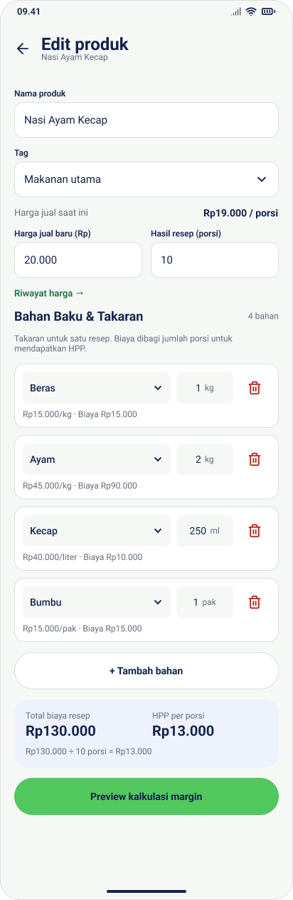
</p>
<p align="center">
<i>Gambar 6.7. Rancangan Antarmuka I-07 - Edit Produk</i>
</p>

Tabel 6.7. Spesifikasi Objek Antarmuka I-07

| Id_Objek | Jenis | Konten | Keterangan |
| :--- | :--- | :--- | :--- |
| I-07-01 | Icon Button | Kembali | Mengarahkan pengguna menuju halaman sebelumnya. |
| I-07-02 | Text Label | Edit produk | Menampilkan judul halaman pengubahan produk. |
| I-07-03 | Text Field | Nama produk | Menampilkan dan memungkinkan perubahan nama produk. |
| I-07-04 | Dropdown | Tag | Menampilkan dan memungkinkan perubahan tag produk. |
| I-07-05 | Text Label | Harga jual saat ini | Menampilkan harga jual terakhir yang tersimpan. |
| I-07-06 | Numeric Field | Harga jual baru (Rp) | Menerima nilai harga jual pengganti. |
| I-07-07 | Numeric Field | Hasil resep (porsi) | Menampilkan dan memungkinkan perubahan jumlah porsi resep. |
| I-07-08 | Text Link | Riwayat harga | Mengarahkan pengguna menuju I-08 untuk produk terkait. |
| I-07-09 | Dropdown | Bahan baku | Menampilkan dan memungkinkan perubahan bahan baku dalam komposisi produk. |
| I-07-10 | Numeric Field | Takaran bahan | Memungkinkan perubahan jumlah bahan baku yang digunakan. |
| I-07-11 | Icon Button | Hapus bahan | Menghapus bahan dari daftar komposisi yang sedang diedit. |
| I-07-12 | Button | + Tambah bahan | Menambahkan bahan baku baru pada komposisi resep. |
| I-07-13 | Result Panel | Total biaya resep; HPP per porsi | Menampilkan biaya resep dan HPP hasil perhitungan berdasarkan data terbaru. |
| I-07-14 | Button | Preview kalkulasi margin | Memvalidasi perubahan dan membuka dialog pratinjau hasil perhitungan margin. |
| I-07-15 | Dialog | Preview kalkulasi margin | Menampilkan harga jual, HPP, keuntungan atau kerugian, dan persentase margin setelah perubahan. |
| I-07-16 | Button | Kembali edit | Menutup dialog preview tanpa menyimpan perubahan. |
| I-07-17 | Button | Simpan perubahan | Menyimpan data produk dan mencatat perubahan harga jual ke RiwayatHargaJual jika harga jual berubah. |
| I-07-18 | Loading Indicator | Menyimpan perubahan... | Menunjukkan proses penyimpanan sedang berlangsung. |
| I-07-19 | Error Message | Perubahan belum tersimpan | Ditampilkan apabila penyimpanan gagal. Input pengguna dipertahankan. |
| I-07-20 | Success Message | Perubahan berhasil disimpan | Menampilkan konfirmasi bahwa perubahan data produk berhasil disimpan. |
| I-07-21 | Button | Lihat Riwayat harga | Membuka antarmuka I-08 untuk produk terkait. |
| I-07-22 | Button | Kembali ke Beranda | Membuka antarmuka I-04. |
| I-07-23 | Empty State | Produk tidak tersedia | Ditampilkan apabila produk yang akan diedit tidak dapat ditemukan. |

## 6.8 Rancangan Antarmuka I-08

**Antarmuka:** I-08  
**Nama Layar:** Riwayat Harga Jual  
**Kelas Perancangan:** PriceHistoryPage  
**Use Case Terkait:** UC07

<p align="center">
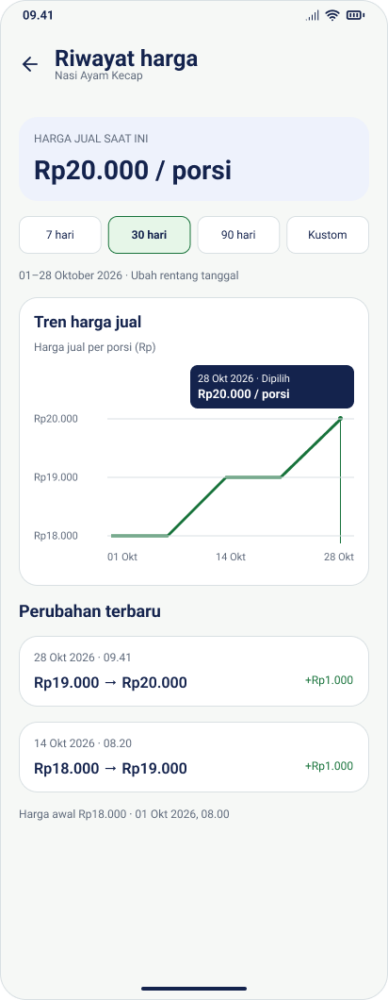
</p>
<p align="center">
<i>Gambar 6.8. Rancangan Antarmuka I-08 - Riwayat Harga Jual</i>
</p>

Tabel 6.8. Spesifikasi Objek Antarmuka I-08

| Id_Objek | Jenis | Konten | Keterangan |
| :--- | :--- | :--- | :--- |
| I-08-01 | Icon Button | Kembali | Mengarahkan pengguna ke halaman sebelumnya. |
| I-08-02 | Text Label | Riwayat harga | Menampilkan judul halaman. |
| I-08-03 | Text Label | Nama produk | Menampilkan produk yang sedang diamati. |
| I-08-04 | Result Panel | Harga jual saat ini | Menampilkan harga jual terakhir produk. |
| I-08-05 | Filter Button | 7 hari | Menampilkan riwayat harga jual selama tujuh hari terakhir. |
| I-08-06 | Filter Button | 30 hari | Menampilkan riwayat harga jual selama tiga puluh hari terakhir. |
| I-08-07 | Filter Button | 90 hari | Menampilkan riwayat harga jual selama sembilan puluh hari terakhir. |
| I-08-08 | Filter Button | Kustom | Memungkinkan pengguna memilih rentang tanggal riwayat. |
| I-08-09 | Text Label | Rentang tanggal | Menampilkan periode historis yang sedang dipilih. |
| I-08-10 | Line Chart | Tren harga jual | Menampilkan grafik perubahan harga jual berdasarkan data historis. |
| I-08-11 | Chart Tooltip | Tanggal dan harga jual | Menampilkan detail titik harga saat pengguna memilih titik pada grafik. |
| I-08-12 | Text Label | Perubahan terbaru | Menampilkan judul daftar perubahan harga jual. |
| I-08-13 | History Card | Harga lama, harga baru, selisih, waktu perubahan | Menampilkan informasi tiap perubahan harga jual yang tercatat. |
| I-08-14 | Loading Placeholder | Memuat riwayat harga jual... | Menunjukkan proses pengambilan data historis. |
| I-08-15 | Error Message | Riwayat gagal dimuat | Menampilkan kesalahan pengambilan data riwayat. |
| I-08-16 | Button | Coba lagi | Mengulangi pengambilan data pada rentang waktu yang sedang dipilih. |
| I-08-17 | Empty State | Belum ada riwayat harga | Ditampilkan apabila belum ada perubahan harga jual produk yang tercatat. |
| I-08-18 | Button | Edit harga jual | Mengarahkan pengguna menuju I-07 untuk memperbarui harga jual produk. |

## 6.9 Rancangan Antarmuka I-09

**Antarmuka:** I-09  
**Nama Layar:** Tren Harga Bahan Baku  
**Kelas Perancangan:** TrenBahanBakuPage  
**Use Case Terkait:** UC08

<p align="center">
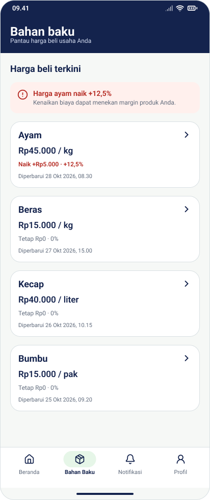
</p>
<p align="center">
<i>Gambar 6.9. Rancangan Antarmuka I-09 - Daftar Bahan Baku</i>
</p>

<p align="center">

</p>
<p align="center">
<i>Gambar 6.10. Rancangan Antarmuka I-09 - Detail Tren Bahan Baku</i>
</p>

Tabel 6.9. Spesifikasi Objek Antarmuka I-09

| Id_Objek | Jenis | Konten | Keterangan |
| :--- | :--- | :--- | :--- |
| I-09-01 | Text Label | Bahan baku | Menampilkan judul halaman daftar bahan baku. |
| I-09-02 | Text Label | Harga beli terkini | Menampilkan bagian daftar harga bahan baku terbaru. |
| I-09-03 | Alert | Harga bahan naik | Menampilkan peringatan apabila terdapat kenaikan harga bahan baku yang dapat memengaruhi biaya produk. |
| I-09-04 | Ingredient Card | Nama bahan, harga beli, satuan, perubahan harga, waktu pembaruan | Menampilkan ringkasan harga bahan baku. Ketika dipilih, sistem membuka detail bahan terkait. |
| I-09-05 | Bottom Navigation | Beranda, Bahan Baku, Notifikasi, Profil | Mengarahkan pengguna menuju I-04, I-09, I-12, atau I-10 sesuai pilihan. |
| I-09-06 | Icon Button | Kembali | Menutup tampilan detail bahan dan kembali ke daftar bahan baku. |
| I-09-07 | Text Label | Detail bahan | Menampilkan judul halaman detail bahan baku. |
| I-09-08 | Result Panel | Harga beli saat ini | Menampilkan harga beli terakhir bahan baku dan persentase perubahan harganya. |
| I-09-09 | Filter Button | 7 hari | Menampilkan tren harga beli selama tujuh hari terakhir. |
| I-09-10 | Filter Button | 30 hari | Menampilkan tren harga beli selama tiga puluh hari terakhir. |
| I-09-11 | Filter Button | 90 hari | Menampilkan tren harga beli selama sembilan puluh hari terakhir. |
| I-09-12 | Filter Button | Kustom | Memungkinkan pemilihan rentang tanggal sesuai kebutuhan pengguna. |
| I-09-13 | Line Chart | Riwayat harga beli | Menampilkan grafik historis perubahan harga beli bahan baku. |
| I-09-14 | Chart Tooltip | Tanggal dan harga beli | Menampilkan nilai harga beli pada titik grafik yang dipilih. |
| I-09-15 | Text Label | Produk yang terdampak | Menampilkan bagian daftar produk yang menggunakan bahan baku terkait. |
| I-09-16 | Product Card | Nama produk, HPP, harga jual, margin | Menampilkan dampak harga bahan baku terhadap profitabilitas produk terkait. |
| I-09-17 | Button | Tinjau harga produk | Mengarahkan pengguna menuju I-07 untuk produk yang dipilih. |
| I-09-18 | Loading Placeholder | Memuat harga bahan baku | Menunjukkan proses pengambilan daftar atau data historis bahan baku. |
| I-09-19 | Error Message | Harga bahan gagal dimuat | Menampilkan kesalahan apabila data bahan baku tidak dapat diambil. |
| I-09-20 | Button | Coba lagi | Mengulangi permintaan pengambilan data yang gagal. |
| I-09-21 | Empty State | Belum ada bahan baku | Ditampilkan ketika belum terdapat bahan baku yang digunakan oleh produk. |
| I-09-22 | Empty State | Belum ada riwayat bahan | Ditampilkan ketika bahan baku belum memiliki catatan perubahan harga. |
| I-09-23 | Button | Kembali ke Bahan Baku | Mengembalikan pengguna ke daftar bahan baku. |

## 6.10 Rancangan Antarmuka I-10

**Antarmuka:** I-10  
**Nama Layar:** Profil Pengguna  
**Kelas Perancangan:** ProfilePage  
**Use Case Terkait:** UC11, UC12

<p align="center">
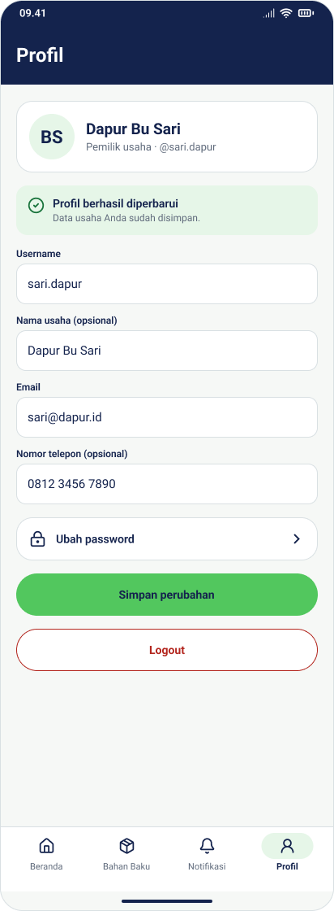
</p>
<p align="center">
<i>Gambar 6.11. Rancangan Antarmuka I-10 - Profil Pengguna</i>
</p>

Tabel 6.10. Spesifikasi Objek Antarmuka I-10

| Id_Objek | Jenis | Konten | Keterangan |
| :--- | :--- | :--- | :--- |
| I-10-01 | Text Label | Profil | Menampilkan judul halaman profil. |
| I-10-02 | Profile Card | Inisial, nama usaha, username | Menampilkan ringkasan identitas pengguna dan usahanya. |
| I-10-03 | Text Field | Username | Menampilkan username pengguna dan menyediakan input perubahan sesuai prototipe. |
| I-10-04 | Text Field | Nama usaha | Menampilkan dan memungkinkan pengubahan nama usaha. |
| I-10-05 | Text Field | Email | Menampilkan dan memungkinkan pengubahan alamat email. |
| I-10-06 | Text Field | Nomor telepon | Menampilkan dan memungkinkan pengubahan nomor telepon. |
| I-10-07 | Button | Ubah password | Membuka proses perubahan password akun. |
| I-10-08 | Button | Simpan perubahan | Memvalidasi input dan meneruskan penyimpanan perubahan profil kepada ProfileController. |
| I-10-09 | Button | Logout | Menampilkan dialog konfirmasi untuk keluar dari akun. |
| I-10-10 | Validation Message | Format email tidak valid; Gunakan nomor telepon berisi angka | Menampilkan kesalahan pada input profil yang tidak sesuai ketentuan. |
| I-10-11 | Information Message | Lengkapi profil usaha | Memberikan informasi apabila data profil opsional belum diisi. |
| I-10-12 | Loading Indicator | Menyimpan perubahan... | Menunjukkan proses penyimpanan profil dan menonaktifkan input sementara. |
| I-10-13 | Success Message | Profil berhasil diperbarui | Menampilkan konfirmasi bahwa perubahan profil telah tersimpan. |
| I-10-14 | Confirmation Dialog | Keluar dari akun? | Meminta konfirmasi sebelum sistem mengakhiri sesi pengguna. |
| I-10-15 | Button | Batal | Menutup dialog logout dan mempertahankan sesi pengguna. |
| I-10-16 | Button | Keluar | Mengakhiri sesi melalui ProfileController dan mengarahkan pengguna ke I-01. |
| I-10-17 | Bottom Navigation | Beranda, Bahan Baku, Notifikasi, Profil | Mengarahkan pengguna menuju halaman utama sesuai pilihan. |

## 6.11 Rancangan Antarmuka I-11

**Antarmuka:** I-11  
**Nama Layar:** Push Notification  
**Kelas Perancangan:** PushNotificationUI  
**Use Case Terkait:** UC09, UC10

<p align="center">
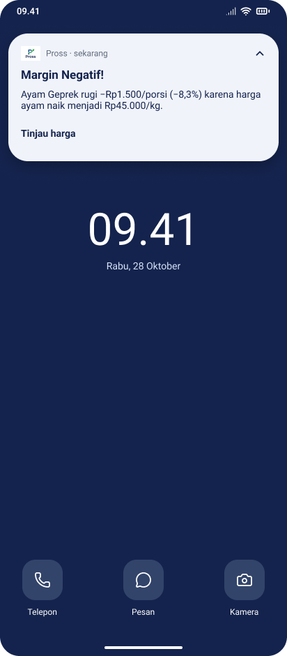
</p>
<p align="center">
<i>Gambar 6.12. Rancangan Antarmuka I-11 - Push Notification</i>
</p>

Tabel 6.11. Spesifikasi Objek Antarmuka I-11

| Id_Objek | Jenis | Konten | Keterangan |
| :--- | :--- | :--- | :--- |
| I-11-01 | System Notification | Pross | Menampilkan identitas aplikasi sebagai pengirim notifikasi melalui sistem Android. |
| I-11-02 | Notification Title | Margin Negatif! | Menampilkan peringatan ketika suatu produk mengalami margin negatif. |
| I-11-03 | Notification Body | Nama produk, nilai kerugian, persentase margin, dan perubahan harga bahan | Menampilkan ringkasan penyebab perubahan profitabilitas produk. |
| I-11-04 | Notification Action | Tinjau harga | Membuka aplikasi Pross dan mengarahkan pengguna menuju I-07 untuk produk terkait. |
| I-11-05 | Icon Button | Kembali | Mengembalikan pengguna dari halaman pengaturan izin ke halaman sebelumnya. |
| I-11-06 | Text Label | Izin notifikasi | Menampilkan judul pengaturan izin notifikasi. |
| I-11-07 | Warning Message | Notifikasi belum diizinkan | Menjelaskan bahwa notifikasi tidak dapat dikirim karena izin pada perangkat belum diberikan. |
| I-11-08 | Button | Buka pengaturan Android | Membuka halaman pengaturan notifikasi aplikasi Pross pada Android. |
| I-11-09 | Information Panel | Langkah mengaktifkan | Menampilkan petunjuk pengaktifan izin notifikasi melalui pengaturan Android. |
| I-11-10 | Button | Periksa izin lagi | Memeriksa ulang status izin notifikasi pada perangkat. |
| I-11-11 | Loading Indicator | Memeriksa status notifikasi... | Menunjukkan bahwa sistem sedang memeriksa status izin notifikasi. |
| I-11-12 | System Empty State | Tidak ada notifikasi | Ditampilkan oleh panel sistem Android ketika tidak ada notifikasi aktif. |

## 6.12 Rancangan Antarmuka I-12

**Antarmuka:** I-12  
**Nama Layar:** Pusat Notifikasi dalam Aplikasi  
**Use Case Terkait:** UC09, UC10

<p align="center">
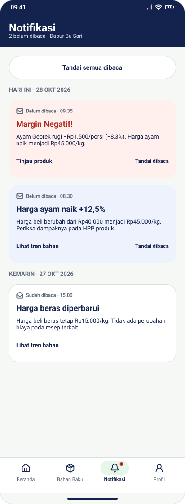
</p>
<p align="center">
<i>Gambar 6.13. Rancangan Antarmuka I-12 - Pusat Notifikasi</i>
</p>

Tabel 6.12. Spesifikasi Objek Antarmuka I-12

| Id_Objek | Jenis | Konten | Keterangan |
| :--- | :--- | :--- | :--- |
| I-12-01 | Text Label | Notifikasi | Menampilkan judul halaman pusat notifikasi. |
| I-12-02 | Text Label | Jumlah belum dibaca | Menampilkan jumlah notifikasi yang belum dibaca pengguna. |
| I-12-03 | Button | Tandai semua dibaca | Mengubah status seluruh notifikasi pengguna menjadi sudah dibaca. |
| I-12-04 | Section Label | Hari ini; Kemarin | Mengelompokkan notifikasi berdasarkan tanggal penerimaan. |
| I-12-05 | Notification Card | Margin Negatif! | Menampilkan informasi produk yang mengalami kerugian beserta nilai margin dan perubahan harga bahan terkait. |
| I-12-06 | Notification Card | Harga bahan naik | Menampilkan pemberitahuan perubahan harga bahan baku dan dampaknya terhadap produk. |
| I-12-07 | Notification Card | Harga bahan diperbarui | Menampilkan informasi pembaruan harga bahan baku yang tercatat. |
| I-12-08 | Status Label | Belum dibaca; Sudah dibaca | Menampilkan status keterbacaan dan waktu penerimaan notifikasi. |
| I-12-09 | Text Link | Tinjau produk | Mengarahkan pengguna menuju I-07 untuk produk yang disebutkan pada notifikasi. |
| I-12-10 | Text Link | Lihat tren bahan | Mengarahkan pengguna menuju I-09 untuk melihat detail bahan baku terkait. |
| I-12-11 | Button | Tandai dibaca | Mengubah status notifikasi tertentu menjadi sudah dibaca. |
| I-12-12 | Loading Placeholder | Memuat pembaruan usaha... | Menunjukkan proses pengambilan daftar notifikasi. |
| I-12-13 | Error Message | Notifikasi gagal dimuat | Menampilkan pesan ketika daftar notifikasi tidak berhasil diambil. |
| I-12-14 | Button | Coba lagi | Mengulangi proses pengambilan daftar notifikasi. |
| I-12-15 | Empty State | Belum ada notifikasi | Ditampilkan apabila belum ada notifikasi yang diterima pengguna. |
| I-12-16 | Button | Kembali ke Beranda | Mengarahkan pengguna menuju I-04. |
| I-12-17 | Bottom Navigation | Beranda, Bahan Baku, Notifikasi, Profil | Memungkinkan perpindahan antara halaman utama aplikasi. |

## 6.13 Rancangan Antarmuka Keseluruhan

Rancangan antarmuka Pross terdiri atas dua belas kelompok antarmuka utama. Setiap kelompok memiliki ID unik yang digunakan secara konsisten pada subbab perancangan dan tabel spesifikasi objek. Beberapa kelompok memiliki tampilan tambahan berupa detail, kondisi kesalahan, pemuatan data, serta dialog konfirmasi.

Tabel 6.13. Rancangan Antarmuka Keseluruhan

| No | Tampilan Antarmuka |
| :--- | :--- |
| I-01 |  |
| I-02 |  |
| I-03 |  |
| I-04 |  |
| I-05 |  |
| I-06 |  |
| I-07 |  |
| I-08 |  |
| I-09 |  |
| I-09 (Detail) |  |
| I-10 |  |
| I-11 |  |
| I-12 |  |

<br>

---
# BAB 7: Matriks Kerunutan

Tabel 7.1. Matriks Kerunutan Kelas terhadap Use Case

| Kelas | Use Case Terkait |
| :--- | :--- |
| *C01 - PemilikUsaha* | *UC01 - Mendaftarkan Akun* <br> *UC02 - Login dengan akun yang sudah terdaftar* <br> *UC03 - Menambahkan Data Produk Baru* <br> *UC04 - Melihat Margin Keuntungan Produk* <br> *UC05 - Mengelola Harga Jual Produk* <br> *UC06 - Menelusuri Daftar Produk* <br> *UC07 - Melihat Perubahan Harga Jual* <br> *UC08 - Memantau Tren Harga Bahan Baku* <br> *UC09 - Menerima Notifikasi Kerugian Produk* <br> *UC10 - Menerima Notifikasi Perubahan Harga Bahan Baku* <br> *UC11 - Mengubah Data Akun* <br> *UC12 - Keluar dari Akun* |
| *C02 - Produk* | *UC03 - Menambahkan Data Produk Baru* <br> *UC04 - Melihat Margin Keuntungan Produk* <br> *UC05 - Mengelola Harga Jual Produk* <br> *UC06 - Menelusuri Daftar Produk* <br> *UC07 - Melihat Perubahan Harga Jual* <br> *UC09 - Menerima Notifikasi Kerugian Produk* <br> *UC10 - Menerima Notifikasi Perubahan Harga Bahan Baku* |
| *C03 - BahanBaku* | *UC03 - Menambahkan Data Produk Baru* <br> *UC04 - Melihat Margin Keuntungan Produk* <br> *UC08 - Memantau Tren Harga Bahan Baku* <br> *UC09 - Menerima Notifikasi Kerugian Produk* <br> *UC10 - Menerima Notifikasi Perubahan Harga Bahan Baku* |
| *C04 - ResepBahan* | *UC03 - Menambahkan Data Produk Baru* <br> *UC04 - Melihat Margin Keuntungan Produk* |
| *C05 - RegistrationPage* | *UC01 - Mendaftarkan Akun* |
| *C06 - AuthController* | *UC01 - Mendaftarkan Akun* <br> *UC02 - Login dengan akun yang sudah terdaftar* |
| *C07 - LoginPage* | *UC02 - Login dengan akun yang sudah terdaftar* |
| *C08 - ResetPasswordPage* | *UC02 - Login dengan akun yang sudah terdaftar* |
| *C09 - ResetPasswordController* | *UC02 - Login dengan akun yang sudah terdaftar* |
| *C10 - AddProductPage* | *UC03 - Menambahkan Data Produk Baru* <br> *UC04 - Melihat Margin Keuntungan Produk* |
| *C11 - MarginController* | *UC03 - Menambahkan Data Produk Baru* <br> *UC04 - Melihat Margin Keuntungan Produk* |
| *C12 - EditProductPage* | *UC05 - Mengelola Harga Jual Produk* |
| *C13 - PriceController* | *UC05 - Mengelola Harga Jual Produk* |
| *C14 - RiwayatHargaBahanBaku* | *UC08 - Memantau Tren Harga Bahan Baku* |
| *C15 - TrenBahanBakuPage* | *UC08 - Memantau Tren Harga Bahan Baku* |
| *C16 - TrenBahanBakuController* | *UC08 - Memantau Tren Harga Bahan Baku* |
| *C17 - Notifikasi* | *UC09 - Menerima Notifikasi Kerugian Produk* <br> *UC10 - Menerima Notifikasi Perubahan Harga Bahan Baku* |
| *C18 - PushNotificationUI* | *UC09 - Menerima Notifikasi Kerugian Produk* <br> *UC10 - Menerima Notifikasi Perubahan Harga Bahan Baku* |
| *C19 - NotificationController* | *UC09 - Menerima Notifikasi Kerugian Produk* <br> *UC10 - Menerima Notifikasi Perubahan Harga Bahan Baku* |
| *C20 - RiwayatHargaJual* | *UC05 - Mengelola Harga Jual Produk* <br> *UC07 - Melihat Perubahan Harga Jual* |
| *C21 - SearchProductPage* | *UC06 - Menelusuri Daftar Produk* |
| *C22 - ProductSearchController* | *UC06 - Menelusuri Daftar Produk* |
| *C23 - PriceHistoryPage* | *UC07 - Melihat Perubahan Harga Jual* |
| *C24 - PriceHistoryController* | *UC07 - Melihat Perubahan Harga Jual* |
| *C25 - ProfilePage* | *UC11 - Mengubah Data Akun* <br> *UC12 - Keluar dari Akun* |
| *C26 - ProfileController* | *UC11 - Mengubah Data Akun* <br> *UC12 - Keluar dari Akun* |

